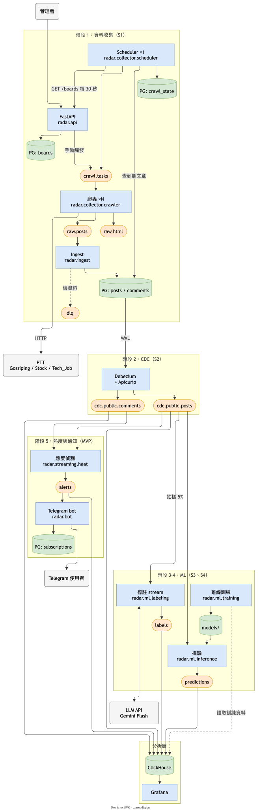

# 即時輿情雷達：開發流程規格

> 狀態：v0.4，對應設計文件 [realtime-sentiment-radar-design.md](realtime-sentiment-radar-design.md)
> 最後更新：2026-10-28（7.27 進 shadow 門檻的統計量與順序 3 判定）

設計文件回答「要做什麼、為什麼」；本文件回答「怎麼做、做到什麼程度算完成」。兩者衝突時，先修設計文件再改本文件。**文件必須與程式同步**：行為、格式、相依套件有變動時，同一個 PR 內一併更新。

## 架構圖



- 框線分組對應第 6 章的階段；節點內第二行是 `src/radar/` 下的模組
- 顏色：藍＝自寫服務、橘＝Kafka topic、綠＝儲存（PG、ClickHouse、模型檔）、灰＝外部
- 編輯：用 draw.io 直接開啟 `architecture.drawio.svg`（圖檔內嵌原始圖），存檔後即更新

## 目錄

1. [開發環境與慣例](#1-開發環境與慣例)
2. [共用約定](#2-共用約定)
3. [訊息格式](#3-訊息格式)
4. [開發流程](#4-開發流程)
5. [測試策略](#5-測試策略)
6. [階段規格](#6-階段規格)
7. [設計補充（需回寫設計文件）](#7-設計補充需回寫設計文件)
8. [風險清單](#8-風險清單)

---

## 1. 開發環境與慣例

### 1.1 工具

| 項目 | 選擇 | 備註 |
|---|---|---|
| Python | 3.12 | 所有自寫服務共用 |
| 套件管理 | uv | `pyproject.toml` + `uv.lock` |
| Lint / format | ruff | 已在 pre-commit |
| 安全掃描 | bandit；CI 另跑 gitleaks、osv-scanner、semgrep | bandit 在 pre-commit；誤判寫進 `.gitleaksignore` 等忽略檔並附理由；`tasks/` 由 `.gitleaks.toml` 整體排除（D-018） |
| 測試 | pytest、pytest-asyncio、pytest-cov、pytest-xdist（D-015）；整合測試用 compose 的 `test` 服務（7.26） | 覆蓋率：PR 改到的程式碼 ≥ 80%（`scripts/coverage_gate.py`），不量的路徑列在 `.coverage-exempt` |
| 設定 | pydantic-settings | 全部從環境變數讀，提供 `.env.example` |
| Kafka client | confluent-kafka | |
| Web API | FastAPI + uvicorn | 依賴以 `Annotated` 注入，測試以 `dependency_overrides` 換成 fake |
| HTTP client | httpx2 | 爬蟲對 PTT 發請求；測試用 `MockTransport`，Starlette 的 TestClient 也使用它 |
| HTML 解析 | selectolax（lexbor 後端） | 1.0 已移除舊的 `selectolax.parser` |
| PG 存取 | SQLAlchemy 2.0（driver 用 psycopg 3） | 用法分工見 2.4 |
| DB migration | Alembic | 由 ORM model 自動產生，再人工檢查 |
| ML | scikit-learn（含 joblib） | 階段 3 baseline；階段 4 推論也在同一個 image 內使用 |
| BERT 推論 | onnxruntime、tokenizers（D-020）；開發用 onnx | 階段 8；載入 ONNX 與 JSON，不載 pickle；測試用 onnx 即時產生小模型（7.27） |
| LLM 標註 | Groq、OpenRouter（OpenAI 相容 API）、Gemini REST，皆以 httpx2 直接呼叫 | 不用官方 SDK；包在 `Labeler` 介面後，換服務商只換實作；Claude 以 skill 手動標註（7.11） |
| CDC Avro 解碼 | `confluent-kafka[avro]` | Python 端讀 `cdc.public.*`（S3-08、階段 4） |
| Log | loggerhelper 2.0.0（`lib/` 內的 wheel） | `LOG_NAME` 設成服務名稱；訊息中帶 `post_id`（如有）；錯誤可選擇送 Slack |

### 1.2 Repo 結構

採用 src layout：所有 Python 程式碼放在 `src/radar/`，以套件 `radar` 安裝（`uv sync` 會以 editable 模式安裝），import 一律寫 `from radar.xxx import ...`，執行用 `python -m radar.collector.scheduler`。

本文件提到的程式碼路徑（如 `common/schemas.py`、`ml/labeling/backfill.py`）都相對於 `src/radar/`。設計文件 10.1 的結構之外，另外加上：

```
├── src/radar/               # Python 程式碼（見設計文件 10.1）
├── pyproject.toml
├── alembic.ini
├── Makefile                 # 常用指令入口
├── .env.example
├── infra/
│   ├── postgres/migrations/ # Alembic（alembic.ini 放在根目錄）
│   ├── kafka/topics.yaml    # topic 定義，由 tools/create_topics.py 套用
│   ├── debezium/            # Connect image（含 Apicurio converter）、connector 設定
│   └── clickhouse/          # config.d、users.d、migrations/（編號 SQL）
├── docs/labeling-guideline.md  # 情緒標註準則（LLM、Claude、人工共用）
├── docs/reports/            # 實驗與模型評估報告（model-evaluation.md 由人撰寫；s3-05-push-ratio.md），進 repo
├── .claude/skills/label-posts/ # Claude 手動標註的 skill
├── tools/                   # 營運腳本（建 topic、ClickHouse migration、註冊 connector、seed）；scripts/ 是 agent 流程腳本
├── tests/
│   ├── unit/
│   ├── integration/
│   ├── e2e/                 # 假 PTT 伺服器與端到端測試
│   └── fixtures/ptt/        # 存下來的 PTT HTML
├── notebooks/               # 甲方在 Colab 執行的 notebook（階段 8，7.27），不帶輸出進 repo
├── data/                    # 不進 repo：testset/、manual/、datasets/、prompt-tuning/
└── models/                  # 不進 repo：<model_version>/model_card.json，加上 model.joblib（baseline）或 model.onnx、tokenizer.json（BERT，7.27）
```

### 1.3 Makefile 指令

| 指令 | 動作 |
|---|---|
| `make up` / `make down` | 啟動 / 關閉基礎設施：Kafka ×3、PG、Apicurio、Kafka Connect、ClickHouse、Grafana（http://127.0.0.1:`GRAFANA_PORT`，7.25）、Kafka UI |
| `make migrate` | `alembic upgrade head` |
| `make topics` | 依 `topics.yaml` 建立或更新 topic（冪等） |
| `make connector` | 註冊或更新 Debezium connector（冪等） |
| `make up-labeling` | 啟動串流抽樣標註（S3-08，會持續呼叫 LLM API） |
| `make testset` | 依看板配額抽出 300 篇人工測試集（Gossiping 180、Stock 90、Tech_Job 30；只能抽一次） |
| `make human-label` | 本機人工標註頁（http://127.0.0.1:8090） |
| `make ch-migrate` | 套用 ClickHouse 尚未執行的 migration |
| `make api` | 本機啟動管理 API（http://localhost:8000/docs） |
| `make seed` | 透過 API 建立初始看板（冪等，需先 `make api`） |
| `make up-app` | 基礎設施加上 api、scheduler、crawler ×3、ingest；`init` 自動建表、建 topic、ClickHouse migration、註冊 connector |
| `make e2e-up` / `make e2e` | 啟動端到端環境（假 PTT、e2e 專用 volume）/ 執行端到端測試 |
| `make e2e-down` | 停止端到端環境並刪除其資料 volume |
| `make setup` / `make ci-setup` | 本機／CI 安裝相依 |
| `make check` | pre-commit 全部 hook + 單元測試（CI 每個 PR 都跑） |
| `make coverage` | 單元 + 整合測試的覆蓋率，Cobertura XML 寫到 `coverage-reports/` |
| `make lint` | ruff + bandit |
| `make test` | 單元測試 |
| `make test-int` | 整合測試：`docker compose -f compose.yaml --env-file .env run --rm test`（需要 Docker；agent 在 sandbox 內改直接下 `docker compose --env-file .env -f .worktrees/<task_id>/compose.yaml run --rm test`，見 7.26） |

### 1.4 分支與提交

- `main`：可部署版本；`develop`：開發整合
- 階段 7 起改用 agent 團隊流程（`scripts/` 的 `task.py`、`pr.py`、`release.py`；規則見 CLAUDE.md 與 `docs/decisions.md` D-001～D-006）：
  - 功能分支：`<類型>/<task_id>`，例如 `feat/dashboard-board-trend`，PR 合進 `develop`；跟上 develop 用 `pr.py sync`（merge，不 rebase）
  - 版本以 semver 發版：階段 1～6 由 `v0.6.0` 涵蓋（`stage-3`～`stage-6` 不補打），之後每階段一版（階段 7 = `v0.7.0`），見 D-003
  - Commit：`<類型>(<task_id>): ...`
- 階段 6 以前：功能分支 `feat/s<階段>-<簡述>`；Commit 如 `feat(crawler): ...`；`stage-<n>` tag 只打到 `stage-2`，之後見 D-003
- 緊急修正從 `main` 開 `fix/*`，合回 `main` 後由 workflow 同步到 `develop`

---

## 2. 共用約定

### 2.1 識別碼與時間

- `post_id` = `<board>.<PTT 文章檔名>`，例如 `Stock.M.1759730000.A.1B2`
- 所有時間以 UTC 存放與傳遞（ISO 8601）；PTT 頁面時間是 `Asia/Taipei`，在 parser 轉換
- 推文時間沒有年份：取文章年份，推文月份小於文章月份時年份 +1；補成隔年而晚於爬取時間超過 1 天的，視為轉錄／修改帶入的舊推文，退回文章年份（仍須不晚於爬取時間 + 1 天）；其餘晚於爬取時間超過 1 天的回 NULL 並記 log。PTT 截斷過長推文時會缺 HH:MM，也是 NULL

### 2.2 Kafka

| 項目 | 規則 |
|---|---|
| 序列化 | 自寫 topic 用 JSON（pydantic model 定義在 `common/schemas.py`）；CDC topic 用 Avro + Apicurio |
| 版本 | 每則 JSON 訊息帶 `schema_version`，只做向後相容的變更（加欄位） |
| Key | 依設計文件：`post_id`；`crawl.tasks` 的列表任務例外，用 `board`（見 7.1），且 partition 由送出端明確指定（見 7.10；爬蟲送的續抓任務不指定，見 7.28） |
| Producer | `acks=all`、`enable.idempotence=true`、`compression.type=zstd`、`message.max.bytes=5MB`（`raw.html` 爆文可能超過預設 1MB） |
| Consumer | 關閉 auto commit，處理完（含寫入下游）才 commit，at-least-once |
| 錯誤處理 | 暫時性錯誤（網路、DB 斷線）：指數退避重試，不 commit；資料錯誤（解析、驗證失敗，或 handler 回報寫不進下游的訊息）：寫入 `dlq` 後 commit（7.13） |
| 重試期間 | handler 拋 `TransientError` 時：`pause()` 已分配的 partition 並持續 `poll()`，維持 group 成員資格；重試不限時間，成功後 `resume()`（#11：只 sleep 不 poll 會超過 `max.poll.interval.ms` 被踢出 group） |
| 重試上限 | handler 的重試由各服務決定，`BatchConsumer` 不設上限（commit 重試另有上限，見下列）：爬蟲同一網址 5 次後略過；ingest 不設上限（PG 停機就等）；串流標註依服務商冷卻時間等待（`TransientError.retry_after_s`） |
| commit 失敗 | 失去 assignment（`_ASSIGNMENT_LOST`、`UNKNOWN_MEMBER_ID`、`ILLEGAL_GENERATION`、`REBALANCE_IN_PROGRESS`）記 warning 後繼續，該批由下一個取得 partition 的成員重做（冪等）；暫時性錯誤（`COORDINATOR_LOAD_IN_PROGRESS`、`COORDINATOR_NOT_AVAILABLE`、`NOT_COORDINATOR`，Kafka 重啟時出現）用同一組退避重試最多 6 次，每次記 WARNING（錯誤碼、第幾次），期間收到停止訊號就結束、不 commit；超過上限或其他錯誤照舊中止（#144）。commit 重試不 poll：6 次共等約 31.5 秒（0.5+1+2+4+8+16），小於 `max.poll.interval.ms`（預設 300 秒），心跳由 librdkafka 背景執行緒送；調整退避、上限或 `max.poll.interval.ms` 時要一起檢查 |
| 優雅關閉 | 收到 SIGTERM 先處理完當前批次、commit、再關閉；爬蟲一個列表任務可能需要 1 分鐘以上，compose 給 `stop_grace_period: 90s`，逾時被強制結束也只是該批重做 |

### 2.3 DLQ 訊息

```json
{
  "source_topic": "raw.posts", "partition": 1, "offset": 12345,
  "consumer": "ingest", "error": "ValidationError: ...",
  "payload_b64": "...", "failed_at": "2026-10-06T08:00:00Z"
}
```

### 2.4 PostgreSQL

- Schema 只透過 migration 變更，不手動改
- 表定義集中在 `common/db/models.py`（SQLAlchemy ORM model），是 schema 的唯一來源；Alembic 從這裡 autogenerate
- ORM model 只描述 PG 表；Kafka 訊息用 `common/schemas.py` 的 pydantic model，兩者不混用

| 場景 | 寫法 | 理由 |
|---|---|---|
| FastAPI 的 `boards` CRUD、bot 的 `subscriptions`、`chat_settings`、`muted_posts` | ORM（`Session`） | 單筆讀寫，ORM 最省事 |
| Ingest 批次 upsert | Core：`postgresql.insert().on_conflict_do_update(where=...)` | 一次寫 500 筆，ORM 逐筆 flush 太慢；帶條件 upsert 需要 Core 才寫得出來 |
| Scheduler 查詢到期文章 | Core `select()` | 只讀，回傳 tuple 即可 |
| Advisory lock、publication、`REPLICA IDENTITY` | `text()` 原生 SQL | 屬於 PG 專屬功能，ORM 不支援 |

- Alembic autogenerate 偵測不到 publication、`REPLICA IDENTITY` 等 PG 專屬設定，這類變更在 migration 中用 `op.execute()` 手寫
- 全部使用同步 API；FastAPI 的同步 endpoint 會在 threadpool 執行，目前流量不需要 async
- 每張表只有一個寫入者（設計文件 5.4）；新增表時必須在 migration 註解寫明寫入者、是否被 Debezium 監聽

---

## 3. 訊息格式

以下是 JSON 範例，正式定義以 `common/schemas.py` 的 pydantic model 為準。

### 3.1 `crawl.tasks`

```json
{
  "schema_version": 1, "task_id": "uuid",
  "type": "list",                 // list | post
  "board": "Stock",
  "url": "https://www.ptt.cc/bbs/Stock/index.html",
  "post_id": null,                // type=post 時必填
  "reason": "schedule",           // schedule | manual | recrawl | backfill
  "since": null,                  // type=list 選填：往前翻到不晚於此時間的文章（7.28）
  "backfill_depth": 0,            // reason=backfill：這條續抓鏈已讀的頁數
  "created_at": "..."
}
```

- `type=post` 必須帶屬於 `board` 的 `post_id`；`type=list` 不可帶
- `since`、`backfill_depth` 只用於 `type=list`（post 任務必須是 null、0）；`reason=backfill` 只用於 `type=list`，由爬蟲送出（7.28）
- Kafka key：list 任務用 `board`、post 任務用 `post_id`（`CrawlTask.kafka_key()`，見 7.1）
- list 任務的 partition 依啟用中看板的名稱排序輪流指定，不靠 key hash（`resolve_list_partition`，見 7.10）

### 3.2 `raw.posts`

```json
{
  "schema_version": 1, "task_id": "uuid",
  "post_id": "Stock.M.1759730000.A.1B2", "board": "Stock",
  "url": "...", "author": "...", "title": "...", "content": "...",
  "created_at": "...", "crawled_at": "...",
  "push_count": 12, "boo_count": 3, "is_deleted": false,
  "comments": [
    {"floor": 1, "type": "push", "user_id": "...", "content": "...", "commented_at": "..."}
  ]
}
```

- `push_count` / `boo_count` 由內頁推文計算，不用列表頁的數字（列表頁有「爆」「X1」等非數值）
- 驗證規則（不符合即 `ValidationError`，由 consumer 送 `dlq`）：
  - 所有時間必須帶時區，統一轉成 UTC
  - `post_id` 必須屬於 `board`；`floor` 從 1 開始且不重複
  - `push_count` / `boo_count` 必須等於推文中 push / boo 的數量，對不上代表 parser 有 bug
- **刪除快照**：文章頁 404 時送出 `is_deleted=true`、推噓數 0、沒有推文、`created_at` 由檔名 epoch 推算；Ingest 只據此標記刪除

### 3.3 `raw.html`

```json
{"schema_version": 1, "post_id": "...", "url": "...", "crawled_at": "...", "html": "..."}
```

### 3.4 `labels`

```json
{
  "schema_version": 1, "post_id": "...",
  "labeler": "groq:qwen/qwen3.8-27b", "version": "prompt-v5", "labeled_at": "...",
  "sentiments": [
    {"target": null, "polarity": "negative"},
    {"target": "台積電", "polarity": "positive"}
  ]
}
```

- `labeler`：實際標註的模型，OpenAI 相容服務商寫成 `<服務商>:<模型>`；Claude 手動標註為 `claude-sonnet-manual`
- `version`：prompt 版本（`PROMPT_VERSION`），與 `docs/labeling-guideline.md` 的版本一致
- 驗證規則：恰好一筆 `target = null`（整篇）；對象不可空白、不可重複；`polarity` 只能是 `positive`、`negative`、`neutral`
- 人工測試集的標註**不送這個 topic**，只存在本機 `data/testset/`，避免混進訓練資料

### 3.5 `predictions`

```json
{
  "schema_version": 1, "post_id": "...", "model_version": "tfidf-lr-20261020",
  "predicted_at": "...", "polarity": "negative",
  "scores": {"positive": 0.1, "negative": 0.7, "neutral": 0.2},
  "text_hash": "<64 字元 hex>"
}
```

- pydantic model：`common/schemas.py` 的 `Prediction`；`scores` 的 key 恰好是三個 `polarity`，值的總和為 1（容許浮點誤差），`polarity` 為分數最高的類別
- 同一篇文章、同一個模型版本可能有多筆（內文被編輯後重新推論），下游取 `predicted_at` 最新的一筆
- shadow 推論（階段 8）以相同格式寫到 `predictions.shadow`，不寫這個 topic（7.27）
- `text_hash`：這次推論的模型輸入文字的 SHA-256（hex）；推論服務重啟時用來重建快取（7.19）。2026-10-16 新增，之前的訊息沒有這個欄位，ClickHouse 存成空字串

### 3.6 `alerts`

```json
{
  "schema_version": 1, "alert_id": "uuid",
  "unit_type": "post",            // post | board | entity | topic
  "unit_key": "Gossiping.M.1759730000.A.1B2",
  "board": "Gossiping",
  "window_start": "...", "window_end": "...",
  "value": 85, "baseline": 6.2, "zscore": 7.4,
  "sample_post_ids": ["..."], "created_at": "..."
}
```

- pydantic model：`common/schemas.py` 的 `Alert`；寫入者只有 heat（7.20）
- `alert_id`：以 `uuid5` 由 `unit_type`、`unit_key`、`window_end` 算出；同一個警示重送時 id 相同，下游可去重
- MVP 只有 `post`（單篇文章的推文暴增）與 `board`（看板整體推文量暴增）
- `value`：視窗內新增推文數，以分鐘結算時的值計（不是剛越過門檻的那一則，#50）；`baseline`、`zscore`：結算時、以該分鐘更新前的 EWMA 平均與 z-score
- `sample_post_ids`：`post` 為該篇；`board` 為視窗內推文最多的前 3 篇

---

## 4. 開發流程

### 4.1 每個任務的循環

1. **確認設計**：任務若改變資料流、表或 topic，先改設計文件
2. **介面先行**：先寫 pydantic model / ORM model + Alembic migration / topic 設定，並在 PR 中單獨可審
3. **實作 + 單元測試**
4. **整合測試**：在 compose 環境中跑通
5. **驗收**：對照第 6 章該階段的驗收標準
6. **更新文件**：README 中的啟動方式、本文件的任務勾選

### 4.2 完成定義（Definition of Done）

- [ ] `make lint`、`make test` 通過
- [ ] 新增的 consumer 有整合測試，至少涵蓋：正常處理、重複訊息（冪等）、壞訊息進 DLQ
- [ ] 新增的環境變數已加入 `.env.example`
- [ ] 新增服務已加入 docker-compose，且 `restart: unless-stopped`
- [ ] 不會對 PTT 發出真實請求的測試才能進 CI

---

## 5. 測試策略

| 層級 | 範圍 | 工具 | 執行時機 |
|---|---|---|---|
| 單元 | parser、upsert SQL 組裝、熱度計算、年齡分級 | pytest | 本地每次 commit；CI 於 PR 開到及合併到 `develop` / `main` 時 |
| 整合 | 單一服務 + 真實 Kafka / PG / ClickHouse（單節點即可） | 根目錄 `compose.yaml` 的 `kafka`、`postgres`、`clickhouse` 與 `test` 服務（7.26）；fixture 讀 `IT_*` 環境變數，session 開始時重置 | CI 於 PR 開到及合併到 `develop` / `main` 時，每個事件只跑一次（含覆蓋率）；只改文件時跳過。CI 以 `compose.ci.yaml` 把服務綁在 runner 的 `127.0.0.1`、測試在 runner 上跑，並把 docker daemon 的 `registry-mirrors` 設為 `mirror.gcr.io`（runner 直連 Docker Hub 常撞到次數限制或逾時） |
| 端到端 | 整個 compose，用假 PTT 伺服器 | `make e2e-up && make e2e`（約 10 分鐘，見下方「端到端環境」） | 每階段驗收 |
| 回放 | 把錄下來的 topic 資料重送，驗證熱度偵測 | 腳本 | 第 5 階段起 |

- **PTT fixture**：每種頁面至少存一份 HTML（一般文、刪除文、爆文、含 IP 的推文、跨年推文、被編輯過的文章），parser 測試只讀 fixture
- **假 PTT 伺服器**（`tests/e2e/fake_ptt.py`）：小型 FastAPI app，產生與 PTT 相同結構的頁面，並提供控制端點新增文章、推文、刪除文章；單元測試確認其頁面能被正式 parser 解析
- **端到端環境**：
  - 爬蟲以 `CRAWLER_PTT_BASE_URL` 改打假伺服器（只換主機，資料中的網址仍是 `www.ptt.cc`），任何請求都不會打到真的 PTT
  - Scheduler 以 `SCHEDULER_TIME_SCALE=0.05` 縮短重爬間隔
  - Postgres、Kafka、ClickHouse、Grafana（`e2e_grafana_data`，UAT v0.7.0 F-1、#101）、熱度偵測狀態（`e2e_heat_state`）與自寫服務的 log（`/app/log`）都改掛 e2e 專用的 volume，不碰開發資料。`make e2e-down` 用 `down -v` 刪除這些 volume；log 原本與開發環境共用 `app_logs`，2026-10-10 因此刪掉開發環境 10/07～10/09 的 log（#29）。單元測試檢查開發環境中掛 `app_logs` 的服務在 e2e 都改掛 `e2e_app_logs`，另有通用回歸測試檢查 e2e 合併後沒有任何服務掛開發 volume（compose v2 的 `down -v` 只刪啟用中服務引用的 volume，這是 e2e 不刪開發資料的前提，#118）
  - 開發環境與 e2e 共用 compose 專案與容器名稱，不能同時運作。`make e2e-up` 先以 `down`（不加 `-v`）停掉開發環境，`make up`、`make up-app` 先以 `make e2e-down` 清掉 e2e 環境；跑 e2e 前要先停掉開發環境的長時間作業（例如驗收）
    - 只靠 compose 自己判斷會出錯：設定在兩邊相同的服務（Apicurio、Kafka UI）不會被重建，沿用的舊 Apicurio 連線池指向已被取代的 Postgres，Debezium 註冊 schema 失敗、task 一啟動就 `FAILED`（#41）
    - 判斷方式：`radar_fake_ptt` 容器存在 = e2e 環境
  - `.env` 與開發環境共用，但 e2e 會刻意製造故障：compose 覆寫檔把各服務的 `SLACK_*`、`CDC_WATCHDOG_HEARTBEAT_URL` 設成空字串，`tests/e2e/conftest.py` 也在測試程式內清掉，不送 Slack 與外部 heartbeat
  - 測試標記為 `e2e`，一般 `pytest` 與 CI 預設排除
  - 耗時（2026-10-16，12 個測試約 10.5 分鐘）大多是刻意的等待，不是效能退化：#31 的兩個 Apicurio 停機測試約 3.7 分鐘（等 heartbeat 65 秒、停機 40 秒、等 watchdog 重啟 task）；停用看板的測試固定等 75 秒；其餘每個測試約 20～55 秒，主要在等列表輪詢（測試看板 `interval_sec` 30 秒）。原本的「3～4 分鐘」是 2026-10-08 只有 9 個測試時的數字
- **端到端情境**：新看板被排程並寫入 PG、新推文在重爬後反映、刪除文被標記、停用看板後停止爬取、爬蟲停止期間的任務在重啟後接續處理；階段 2 起加上 CDC：新文章進 `posts_latest`、推文數變化進 `posts_history`、推文帶看板進 `comments`、內容沒變的重爬不產生 CDC 事件、Apicurio 停機後 CDC 自動恢復（`tests/e2e/test_cdc.py`）
- **LLM**：單元與整合測試一律用 `MockTransport` 或 fake，不呼叫真的 LLM API；prompt 調整才實際呼叫，結果存在 `data/prompt-tuning/`

---

## 6. 階段規格

規模估計：S = 1～3 天、M = 1 週、L = 2 週以上（以業餘時間計）。

### 進度

| 任務 | 狀態 | PR |
|---|---|---|
| 階段 0（S0-01～S0-06） | ✅ 完成 | #1 |
| S1-01 資料表與訊息格式 | ✅ 完成 | #2 |
| S1-02 PTT parser | ✅ 完成 | #4 |
| S1-03 看板管理 API、S1-08 初始看板 | ✅ 完成 | #5 |
| S1-04 爬蟲、S1-05 Ingest | ✅ 完成 | #6 |
| S1-06 Scheduler、S1-07 假 PTT 伺服器與端到端測試 | ✅ 完成 | #7 |
| 階段 1 驗收（24 小時實際運作） | ✅ 通過（2026-10-08），紀錄見階段 1「驗收紀錄」；驗收中修正 #15、#16 | — |
| 列表任務 partition 修正（7.10） | ✅ 完成；重跑「停掉爬蟲 10 分鐘」積壓 21 分鐘消化完（原 64 分鐘） | #9 |
| Consumer 重試期間維持成員資格（2.2） | ✅ 完成：pause/resume、commit 失去 assignment 不中止、爬蟲同一網址 5 次略過、串流標註依冷卻時間等待；整合測試重現並驗證（重試 10 秒 > `max.poll.interval.ms` 6 秒） | #11 |
| S2-01 Spike：ClickHouse 讀 Apicurio Avro | ✅ 完成（結論見設計文件 6.2；以 Debezium 3.7 / Apicurio 3.3 / ClickHouse 26.8 驗證） | #8 |
| S2-02～S2-06 CDC 與 ClickHouse | ✅ 程式完成；端到端測試（`tests/e2e/test_cdc.py`）2026-10-08 通過（首次執行時發現 image 缺 `infra/` 檔案等 3 個問題，見 7.9） | #8、#15 |
| 文章警示門檻（#59） | ✅ 文章另設最低推文數 `HEAT_POST_MIN_COUNT=80`，看板維持 30（7.20） | — |
| 晚到的舊快照刪掉較新的推文（#52） | ✅ `posts.comment_count`（推＋噓＋箭頭）列入變化判斷，重爬門檻改讀這欄（7.24）；整合測試重現「晚到的舊快照刪掉 10 則新箭頭」後修正 | — |
| 階段 6 規劃：Telegram 按鈕選單與情緒呈現（7.23） | ✅ 文件完成（2026-10-17）；原階段 6～8 順延為 7～9 | — |
| S6-01～S6-06 Telegram 互動與情緒呈現 | ✅ 完成；以真的 Telegram 走過 7.23 驗收清單（紀錄見階段 6「驗收紀錄」）；S6-05 取代 #53 | — |
| 發文 1 小時內的重爬改為每 5 分鐘（7.22，#56） | ✅ 完成；單元、collector 整合測試通過。待部署 Scheduler | — |
| 重爬門檻改看推文總數（7.2，#51） | ✅ 完成；整合測試重現「3 推 120 噓、2 推 30 箭頭的文章滿 1 小時後不再重爬」後修正；開發環境的 PG 上 `EXPLAIN ANALYZE` 新查詢 29 ms（走 `comments` 主鍵）。待部署 Scheduler | — |
| 爬蟲略過重複的重爬任務（7.12） | ✅ 完成；2026-10-09 實測 `crawl.tasks` 積壓 10 分鐘內 3,355 → 1,709（部署前持續增加），期間略過約 1,500 個重複任務 | #21 |
| Ingest 逐筆隔離毒訊息（7.13） | ✅ 完成；整合測試以含 `\x00` 的文章重現（原本整批失敗、服務中止），修正後只有該筆進 DLQ | #12 |
| 刪除標記可撤銷（7.14） | ✅ 完成；整合測試重現原本的兩個問題（較舊的 404 晚到會標記刪除、刪除後較舊的 200 會蓋掉內容），修正後刪除可被較新的快照撤銷 | #13 |
| 推文同步（7.15） | ✅ 完成；整合測試重現中間推文被刪後的樓層位移；端到端測試確認 PG 的推文刪除經 CDC 反映到 `comments_latest FINAL`（`REPLICA IDENTITY FULL`） | #14 |
| e2e 改用專用的 log volume（#29） | ✅ 完成；`docker compose config` 確認 e2e 不再引用開發環境的 `app_logs`。實際 `e2e-up`／`e2e-down` 等階段 2 驗收結束後跑 | #29 |
| 開發與 e2e 環境切換時先停掉另一邊（#41） | ✅ 完成；重現「開發環境運作中執行 `make e2e-up`」：修正後先 `make down` 再啟動，Apicurio 重建、connector RUNNING，e2e 12/12 通過；`make up-app` 會先 `make e2e-down`；`make down` 補上 `--profile inference` | #41 |
| 抓取失敗的新文章不記進列表快取（7.17） | ✅ 完成；單元測試重現「失敗的新文章下一輪不再抓」後修正。尚未部署：等階段 2 驗收結束再重建爬蟲，並跑 e2e | #33 |
| CDC 故障自動恢復（7.16） | ✅ 完成；e2e 重現兩種失敗（舊快取設定在刷新時失敗、沒有 watchdog 時 task 停在 `FAILED`），修正後通過。2026-10-15 開發環境重啟後，10/10 起積壓的 759 MB WAL 約 1 分鐘消化完，PG 與 ClickHouse 的 posts、comments 筆數一致 | #31 |
| 階段 2 驗收（24 小時運作、WAL 延遲） | ✅ 通過（第 2 次，2026-10-16），紀錄見階段 2「驗收紀錄」；第 1 次（2026-10-09）約 8 小時後 Debezium task 失敗而中斷（#31） | — |
| S3-01 標註準則與 prompt | ✅ 完成（prompt-v4，`docs/labeling-guideline.md`；15 篇實測選定標註者）；2026-10-08 依交叉比對升 prompt-v5（規則 11～13）；2026-10-15 依人工測試集升 prompt-v6（規則 11 改寫、新增 14～16；已標的 v5 資料不重標） | #10 |
| S3-02～S3-08 標註、測試集、實驗、訓練、串流標註 | ✅ 程式完成；人工標註頁已在瀏覽器實測。人工測試集 300 篇 2026-10-15 標完；S3-05 推噓比實驗完成，結論「不採用」（`docs/reports/s3-05-push-ratio.md`）；Groq prompt-v6 標註 3,269 篇；S3-06 baseline `tfidf-lr-202610151237` 人工測試集 macro-F1 0.504，評估報告 `docs/reports/model-evaluation.md`（2026-10-16） | #10 |
| 階段 3 驗收（≥ 3,000 篇且各看板達標、評估報告含各看板 F1、推噓比結論） | ⬜ 除 Stock 外皆達標：Stock 286／400 篇，等新文章累積後補標並重新訓練（逐項見評估報告「階段 3 驗收狀態」） | — |
| S4-01～S4-03 推論 consumer | ✅ 程式完成；單元測試、整合測試（真實 Kafka：新文章、重啟後只改推噓數、重複事件、壞訊息進 DLQ）通過。2026-10-16 以 `tfidf-lr-202610151237` 部署（`make up-inference`） | — |
| 階段 4 驗收（推論延遲、不重複推論） | ✅ 通過（2026-10-16），紀錄見階段 4「驗收紀錄」：p95 10.2 秒；重新推論 7 次都對應文字變動 | — |
| 推論快取重啟後從 ClickHouse 載入（7.19） | ✅ 完成；單元測試重現「重啟後快取空、既有文章被編輯不推論」；整合測試（真的 ClickHouse、PG）驗證 migration 0004、載入與補舊 hash。2026-10-16 部署：補 5,509 篇，重啟後 4 分鐘內 3 篇既有文章被編輯，都重新推論 | #37 |
| S5-01～S5-05 熱度偵測、錄製回放（7.20） | ✅ 程式完成；加入 `quixstreams`，`confluent-kafka` 降到 2.12.x。整合測試（真實 Kafka、exactly-once）：暴增各單位只發一則、改寫不算新增、只靠 changelog 恢復後不重發、壞訊息進 DLQ。2026-10-17 實測推文進 PG 晚約 8 分鐘，時間基準由 `commented_at` 改成觀測時間（S5-02）。開發環境已部署 heat，待第 5 階段驗收 | — |
| 文章基準每分鐘更新一次、分鐘結算才發警示（7.20，#49、#50） | ✅ 完成；單元測試重現兩個問題（40 篇活躍文章時文章基準 1 分鐘就洗掉舊值、一分鐘湧入 200 則警示只寫 30），修正後通過；整合測試（真實 Kafka）暴增 40 則的警示 `value` 為 40、重啟後不重發。待部署（重置 heat）後重跑階段 5 的 3 天驗收 | — |
| 階段 7 規劃：Dashboard 呈現方式（7.25） | ✅ 實作完成（2026-10-21）；呈現方式已定案：全用 Grafana（D-014）；`dashboard-grafana-infra`、`dashboard-views`、`dashboard-panels`、`dashboard-integration` 完成（畫面截圖由階段收尾的 uat 做） | — |
| 階段 8 規劃：BERT 與 shadow 比較（7.27） | ✅ 文件完成（2026-10-21，`bert-design`）；D-020～D-024 定案；骨架 `bert-skeleton` | — |
| 整合測試改用 compose `test` 服務、CI 加速（7.26，#78） | ✅ `test-infra-compose`、`test-infra-fast-waits` 完成（2026-10-20；本機 150 個全過、連跑兩次、`-n 0` 也過；CI Integration Test 1 分 56 秒） | — |
| 停機後補抓深度、管線停擺偵測、Kafka coordinator 故障（7.28，#180） | ⬜ 文件完成（2026-10-29，`pipeline-gap-design`）；待實作 `crawl-backfill-depth`、`pipeline-stall-alert`，Kafka 升級待甲方決定。10-08～10-29 的停機缺口依 D-032 不補，記在 7.29 | — |
| S5-06～S5-07 Telegram bot（7.21） | ✅ 完成；2026-10-16 在開發環境以真的 Telegram 實測指令與推送，修正 compose 漏掉 `app-env`。階段 5 驗收第 1 項（人工暴增約 10 秒收到通知）通過 | — |

階段 1 拆成 5 個 PR；全部完成後依下方「驗收」逐項驗證，通過才把 `develop` 合進 `main` 並打 `stage-1` tag；階段 2 相同。階段 3 起的發版方式見 D-003。

### 執行順序（2026-10-17 決定）

| 順序 | 項目 | 說明 |
|---|---|---|
| 1 | #59 文章警示門檻 | 不修的話警示多到無法使用，也會干擾階段 6 的實機測試 |
| 2 | #52 晚到的舊快照刪掉較新的推文 | 資料正確性 |
| 3 | ✅ 調查 Stock、Boy-Girl、Tech_Job 每天文章數偏少（2026-10-17 近 24 小時各 34、3、2 篇） | **結論：PTT 上本來就少，沒有漏抓**（2026-10-17）。三個看板列表前 3 頁共 139 篇，PG 全部都有；PTT 上 Stock 約 30 小時 42 篇（每天約 34）、Boy-Girl 15 天 51 篇（約 3.4）、Tech_Job 21 天 46 篇（約 2.2）。10/13～10/14 數字更低是開發環境停機（10/13 02Z～10/15 06Z；所有停機缺口見 7.29）。看板保留；Stock 標註照「累積到 400 篇」進行 |
| 4 | 階段 6：Telegram 互動與情緒呈現 | 先合併文件，再依骨架、實作兩輪進行 |
| 5 | 階段 7：Dashboard | |
| 6 | 階段 8：BERT 與 shadow 比較 | |
| — | Stock 補標、重新訓練，收尾階段 3 | 不佔順序：新文章累積到 400 篇就做 |
| 7 | **階段 5 的 3 天驗收** | 盡量往後排，在階段 9 之前完成；時間由使用者決定。驗的是警示品質與長時間運作（不是負載測試），放在最後可以用 #59 修正後、帶情緒與推噓的最終版通知驗收 |
| 8 | 階段 9：上雲 | 3 天驗收通過後才開始 |

- 合進 `main` 與發版不等 Stock 補標與 3 天驗收：階段 1～6 以 `v0.6.0` 發版，之後每階段驗收後各發一版（見 D-003）；上表兩項仍照排序之後再做
- 臨時插入的 bug 修正照常優先處理，不改變上表的相對順序

### 階段 0：專案骨架（S）

**目標**：任何人 clone 下來 `make up` 就能起來空的基礎設施。

| ID | 任務 |
|---|---|
| S0-01 | `pyproject.toml`、uv、ruff 設定；修正 pre-commit（見 8.2） |
| S0-02 | docker-compose：Kafka（KRaft 3 節點，副本數 3、`min.insync.replicas=2`）、PostgreSQL、Kafka UI（profile `debug`；階段 2 起改為預設啟動，部署前移除，見 S9-06） |
| S0-03 | `common/`：settings、logging、Kafka producer/consumer 包裝（含 DLQ、優雅關閉）、PG 連線池 |
| S0-04 | `infra/kafka/topics.yaml` + `tools/create_topics.py`（冪等） |
| S0-05 | 共用 Dockerfile（一個 image，靠 `command` 區分服務） |
| S0-06 | GitHub Actions：lint + 單元測試 + 整合測試 |

**驗收**
- `make up && make migrate && make topics` 在乾淨機器上成功
- CI 綠燈

### 階段 1：資料收集到 PG（L）

**目標**：透過 API 管理看板，三個看板的資料持續流入 PG。

| ID | 任務 | 依賴 |
|---|---|---|
| S1-01 | Migration：`posts`、`comments`、`boards`、`crawl_state`（設計文件 5.3，加上 7.2 的欄位） | S0 |
| S1-02 | PTT parser：列表頁、內頁、推文、刪除文；fixture 測試 | — |
| S1-03 | FastAPI：`/boards` CRUD、`POST /boards/{board}/crawl`、`GET /status` | S1-01 |
| S1-04 | 爬蟲：消費 `crawl.tasks`，處理 `list` / `post` 任務，寫 `raw.posts`、`raw.html`；速率限制；列表快取（7.1） | S1-02 |
| S1-05 | Ingest：批次 upsert、同批去重（7.3）、壞訊息進 DLQ | S1-01 |
| S1-06 | Scheduler：`sync_boards`、`board:<name>`、`dispatch_due_posts`；PG advisory lock 保證單一 instance | S1-03 |
| S1-07 | 假 PTT 伺服器 + 端到端測試 | S1-04～06 |
| S1-08 | 種子資料：三個看板的初始設定 | S1-03 |

**初始看板設定**

| 看板 | `interval_sec` | `recrawl_min_push`（推文總數，見 7.2） |
|---|---|---|
| Gossiping | 60 | 10 |
| Stock | 120 | 0 |
| Tech_Job | 600 | 0 |

**驗收**
- 用 API 新增、停用看板，Scheduler 在 30 秒內反映
- 連續運作 24 小時：三個看板都有新文章進 PG，熱門文章的 `push_count` 有隨時間更新
- 同一批 `raw.posts` 重送兩次，PG 的列內容不變（冪等）
- 停掉爬蟲 10 分鐘再啟動，任務接續處理，不需人工介入
- 對 PTT 的平均請求速率 ≤ 1 次/秒（由爬蟲 log 統計）
- `GET /status` 顯示各看板最後爬取時間與 DLQ 數量

**驗收紀錄**（2026-10-07 06:04:42Z～10-08 06:04:42Z，develop @ `1cdeb6a`；lag 每 10 分鐘記錄於 `log/acceptance/lag.log`；收尾的 e2e 與停爬蟲重跑在 develop @ `31910cf`）

| 項目 | 結果 |
|---|---|
| 看板同步 30 秒內反映 | ✅ 停用 3 秒、重新啟用 30 秒（以 Tech_Job 停用再啟用驗證；API 沒有 DELETE，新增測試看板會留下資料） |
| 停掉爬蟲 10 分鐘再啟動 | ✅ 重跑（含 #9）：10-08 07:28:59Z 停、07:39:28Z 啟動，積壓平均分散在三個 partition（重啟時 76 / 122 / 80），**1,284 秒（21 分鐘）**全部降到 ≤ 10，不需人工介入；首次執行時 partition 0 積壓 64 分鐘 → 7.10。紀錄：`log/acceptance/stop-test-20261008.log` |
| `GET /status` | ✅ 各看板 `last_changed_at`（見 7.7）與 DLQ 數量 |
| 熱門文章 `push_count` 隨時間更新 | ✅ 開跑後 30 分鐘內，39 篇中 18 篇有更新 |
| 24 小時三個看板都有新文章 | ✅ 期間發文 1,036 篇：Gossiping 941（17 篇已刪）、Stock 92、Tech_Job 3；列表任務完成 2,232 次（理論值 2,304，差額為停爬蟲測試與 crash 期間） |
| 請求速率 ≤ 1 次/秒 | ✅ 約 0.53 次/秒（翻頁最多時 0.58）。爬蟲不逐筆記錄請求，改以 log + Kafka 訊息數推算：列表頁 ≥ 2,232、內頁 200 共 42,858（`raw.html`）、404 共 19、52x 略過 41、逾時重試 283。52x：520 ×23、525 ×14、521 ×4（< 0.1%），**維持不重試**（見 8.1） |
| 同一批 `raw.posts` 重送兩次，PG 不變 | ✅ 50 篇已過重爬期的 Gossiping 文章（1,893 則推文）的最新快照各送兩次：`posts`、`comments` 的內容與 `xmin` 前後 md5 相同；ingest `received=101 posts_written=0 comments_inserted=0` |
| DLQ、解析失敗 | ✅ 24 小時內 DLQ 0 筆、parse 失敗 0 筆；`raw.posts` lag 最大 2 |
| 爬蟲穩定性 | ⚠️ 10-07 19:36～20:30Z 三個爬蟲共 crash 8 次（Docker 自動重啟，資料未遺失）：PTT 逾時無限重試超過 `max.poll.interval.ms`，失去 assignment → #11；期間 `crawl.tasks` lag 最高 492，21:00Z 前恢復 |
| 端到端測試（含 CDC） | ✅ 9/9（`test_pipeline` 5、`test_cdc` 4，首次執行 CDC）；途中修正 image 缺 `infra/` 檔案與 connector 剛建立時 404（#15）、Kafka 資料未寫進 volume（#16） |

驗收後待處理：#11（consumer 無限重試）、#12（毒訊息卡住 partition）、#13（刪除不可逆）、#14（推文樓層位移）；停爬蟲時 crawler-1 超過 10 秒被強制結束（exit 137），未 commit 的批次重啟後重做，不影響正確性。

### 階段 2：CDC 與 ClickHouse（M）

**目標**：ClickHouse 看得到推噓數變化歷程。

| ID | 任務 |
|---|---|
| S2-01 | **Spike**：驗證 ClickHouse `AvroConfluent` 能讀 Apicurio 序列化的訊息（見 8.1），結論寫回設計文件 |
| S2-02 | PG：`wal_level=logical`、只包含 `posts`、`comments` 的 publication |
| S2-03 | Kafka Connect + Debezium + Apicurio 加入 compose（參照 `kafka_tutorial/deployment` 的寫法）；connector 設定存在 `infra/debezium/`，用腳本註冊；**Apicurio 使用獨立的 database**，不可和 `radar` 共用，否則 Alembic autogenerate 會把 Apicurio 的表當成要刪除的表 |
| S2-04 | Debezium 設定：`table.include.list`、heartbeat、`ExtractNewRecordState`（附加 `__op`、`__source_ts_ms`、`__source_lsn`，刪除以 `delete.tombstone.handling.mode=rewrite` 改寫為 `__deleted`） |
| S2-05 | ClickHouse：Kafka engine 表 + materialized view → `posts_latest`、`posts_history`、`comments` |
| S2-06 | ClickHouse：`labels`、`predictions`、`alerts` 的 JSON topic 接入（`JSONEachRow`） |

**驗收**
- `posts_latest FINAL` 的筆數與 PG `posts` 一致（允許 1 分鐘延遲）
- 挑一篇熱門文章，`posts_history` 能畫出推文數隨時間的曲線
- 重爬但內容沒變的文章不產生 CDC 事件（比對 topic offset）
- 連續運作 24 小時，PG replication slot 的 WAL 延遲沒有持續增加

**驗收紀錄**（第 2 次：2026-10-15 06:34:21Z～10-16 06:44:21Z，`fix/cdc-connector-recovery` @ `4e177cf`（#32）；每 10 分鐘的監控與檢查腳本在 `log/acceptance/stage2/`，這次的產物與容器 log 在 `run2-20261015/`）

| 項目 | 結果 |
|---|---|
| `posts_latest FINAL` 與 PG 一致 | ✅ 結束時先讀 PG、60 秒後讀 ClickHouse：posts 6,543 / 6,545、comments 264,906 / 264,971（CH 多出的是這 60 秒的新資料）；145 筆監控樣本中 PG 與 CH 的 posts 差距最大 1 |
| 熱門文章推文數曲線 | ✅ `Gossiping.M.1792058026.A.0AE`，以 LSN 去重後 49 個版本，推 0 → 444、噓 0 → 110（`run2-20261015/hot_post.svg`）；期間 `(post_id, lsn)` 重複 0 列 |
| 內容沒變的重爬不產生 CDC 事件 | ✅ `raw.posts` 快照 61,291 筆、`cdc.public.posts` 事件 9,929 筆（16.2%）；推噓數、標題、刪除狀態都與前一版相同的事件 36 筆，全是 Re: 文，ingest 只在推噓數、標題、內文變動時更新，判斷為內文編輯 |
| WAL 延遲沒有持續增加 | ✅ flush lag 最大 2.4 MB、結束時 1.45 MB，前後半中位數 0.24 / 0.74 MB；slot 全程 active、connector 全程 `RUNNING/RUNNING`，`cdc-watchdog` 期間沒有重啟 task 或告警 |
| 其他 | DLQ 0 筆；ingest lag 最大 1、ClickHouse consumer lag 最大 501（2 個樣本，下一筆即恢復）；`crawl.tasks` lag 最大 218；PTT 520 ×43、525 ×50（約 0.15%）、逾時 22 次，無 429 / 403 |

- 10-15 13:55:41Z～13:56:54Z 曾停掉爬蟲與 scheduler 約 1 分鐘，檢查 520/525 是否為限速：前 7.3 小時 36 次、平均分散、沒有 429/403，判斷是 PTT 端不穩而非限速（處理方式見 8.1）；重啟後自動接續
- 第 1 次（2026-10-09 21:52Z 起，紀錄在 `run1-20261009/`）約 8 小時後 Debezium task 失敗而中斷（#31），修正見 7.16

### 階段 3：LLM 標註與 baseline（L）

**目標**：第一版情緒模型與評估分數。

| ID | 任務 |
|---|---|
| S3-01 | 標註 prompt 與輸出 JSON schema（3.4 格式，含對象），10～20 篇手動調整到穩定 |
| S3-02 | `ml/labeling/backfill.py`：從 ClickHouse 依看板分層抽樣，主要標註者（`LABEL_PRIMARY`，目前 Groq qwen）標註，限速、可中斷續跑；`--testset` 只標人工測試集（見 7.11） |
| S3-03 | 第二個標註者（Claude，skill `/label-posts`）交叉標註；`cross_check` 輸出一致率、kappa 與不一致清單 CSV；`manual export --testset` 匯出人工測試集給 Claude 標 |
| S3-04 | 人工測試集：300 篇，依看板配額抽樣（`make testset`，見 7.11），以本機標註頁標註（`make human-label`），**不給任何模型訓練** |
| S3-05 | 推噓比弱標註實驗（設計文件 15.6），結論寫成短報告 |
| S3-06 | `ml/training/`：export → train → evaluate；TF-IDF（字元 n-gram，免斷詞）+ Logistic Regression；evaluate 依看板分開計算；依結果撰寫評估報告（見 7.11） |
| S3-07 | 模型產物：`models/<model_version>/`，含模型檔與 `model_card.json`（訓練資料版本、指標） |
| S3-08 | `ml/labeling/stream.py`：只處理 `op=c` 事件，用 `crc32(post_id) % 100 < 5` 抽樣（重跑結果一致；不用內建 `hash()`，它每個 process 結果不同）；`make up-labeling` 啟動 |

**驗收**
- 主要標註者的標註資料（不含測試集）合計 ≥ 3,000 篇，且各看板達到最低篇數：Gossiping ≥ 1,500、HatePolitics ≥ 600、Stock ≥ 400；Boy-Girl、Tech_Job 文章少（每天個位數），不設固定數字，截止時可用的文章全部標完
- 手寫的評估報告 `docs/reports/model-evaluation.md` 有這一版 baseline 的一節（內容要求見 7.11），涵蓋人工測試集上的：
  - baseline 的 macro-F1 與各類別 F1，整體與各看板（Gossiping、Stock、Tech_Job）分開列
  - LLM 標註者（主要標註者、Claude）與人工的一致率與 Cohen's kappa，整體與各看板分開列
  - 錯誤分析與結論
- 推噓比實驗報告 `docs/reports/s3-05-push-ratio.md` 有明確結論（採用 / 改當特徵 / 不採用）

### 階段 4：推論 consumer（S）

**目標**：新文章自動帶情緒分數。

| ID | 任務 |
|---|---|
| S4-01 | `ml/inference/main.py`：消費 `cdc.public.posts`，啟動時載入指定的 `model_version` |
| S4-02 | 觸發條件：模型輸入文字的 hash 與本地快取不同才推論；快取沒有這篇時，只有 `op=c` 推論（細節見 7.18、設計文件 8.2） |
| S4-03 | 寫入 `predictions` |

**驗收**
- 新文章從進 PG 到 ClickHouse 出現推論結果，p95 < 1 分鐘
- 推噓數更新不會觸發重複推論（比對 `predictions` 筆數與新文章數）

**驗收紀錄**（2026-10-16 07:46:57Z～08:46:57Z，develop @ `8b81340`，模型 `tfidf-lr-202610151237`；每 5 秒記錄推論第一次出現在 ClickHouse 的時間，腳本與結果在 `log/acceptance/stage4/`）

| 項目 | 結果 |
|---|---|
| 新文章進 PG 到 ClickHouse 出現推論，p95 < 1 分鐘 | ✅ 期間新文章 86 篇全部有推論：p50 7.4 秒、p95 10.2 秒、最大 11.9 秒（從 CDC 的 PG commit 時間算起，取樣間隔 5 秒；最後 1 篇在結束前 1 秒才推論完，監控來不及記錄，另外確認） |
| 推噓數更新不會觸發重複推論 | ✅ 期間推噓數更新事件 440 筆，推論 92 筆 = 新文章 85 + 重新推論 7；7 次重新推論逐篇比對 `raw.posts` 快照，模型輸入文字（標題 + 內文）都有變動，多是發文後幾分鐘內編輯內文 |
| 其他 | `inference` consumer lag 全程 0、log 沒有 ERROR；啟動時約 12 秒消化完 `cdc.public.posts` 的歷史事件 |

- 第一次快照（`op=r`）的 1,189 篇不推論（S4-02 的設計），**決定不補**；這些是階段 1 爬的文章，在 ClickHouse 沒有情緒分數

### 階段 5：熱度偵測與 Telegram bot（L，**MVP**）

**目標**：話題暴增時收到 Telegram 通知。

| ID | 任務 |
|---|---|
| S5-01 | `streaming/heat.py`（Quix Streams）：依 `post_id` 與 `board` 統計推文數，視窗 10 分鐘、每 1 分鐘滑動 |
| S5-02 | 時間基準用觀測時間（推文進 PG 的時間 `__source_ts_ms`），寬限 2 分鐘；推文時間比觀測時間早超過 30 分鐘的不計入，超過 1 小時的舊事件只更新基準、不觸發警示（避免 CDC 初始 snapshot、補抓或首次爬到爆文時誤報）。2026-10-17 由 `commented_at` 改成觀測時間，理由見 7.20 |
| S5-03 | 基準：EWMA 維護平均與變異數，存在 Quix state，每分鐘更新一次；看板用自己的基準，文章用該看板活躍文章共用的基準（設計文件 15.2、7.20）。2026-10-17 修正文章基準每分鐘被每篇活躍文章各更新一次（#49） |
| S5-04 | 觸發條件（可設定）：z-score ≥ 3 **且** 視窗內推文數 ≥ 30（文章 ≥ 80，#59）；同一 key 30 分鐘內不重複警示；新 key 需累積 1 小時才啟用。每分鐘結算時才判斷，警示的推文數是結算時的值（#50） |
| S5-05 | 錄製與回放工具：把真實的 `cdc.public.comments` 存成檔案，可重送到測試 topic |
| S5-06 | Migration：`subscriptions(chat_id, unit_type, unit_key)`，寫入者 bot，不被 Debezium 監聽 |
| S5-07 | `bot/main.py`：long polling；消費 `alerts` 依訂閱推送；指令 `/start`、`/boards`、`/subscribe <board>`、`/unsubscribe`、`/hot`（MVP 文字指令；按鈕選單見階段 6） |
| S5-08 | （非 MVP 必要）每日 08:00 LLM 摘要 |

**驗收**
- 回放測試：注入一段人工製造的暴增，2 分鐘內收到 Telegram 通知
- 連續運作 3 天：每個看板每天警示數 ≤ 10，人工檢查「值得看」的比例 ≥ 70%
- 重啟 heat 服務後狀態可恢復，不會重新觸發已發過的警示

**驗收紀錄**（進行中）

| 項目 | 結果 |
|---|---|
| 回放測試：人工暴增 2 分鐘內收到 Telegram 通知 | ✅ 2026-10-16 18:55Z：錄下最近 75 分鐘的 `cdc.public.comments`（4,120 筆），以 300 倍速回放到 `replay.cdc.comments`，由另一個 heat（consumer group `heat-replay`、獨立的 state）建立基準；對 HatePolitics 一篇文章注入 2 分鐘 60 則推文，**約 10 秒**收到文章與看板兩則通知（使用者確認收到）。紀錄在 `log/acceptance/stage5/` |
| 連續運作 3 天、每看板每天 ≤ 10 則、值得看 ≥ 70% | ⬜ 待執行：排在階段 8 之後、階段 9 之前，時間由使用者決定（見第 6 章「執行順序」）；要開 caffeinate，避免停擺後的誤報（7.20）。第 1 次（2026-10-16 19:17Z）開始約 10 分鐘後，因外部程式審查發現 #49、#50 而中止 |
| 重啟後不重發已發過的警示 | ✅ 整合測試已驗證（只靠 changelog 恢復）；2026-10-16 19:14Z 開發環境重啟 `radar_heat`，ClickHouse `alerts` 14 筆皆不重複、沒有重送，lag 歸 0。#49、#50 改了觸發時機，但不重發靠的是 exactly-once 與 changelog，沒有變動；整合測試修正後仍通過 |

- 第一次注入 Stock 時 heat 3 秒就發出警示，但使用者沒有訂閱 Stock，bot 正確地沒有推送

### 階段 6：Telegram 互動與情緒呈現（M）

**目標**：在 Telegram 用按鈕操作；警示與查詢除了熱度，也看得到推噓、爭議度與文章情緒（設計文件 9.2、15.7、15.8）。

| ID | 任務 |
|---|---|
| S6-01 | `bot/telegram.py` 擴充 Bot API：`sendMessage` 帶 `reply_markup`、`editMessageText`、`answerCallbackQuery`、`setMyCommands`；`getUpdates` 收 `callback_query`；訊息改用 HTML（外部文字 escape） |
| S6-02 | Migration：`chat_settings(chat_id, post_alerts, board_alerts)`、`muted_posts(chat_id, post_id, muted_at)`，寫入者 bot，不被 Debezium 監聽 |
| S6-03 | `bot/views.py`：每個畫面是「查詢結果 → 文字與按鈕」的純函式；`callback_data` 的格式與解析（7.23） |
| S6-04 | 主選單與畫面：🔥 現在熱門、📋 我的訂閱（✅／⬜ 切換）、📈 看板概況、⚙️ 通知設定；切換時編輯同一則訊息 |
| S6-05 | 警示加上推、噓、箭頭數、爭議度、文章情緒（ClickHouse）與按鈕（開啟原文、看板概況、這篇不再通知、訂閱設定）；依 `chat_settings`、`muted_posts` 過濾 |
| S6-06 | `/start` 改顯示主選單，新增 `/menu`；`setMyCommands` 註冊指令清單；S5-07 的文字指令保留 |

**驗收**
- 訂閱、取消訂閱、現在熱門、看板概況、通知設定都能只用按鈕完成，不需要輸入看板名稱
- 警示含推文數與平常的倍數、推／噓／箭頭、爭議度、文章情緒（信心不足顯示「不確定」、沒有推論顯示「尚無」）與「開啟原文」按鈕
- 點按鈕後 2 秒內畫面更新
- 「不再通知」的文章、關閉的警示類型不再推送
- 以真的 Telegram 走過 7.23 的驗收清單，紀錄於本節

**驗收紀錄**（2026-10-17 16:30Z～10-18 16:50Z，`feat/s6-telegram` 部署到開發環境：Alembic `b2f14c20e4ca`、只重建 bot）：**通過**

| 項目 | 結果 |
|---|---|
| `/start` 主選單；四個畫面來回切換、編輯同一則訊息 | ✅ 使用者確認 |
| 按鈕訂閱／取消（不輸入看板名稱） | ✅ 16:33Z 以按鈕訂閱 Stock、Tech_Job，PG `subscriptions` 對得上 |
| 現在熱門切換「全部看板／只看訂閱」 | ✅ 使用者確認 |
| 看板概況 | ✅ 使用者確認；部署前以開發環境資料預覽，今天的警示數以台北日期計算與 ClickHouse 對得上 |
| 通知設定開關 | ✅ 使用者確認；16:39Z 建立 `chat_settings` |
| `setMyCommands` 指令清單、舊的文字指令（`/boards`、`/hot`） | ✅ 使用者確認；啟動 log 沒有警告 |
| 關閉文章警示後只收看板警示、「不再通知」的文章不再推 | ✅ 在開發環境 PG 以假 chat 寫入後查 `recipients` 再 rollback：關閉文章警示的 chat 只出現在看板警示的對象；不再通知的 chat 不收該篇的文章警示、仍收看板警示 |
| 不在允許清單的 chat 按按鈕沒有反應 | 沒有第二個帳號，以單元測試 `test_handle_update_disallowed_callback_not_answered` 為準 |
| 真的看板警示：各欄位與按鈕 | ✅ 10-18 14:22Z Stock 看板警示（63 則、基準 22.7 → 「2.8 倍」）：前 3 篇的推／噓／箭頭、爭議度與 ClickHouse 對得上；三篇最高分數 0.38～0.43 低於 0.5，顯示「不確定」正確；按鈕為各篇「開啟原文」、看板概況、訂閱設定（看板警示沒有「這篇不再通知」）。附註：Stock 的推論 38% 低於 0.5（全部看板 29%），與 Stock 標註最少一致 |
| 真的文章警示：各欄位與「這篇不再通知」 | ✅ 10-18 16:47Z HatePolitics 文章警示（81 則、基準 4.97 → 「16 倍」；推 27／噓 0／→ 54、爭議 0%；最高分數 0.41 顯示「不確定」），使用者確認欄位與 4 個按鈕；按「這篇不再通知」出現提示，`muted_posts` 16:50:51Z 寫入；`recipients` 對這篇的文章警示回傳空、同看板其他文章與看板警示照常 |

### 階段 7：Dashboard（S）

| ID | 任務 |
|---|---|
| S7-01 | Grafana + ClickHouse datasource，以 provisioning 檔版本控管 |
| S7-02 | 面板：各看板推文量曲線、情緒分布與趨勢、爭議度、近 24 小時警示列表、熱門文章排行 |

**驗收**：`make up` 後打開 Grafana 不需手動設定即可看到所有面板。

呈現方式已定案：全用 Grafana 面板，自建 web 前端延到階段 9（D-014）；查詢來源、面板與派工順序見 7.25。

### 階段 8：BERT 與 shadow 比較（M）

| ID | 任務 |
|---|---|
| S8-01 | fine-tune notebook（`notebooks/bert_finetune.ipynb`）：agent 撰寫、甲方在 Colab 執行（D-019、D-024），兩個預訓練模型各一版（D-021），產出 ONNX 模型包；`import_model` 驗證後放進 `models/<model_version>/`（不進 git） |
| S8-02 | `Classifier` 介面讓評估與推論同時支援 sklearn、ONNX；shadow 推論 `inference-shadow` 用新 consumer group 與新 `model_version` 並行，寫 `predictions.shadow` → ClickHouse `predictions_shadow` |
| S8-03 | 比較兩版：人工測試集 macro-F1（`evaluate`，離線）；ClickHouse 上的一致率、對 LLM 標註的 macro-F1、不一致的文章、推論延遲、信心分布（`compare`） |

設計、交付物、威脅與派工順序見 7.27。

**驗收**
- 新模型在人工測試集的 macro-F1、各類別與各看板 F1，與 baseline 並列
- shadow 連續運作至少 3 天且兩版重疊 ≥ 500 篇；`compare` 的各項指標與不一致文章的錯誤分析
- shadow 期間 Telegram 與 Dashboard 顯示的情緒只來自現行模型（`predictions` 沒有 shadow 版本的列）
- 以上寫入手寫的評估報告 `docs/reports/model-evaluation.md`（與階段 3 的 baseline 同一份），決定是否切換預設模型；切換條件包含推論延遲 p95 < 1 分鐘（同階段 4）；切換時重新決定 Telegram 顯示情緒的信心門檻（設計文件 15.8）

### 階段 9：上雲（M）

| ID | 任務 |
|---|---|
| S9-01 | 確認所有 image 有 arm64 版本（Oracle 免費 ARM）；Grafana 的 ClickHouse plugin 沒有官方平台清單，以 arm64 建置 `infra/grafana/Dockerfile` 並跑 7.25 的測試 |
| S9-02 | Terraform：VM、網路、磁碟；VM 上跑 docker-compose |
| S9-03 | Secrets 不進 repo（`.env` 由部署流程注入） |
| S9-04 | PG 每日備份到另一個磁碟或物件儲存 |
| S9-05 | 磁碟使用量監控：Kafka log、PG WAL、ClickHouse |
| S9-06 | 移除 Kafka UI（開發期間預設啟動，沒有身分驗證） |

**驗收**：連續運作 7 天不需人工介入，磁碟使用量穩定。

### 後續階段

| 階段 | 內容 | 前置 |
|---|---|---|
| 10 | 實體熱度：CKIP NER + 自訂詞典，`unit_type=entity` | 階段 5 |
| 11 | 主題熱度：離線 BERTopic + 線上指派，`unit_type=topic` | 階段 10、累積 1 個月以上資料 |
| 12 | aspect-based 模型（利用階段 3 已標註的對象） | 階段 8 |
| 13 | 即時資料來源：改從 PTT BBS（WebSocket）讀推文，突破網頁版約 10 分鐘的更新週期（7.22、#57）；先做 spike 確認站規、帳號與連線限制、實際延遲，再決定是否在階段 9 上雲前導入 | 階段 5 |
| 14 | 推文層級情緒（群眾反應，設計文件 14.4）：LLM 抽樣標註推文、訓練推文層級的模型、彙總成文章底下的輿論偏向；先估標註成本，等階段 6 上線看需求再排時程 | 階段 6 |
| 15 | Telegram Mini App（設計文件 14.3）：圖表、可篩選的清單、看板情緒趨勢 | 階段 9（對外 HTTPS） |

---

## 7. 設計補充

寫規格與實作時發現設計文件沒說清楚的地方，以下是決定。**7.1～7.8 皆已回寫設計文件（2026-10-07）；7.9 部分已寫入設計文件 6.1～6.3，其餘待階段 2 驗收後回寫；7.10 已回寫設計文件 3.1；7.11 部分已寫入設計文件 7.4，其餘待階段 3 驗收後回寫；7.12 已回寫設計文件 4.5、4.6；7.13 已回寫設計文件 5.1；7.14 已回寫設計文件 5.1、5.2、6.3、12.2；7.15 已回寫設計文件 5.1、5.2、6.1、6.3、8.3、12.2**，本章保留決策理由。

### 7.1 爬蟲如何判斷「推文數沒變就不抓內頁」

設計要求爬蟲不碰 PG，但又要知道列表頁上的推文數有沒有變。

- 列表任務的 Kafka key 用 `board`，同一個看板固定由同一個爬蟲處理
- 爬蟲在記憶體保留 `post_id → 列表推文數` 的 LRU 快取
- 列表上的文章不在快取中或推文數改變 → 抓內頁
- 顯示「爆」的文章視為沒變，交給 `dispatch_due_posts` 定期重爬
- Rebalance 或重啟後快取清空，只會多抓幾次內頁，upsert 會擋掉沒變化的寫入，結果仍正確
- 列表任務的 partition 由送出端明確指定，見 7.10

### 7.2 重爬請求量超出預算

依設計文件 4.2 的年齡分級，每篇文章 24 小時內會被重爬約 78 次（2026-10-17 起 1 小時內改為每 5 分鐘，約 60 次，見 7.22）。Gossiping 一天若有 3,000 篇，光重爬就約 2.7 次/秒，容易被封鎖。

- `boards` 加欄位 `recrawl_min_push INT NOT NULL DEFAULT 0`
- 文章滿 1 小時後，推文數低於門檻就停止重爬
- Gossiping 先設 10，依實際請求量調整
- **門檻改看推文總數**（fix，2026-10-17，#51）：原本只看推數，少數推、大量噓的逆風文，與用箭頭對罵上百樓的文章，滿 1 小時後就不再重爬，後續推文進不了 PG 與熱度偵測。改成推、噓、箭頭都算
  - 原本由 Scheduler 查詢時對 `comments` 依主鍵數推文，避免在 `posts` 加欄位讓每則新箭頭都多一個 CDC 事件；#52 為了修推文誤刪仍加了 `posts.comment_count`，門檻改讀這欄（7.24）
  - 欄位名稱 `recrawl_min_push` 沿用（改名要動 migration、API 與 seed），意義改為推文總數
  - 請求量（2026-10-17 開發環境，發文 1～24 小時的文章）：Gossiping 684 篇中達門檻的由 122 篇增為 391 篇，HatePolitics 394 篇中由 92 篇增為 260 篇；每篇 1～24 小時約重爬 48 次，合計每天約多 2.1 萬次（約 0.25 次／秒）。超出預算時把門檻調到 20（兩看板合計約多 150 篇）

### 7.3 Ingest 同一批次內有重複的 `post_id`

PostgreSQL 的 `INSERT ... ON CONFLICT DO UPDATE` 不能在同一個語句裡更新同一列兩次，會直接報錯。批次寫入前先在記憶體依 `post_id` 去重，保留 `crawled_at` 最新的一筆；推文依 `(post_id, floor)` 去重。

### 7.4 推文樓層的穩定性

`floor` 是推文在頁面中的順序。作者編輯文章時可能刪改推文，導致樓層位移、新舊推文對不上。MVP 接受此誤差；若實測影響明顯，再改用 `(user_id, commented_at, content)` 的 hash 當推文識別。

2026-10-10 改為重爬時同步推文，見 7.15。

### 7.5 刪除文的處理（S1-04、S1-05）

文章頁 404 時，爬蟲送出刪除快照；若 Ingest 直接 upsert，推噓數會被清成 0、內文會被清空。因此 Ingest 只把既有文章的 `is_deleted` 設為 true，保留刪除前的內容；從未見過的文章略過。

刪除標記可被較新的正常快照撤銷，見 7.14。

### 7.6 標題列入變化判斷（S1-05）

設計原本只比對推噓數與內文。作者有時會改標題，不比對的話 `posts.title` 永遠停在第一次爬到的版本，所以 upsert 也比對並更新標題。

### 7.7 `/status` 顯示最後變化時間（S1-03）

設計原本寫「各看板最後爬取時間」，但 Ingest 只在內容有變化時寫入 `posts`，從 PG 拿不到真正的爬取時間。先回傳 `last_changed_at`（最後一次有變化），足以判斷資料是否持續流入；真正的爬取時間待爬蟲有記錄後再補。

### 7.8 Scheduler 的實作選擇（S1-06）

- 用 `BlockingScheduler` 而非設計範例的 `AsyncIOScheduler`：專案程式皆為同步，async 版本只會多一層事件迴圈
- 新看板的計時器立刻執行一次，否則 `interval_sec` 較長的看板（例如 Tech_Job 600 秒）要等很久才第一次爬
- 每輪最多派發 500 篇重爬，高峰期分散到後面幾輪，避免爬蟲任務大量積壓
- 已刪除的文章與停用看板的文章不再重爬

### 7.9 CDC 與 ClickHouse 的部署方式（S2-02～S2-06）

- **Apicurio 的 database**：PG 的 init script 只在空 volume 時執行，既有環境不會跑；改由一次性服務 `apicurio-db-init` 以 `CREATE DATABASE ... WHERE NOT EXISTS` 建立（冪等），Apicurio 等它完成才啟動
- **Publication**：Alembic migration 建立 `radar_cdc`（只含 `posts`、`comments`），schema 變更都走 migration；Debezium 設 `publication.autocreate.mode=disabled`
- **Connector 註冊**：`infra/debezium/radar-cdc.json` 以 `${VAR}` 引用環境變數，`tools/register_connector.py` 替換後 `PUT /connectors/<name>/config`（冪等，設定有變就更新）
- **ClickHouse schema**：`infra/clickhouse/migrations/NNNN_<name>.sql`，`tools/migrate_clickhouse.py` 透過 HTTP 介面依序執行，已執行的版本記在 ClickHouse 的 `schema_migrations` 表
- **Image 內容**：`init` 在 container 內執行上述腳本，`Dockerfile` 必須 COPY `infra/clickhouse/migrations/` 與 `infra/debezium/radar-cdc.json`；migration 資料夾不存在或沒有檔案時直接報錯，不可當成「沒有待執行的 migration」默默略過
- **等待 connector 啟動**：PUT 建立後狀態是非同步產生的，剛建立時查 `/status` 會先回 404，視為尚未就緒繼續輪詢，逾時才報錯
- **執行順序**（`init` 服務）：Alembic → topic → ClickHouse migration → 註冊 connector。ClickHouse 先建好才開始產生 CDC 事件；Kafka engine 表從最早的 offset 讀，順序顛倒也不會掉資料
- Apicurio、Kafka Connect、ClickHouse 放在預設 profile（`make up` 就啟動），階段 2 起它們是資料流的一部分

### 7.10 列表任務的 partition 分配（fix，2026-10-07）

階段 1 驗收時發現：`Gossiping`、`Stock`、`Tech_Job` 的 key hash 後都落在 `crawl.tasks` 的 partition 0，全部列表任務由同一個爬蟲處理；停機 10 分鐘後，該 partition 每分鐘消化約 12 個、流入約 11 個，積壓幾乎消不掉，另外兩個爬蟲只處理重爬。

- 送出列表任務時明確指定 partition：啟用中的看板依名稱排序，第 i 個看板 → `i % partition 數`；key 仍為 `board`
- Scheduler 用最近一次同步到的看板清單，API（手動觸發）查 PG；兩邊的看板清單一致，算出的 partition 就一致
- 看板不在清單中（例如剛新增、Scheduler 還沒同步，或手動觸發停用中的看板）→ 不指定，退回 key hash
- 新增或停用看板會讓部分看板換 partition，只造成一次列表快取失效（7.1），結果仍正確
- partition 數向 broker 查詢，不寫死；查詢失敗同樣退回 key hash，不讓任務停送（`resolve_list_partition`）

### 7.11 LLM 標註與 baseline 的實作選擇（S3-01～S3-08）

- **呼叫方式**：httpx2 直接呼叫，不用官方 SDK；Gemini 以 `responseSchema`、OpenAI 相容 API 以 `response_format: json_schema` 要求固定 JSON；`Labeler` 介面隔離實作
- **標註者來源**（皆實作 `Labeler`，產出相同的 `Label`，以 `labeler` 欄位區分）：
  - Gemini REST（`GeminiLabeler`）
  - OpenAI 相容 API（`OpenAICompatibleLabeler`）：Groq、OpenRouter 共用一個實作，只換 base URL、key、模型
  - Claude（手動）：`export` 匯出一批文章 → 在 Claude Code 執行 skill `/label-posts` 標註 → `import` 驗證後送 Kafka；`labeler` 記為 `claude-sonnet-manual`。使用訂閱額度、由人觸發；需要全自動時改走 Anthropic API
- **主要標註者**：固定一個模型跑完整個 backfill，不混用（系統性偏差不會因資料量變多而抵銷，反而被學得更確定）。由同一批 15 篇比較後選定 `groq: qwen/qwen3.8-27b`（見下方「模型實測」）
- **第二標註者**：Claude Sonnet（手動 skill），與主要標註者不同家族，錯誤較不相關，交叉比對才有意義；量約 1,000～1,500 篇；只標主要標註者已標過的文章，兩邊才有重疊可比
- **額度以「專案 × 模型」計算**（Gemini 429 的 quotaId 為 `...PerProjectPerModel`）：同一專案輪流使用不同模型屬正常使用，多開專案或帳號湊同一模型的額度則可能違反條款
- **限速**：免費額度以每分鐘、每日請求數計，各服務商的 `*_MIN_INTERVAL_S` 控制間隔；3,000 篇可能要分數天跑，backfill 必須可中斷續跑
- **寫入**：標註結果送 Kafka `labels`（3.4），經 S2-06 進 ClickHouse；**不寫 PG**
- **續跑**：抽樣時排除 ClickHouse `labels` 已有相同 `labeler` + `version` 的文章
- **抽樣**：`posts_latest FINAL`，排除刪除文與空內文，依看板分層，以 `cityHash64(post_id, seed)` 排序取前 N 篇（同一個 seed 重跑結果一致）
- **送給模型的文字**：標題 + 內文，內文超過 `LABEL_MAX_CHARS`（預設 2,000 字）截斷，控制 token
- **人工測試集**：先抽 300 篇，`post_id` 清單存 `data/testset/post_ids.txt`，人工標註存 `data/testset/human_labels.jsonl`（`data/` 不進 repo）；訓練匯出一律排除這些文章
  - 依看板指定配額（`--counts Gossiping=180 Stock=90 Tech_Job=30`），不平均分配：Tech_Job 每天約 3 篇，抽太多就沒有文章可訓練；Stock 每天約 90 篇，留給訓練的會持續增加
  - 任一看板可用文章不足配額時直接報錯，不默默少抽
  - 只從階段 1 的三個看板抽；階段 3 新增的看板不在測試集內，沒有各自的 F1
  - 主要標註者與 Claude **也要標測試集**（`backfill --testset`、`manual export --testset`），才算得出「LLM vs 人工」一致率；這些標註照樣送 `labels`，但 export 一律排除測試集，不會進訓練資料。一般抽樣（backfill、manual export）仍排除測試集，避免佔用額度
- **階段 3 新增看板**（透過 API，不改程式）：`HatePolitics`（`interval_sec` 120、`recrawl_min_push` 10）、`Boy-Girl`（男女版，300、0），增加輿情話題的多樣性；只進 LLM 標註與訓練資料
- **人工標註頁**：`python -m radar.ml.labeling.human_app`，只綁 `127.0.0.1`，一篇一頁、鍵盤選情緒，可補對象
- **訓練資料**：每篇取主要標註者的整篇情緒（`target IS NULL`）；兩個標註者整篇情緒不一致的文章不進訓練集，改列入 S3-03 的人工檢查 CSV
- **評估報告**：`docs/reports/model-evaluation.md`（進 repo）**由人撰寫**，不由程式產生；所有模型版本的分數與分析集中在這一份，之後的模型（階段 8）也寫在這裡。**報告寫完，模型的評估才算完成**
  - 數字來源：`evaluate` 輸出的 `models/<model_version>/evaluation.md`（不進 repo），含整體與各看板（Gossiping、Stock、Tech_Job）的 macro-F1、各類別 F1、整體混淆矩陣，以及 LLM 標註者 vs 人工（整體與各看板）的一致率與 kappa
  - 每個模型版本一節，至少寫：訓練資料（篇數、各類別數、標註者與 prompt 版本）、上述分數、錯誤分析（看幾篇判錯的文章，歸納原因）、結論與下一步
  - Tech_Job 只有 30 篇，F1 誤差大，只供參考
- **模型產物**：`models/<model_version>/model.joblib` 與 `model_card.json`（`models/` 不進 repo）；`model_version` = `tfidf-lr-<UTC 日期時間>`
- **S3-08 串流標註**用 `confluent-kafka[avro]` 解 Apicurio 序列化的 Avro（schema registry client 打 Apicurio 的 ccompat API）；階段 4 推論沿用同一套
- **服務商輪替**：`FallbackLabeler` 依序嘗試多個 `Labeler`，遇到每日額度用完換下一個；只用在串流標註（S3-08）。backfill 固定主要標註者，額度用完就停、隔天續跑
- **標註準則**（prompt-v6，全文與修訂紀錄見 `docs/labeling-guideline.md`）：
  - v6（2026-10-15，依人工測試集修訂）：提問文改依語氣判斷（說反話、嘲諷、抱怨、指責或挑釁才算表態）；股票看多看空算正負面；正負混合時整篇跟著作者主張的對象；忽略簽名檔與無關內容；規則 7 補上「備註」
  - 提問文分真心發問（整篇 neutral、被評價的對象照列）與反問酸人（依規則 5 判斷語氣）；未指名的對象不列；只有表情符號或一兩個字 → neutral（v5）
  - 升版時已標的 v4 資料保留、不自動重標，各查詢以 `version` 區分；Groq v4 的 240 篇是否重標另行決定
  - 標題為 `[新聞]` 的文章只看作者的「心得/評論」段落；沒有或空白 → 整篇 neutral
  - 心得用了帶評價的字眼（例如「慘敗」「被打爆」「笑死」）即視為表態，整篇與該對象都依字眼的語氣判斷；只是中性摘要 → neutral。v2、v3 曾規定「整篇 neutral、對象另判」，三個模型都無法遵守，v4 改成人與模型都能一致遵守的版本
  - 轉貼他人貼文時，被轉貼者的立場不是作者的立場；只被提及、被詢問的對象不列
  - LLM、Claude skill、人工測試集使用同一份準則；`RULES` 與文件逐字一致由單元測試檢查
- **人工標註頁的輔助**：心得段落加底色並可跳轉、引用他人的行變灰（對應準則規則 7、9）；新增對象的情緒預設與整篇相同，避免沒改下拉選單而默默存成中立（瀏覽器實測發現）
- **調 prompt 的資料**（S3-01）：10～20 篇直接從 PG 取，不必等 ClickHouse
- **限速器**：`RateLimiter` 從 `collector/` 搬到 `common/rate_limit.py`，爬蟲與標註共用
- **模型實測**（2026-10-07，prompt 調整用的 15 篇）：主要標註者 `groq: qwen/qwen3.8-27b`；`gemini-3.1-flash-lite` 當串流備援；`gemini-3.5-flash` 免費 20 次/天、`gemini-3.1-pro` 免費額度為 0、`gemma-4` 在 Gemini 回 500、OpenRouter 免費模型全部被限速
- **錯誤分類**：每分鐘限速、5xx、連線錯誤可重試；每日額度用完停止（backfill）或換下一個（串流）；輸出格式不符重送一次（qwen 偶爾漏掉整篇那一筆）；API key、模型名稱錯誤直接中止，不逐篇略過
- **串流標註**：`FallbackLabeler` 依 `LABEL_PRIMARY`、`LABEL_FALLBACKS` 順序嘗試，額度用完的冷卻 1 小時；全部用完時拋出帶 `retry_after_s`（最早結束冷卻的時間）的錯誤，consumer 暫停到那時再試，不每 30 秒空轉；`Label.labeler` 記錄實際使用的模型。Schema registry 連不上時服務停止、由 docker 重啟，不送 DLQ（否則暫時故障會讓所有訊息進 DLQ）

### 7.12 爬蟲略過重複的重爬任務（fix，2026-10-09，#21）

2026-10-08 新增 HatePolitics、Boy-Girl 後，`crawl.tasks` 每分鐘流入約 43 個任務，超過 3 個爬蟲的消化量。Scheduler 派發時就推進 `next_crawl_at`，任務在佇列裡等超過重爬間隔，同一篇會再派一次（一輪曾派 78 個），積壓越多重複越多。

- **不在 Scheduler 端判斷**：Ingest 只在內容有變化時寫 `posts`（7.7），推文數沒變的重爬不會更新 `crawled_at`，Scheduler 分不出「還在佇列」與「抓過但沒變」
- 爬蟲以 LRU（`RecentFetches`）記住 `post_id → 最後一次收到內頁回應的時間`（含 404、解析失敗；連線錯誤不算）；文章任務的 `created_at` 早於這個時間就略過，不發請求
- 文章任務以 `post_id` 為 key，同一篇固定落在同一個 partition；列表任務順帶抓的內頁也記錄，同一個爬蟲收到的重爬可一併略過
- 判斷用 Scheduler 的時鐘（`created_at`）比爬蟲的時鐘（抓取時間），兩者在同一台主機，誤差可忽略；誤差只會讓少數任務多抓或少抓一次
- 重啟或 rebalance 後清空，只會多抓幾次，結果仍正確
- 去重後若消化量仍不足，先透過 API 調整看板的 `interval_sec`、`recrawl_min_push`；不放寬限速，也暫不加 Scheduler 端背壓

### 7.13 Ingest 逐筆隔離毒訊息（fix，2026-10-09，#12）

能通過 `RawPost` 驗證、寫入 PG 時卻觸發 DB 錯誤的訊息，原本會讓 ingest 停止；Docker 重啟後讀到同一批又失敗，無限 crash，整個 partition 卡住。

- **錯誤分類**：`IntegrityError`、`DataError` 視為該筆資料有問題（2026-10-09 實測文字含 `\x00` 時 psycopg 拋 `DataError`）；`OperationalError` 仍是暫時性錯誤；其他 DB 錯誤仍中止服務
- **逐筆模式**：整批寫入遇到資料錯誤 → rollback → 每筆在自己的 savepoint 寫入；失敗的回報給 consumer，其他照常 commit
- **介面**：`BatchConsumer` 的 handler 可回傳 `list[Rejection]`（`index` 對應傳入的第幾筆、`error`），consumer 依 index 找回原始 `Message` 送 `dlq` 後才 commit；回傳 `None` 等同全部成功，既有 handler 不必改
- 同批去重（7.3）後才逐筆寫入；被去重掉的重複訊息不送 DLQ

### 7.14 刪除標記可撤銷（fix，2026-10-10，#13）

原本 `is_deleted` 一旦設為 true 就不會改回來，Scheduler 也不再重爬；PTT 或 Cloudflare 暫時回錯誤的 404 時，文章會被永久誤判為刪除。另外 `mark_deleted` 不看時間，較舊的 404 晚到會把已抓到 200 的文章誤標為刪除。

- **撤銷**：`upsert_posts` 收到比 `posts.crawled_at` 新的正常快照，且文章已標記刪除時，視為有變化：寫入新內容並把 `is_deleted` 改回 false
- **刪除也比時間**：`mark_deleted` 只在刪除快照比 `posts.crawled_at` 新時才標記，並把 `crawled_at` 更新為刪除快照的時間，之後較舊的 200 晚到也不會撤銷刪除
- **復原途徑**：Scheduler 照舊排除已刪除的文章，不為真正的刪文浪費請求。被誤判的文章若還在列表上，推文數一變或爬蟲重啟（列表快取清空）就會由列表任務重抓內頁而復原；已掉出列表、推文又不再變動的無法復原，可接受
- **不採用「連續 N 次 404 才算刪除」**：要在 Scheduler 或 Ingest 多存 404 次數，複雜度不值得
- **下游**：撤銷是一般的 UPDATE，CDC 產生 `is_deleted=false` 的事件，`posts_latest` 以 LSN 取代；串流標註只處理新文章（`op=c`），不受影響

### 7.15 推文同步（fix，2026-10-10，#14）

推文以頁面順序編樓層、`ON CONFLICT DO NOTHING` 寫入；中間的推文被刪時後面全部往前移，PG 的舊樓層不會更新，最後幾則可能永遠寫不進去，`comments` 與 `posts.push_count` 對不上。

- **同步而非重寫**：同一樓層內容不同才更新，超過新快照最大樓層的刪除。一般重爬只有新推文接在後面，不多寫、不多產生 CDC 事件；只有位移的那幾層會改寫
- **只同步不舊的快照**：`upsert_posts` 之後，`posts.crawled_at <= 快照的 crawled_at` 的文章才同步（新文章、有變化而寫入的、沒變化的都算）；比較舊的快照不碰推文。刪除快照照舊不碰推文；2026-10-17 起推文數也列入變化判斷，只多了箭頭的快照也會讓 `crawled_at` 前進（7.24）
- **不改用 hash 識別**（issue 方案 B）：PTT 推文時間只到分鐘，同一人同一分鐘的相同推文會碰撞；且仍需處理刪除
- **統計**：`WriteStats.comments_inserted` 改為 `comments_written`（新增＋更新）與 `comments_deleted`
- **PG**：Alembic migration 對 `comments` 設 `REPLICA IDENTITY FULL`。代價是 `comments` 的更新、刪除在 WAL 多存整列舊值；這兩種事件只在樓層位移時發生，量很少
- **ClickHouse**：migration `0003` 新建 `comments_latest`（`ReplacingMergeTree(lsn, is_deleted)`，`is_deleted` 由 `__deleted` 轉成 `UInt8`），複製舊 `comments` 的資料後刪除舊表與 MV。用新表名而不是原地換 engine，是因為 ClickHouse 不能改 engine，`EXCHANGE TABLES` 重跑又會換回來
  - 先刪舊 MV 再建新 MV：中間 Kafka engine 表沒有 MV 就不消費，consumer group 的 offset 不動，不會漏訊息
  - DDL 沒有 transaction（設計文件 6.3）；複製資料那一步重跑時舊表可能已刪，失敗需手動處理
- **驗證**：PG 刪除推文的 CDC 事件只能在端到端環境驗證（需要 Connect、Apicurio）；假 PTT 新增「刪除某一層推文」的控制端點，`tests/e2e/test_cdc.py` 驗證刪除與位移反映到 `comments_latest FINAL`

### 7.16 CDC 故障自動恢復（fix，2026-10-15，#31）

2026-10-10T05:53Z，階段 2 的 24 小時驗收進行約 8 小時後，Debezium task 進入 `FAILED`，之後約 6 小時 ClickHouse 停止更新，replication slot 累積約 380 MB 的 WAL，沒有任何警告。

**原因**（從 log 與 converter 3.3.3 的 bytecode 確認）：
- Converter 的 schema 快取預設 `check-period-ms=30000`。過期後下一筆訊息會同步呼叫 Apicurio `POST .../artifacts?ifExists=FIND_OR_CREATE_VERSION`，平時大約每 30 秒一次
- 當時 Apicurio 收到的請求沒有 body，回了 400（`Request is missing a required parameter: body`），client 端看到的是 `HttpClosedException`
- 快取層（`ERCache`）的 `retry-count` 只重試 HTTP 429；SDK 本身雖然把 `HttpClosedException` 視為可重試（預設 3 次），Apicurio 卻只收到一次請求。實際沒有重試的原因不明，不打算深究或依賴它
- Connect 只重試 `RetriableException`，其他例外直接讓 task 失敗，而且不會自動恢復

**修正**（設計文件 6.4）：
- **Converter 設定**（`infra/debezium/radar-cdc.json`，key 與 value 都設）：
  - `apicurio.registry.fault-tolerant-refresh=true`：刷新失敗時沿用已快取的 schema，只記 log
  - `apicurio.registry.check-period-ms=3600000`：快取是依 schema 內容查找，內容變了一定查不到、會立即註冊，拉長過期時間不會讓新的 schema 晚生效
  - **限制**：task 重啟（Connect 重啟、更新設定、watchdog 重啟）會清空快取，每種 schema 要等它第一次出現時才會快取。heartbeat 在 task 啟動後超過間隔、又有新事件時才送，comments 要等有新推文。這段期間 Apicurio 停機仍會讓 task 失敗，由 watchdog 在 Apicurio 恢復後重啟（2026-10-15 e2e 實測發現）
- **`cdc-watchdog`**（`python -m radar.cdc.watchdog`，compose 的 `app` profile）：
  - 每 `CDC_WATCHDOG_INTERVAL_S`（預設 30 秒）查一次 `GET /connectors/<name>/status`，task 或 connector 為 `FAILED` 時呼叫 `POST /connectors/<name>/restart?includeTasks=true&onlyFailed=true`
  - 重啟後仍然失敗，下一次重啟的間隔加倍（30 秒起，最多 10 分鐘），不設次數上限
  - 剛進入失敗、恢復正常時各記一次（ERROR／INFO）；每次重啟記 WARNING（`SLACK_LOG_LEVEL=ERROR` 時不送 Slack），避免洗版
  - 同時查 `pg_replication_slots`：`active=false` 持續超過 `CDC_WATCHDOG_SLOT_INACTIVE_ALERT_S`（預設 300 秒），或 `pg_current_wal_lsn() - confirmed_flush_lsn` 超過 `CDC_WATCHDOG_SLOT_LAG_ALERT_BYTES`（預設 256 MB），記 ERROR；同樣只在狀態改變時記
  - 狀態判斷寫成純函式（輸入狀態、時間 → 輸出動作），單元測試不需要 Connect 或 PG
  - Connect REST API 連不上、查 slot 失敗時記 WARNING，下一輪再試，服務本身不中止
- **外部 heartbeat**（`CDC_WATCHDOG_HEARTBEAT_URL`，選填）：
  - 每輪檢查完 ping 一次：CDC 正常時 `GET <url>`；connector 處於失敗狀態，或 slot 有任何警示時 `GET <url>/fail`
  - Connect REST API 連不上不算異常：Connect 停太久時 slot 會變成 inactive，由 slot 的警示涵蓋，避免 Connect 重啟的 1 分鐘內誤報
  - ping 失敗只記 WARNING，不影響檢查；HTTP（Connect、heartbeat）與 PG 查詢都設 timeout，避免卡住後 heartbeat 照常送出，讓人誤以為正常
  - healthchecks.io 只在狀態改變時（正常↔異常、逾時）寄信，不會每輪都寄
  - 設定：在 healthchecks.io 建一個 check，Period 1 分鐘、Grace 5 分鐘，通知方式選 email，把 ping URL 填進 `.env`
- **Slack**：沿用 loggerhelper 的串接（`SLACK_WEBHOOK_URL` 或 `SLACK_BOT_TOKEN` + `SLACK_CHANNEL`）。建議設 `SLACK_LOG_LEVEL=ERROR`：所有服務共用 `.env`，預設的 WARNING 會把爬蟲的 HTTP 520、重試等日常訊息也送出去
- **只能 1 個 instance**：compose 固定 `container_name`。重複重啟只會讓 task 多重啟一次，不會造成資料錯誤，所以不像 Scheduler 那樣用 advisory lock
- **驗證**（端到端，`tests/e2e/test_cdc.py`）：
  - 先讓 posts、comments、heartbeat 的 schema 都進快取，再停掉 Apicurio 超過舊的快取期限，新文章仍然會進 `posts_latest`。舊設定下 task 在快取刷新時失敗（stack 經過 `ERCache.performRefresh`，與 2026-10-10 相同）
  - Apicurio 停機時重啟 Connect（快取清空），讓 task 遇到快取裡沒有的 schema 而失敗；Apicurio 恢復後，不需要人工介入，新文章能進 `posts_latest`。停掉 watchdog 時，Apicurio 恢復後 task 仍停在 `FAILED`
  - e2e 環境把 watchdog 的檢查間隔與退避時間縮短

### 7.17 抓取失敗的新文章不記進列表快取（fix，2026-10-15，#33）

2026-10-15 14:30～16:20（台北）的 18 次 520／525 涉及 15 篇文章，其中 `HatePolitics.M.1792046614.A.30B` 一直沒有進 PG。列表任務不論內頁抓取成功與否都把推文數記進 `ListPushCache`，之後推文數沒變就不再抓；這篇又還不在 PG，Scheduler 也不會重爬。8.1 原本寫的「之後的重爬會再抓到」只對已在 PG 的文章成立。

- **不記進快取**：列表任務抓內頁遇到 `FetchError`（含暫時性錯誤重試 5 次後放棄）時，不呼叫 `remember`，下一輪列表輪詢會再抓
- **最多重試 3 輪**：同一篇在列表任務中連續失敗 3 次就照常記進快取並記 ERROR（可能永久漏抓），避免一篇一直失敗的文章每輪都多發請求；計數存在 handler 內，最多記 1,000 篇（超過丟最舊的），重啟後清空
- **解析失敗、404 照舊記進快取**：重抓結果相同
- **`fetch_and_publish_post` 改回傳結果種類**（`PostOutcome`：送出、解析失敗、抓取失敗），列表任務據此決定要不要記進快取；文章任務照舊不需要
- **log 等級**：單次抓取失敗（列表頁、內頁）改記 WARNING；連續 20 次抓取失敗（不分網址）記一次 ERROR、之後第一次成功記 INFO。日常 0.4% 的 52x 幾乎不可能連續 20 次，連續失敗代表 PTT 或 Cloudflare 長時間無法連線，需要人處理
- 門檻（3 輪、1,000 篇、20 次）是 `CrawlHandler` 的建構參數，與既有的 `max_list_pages`、`max_transient_attempts` 一致，不另開環境變數

### 7.18 推論 consumer 的實作選擇（S4-01～S4-03）

- **模組**：`ml/inference/main.py`，`python -m radar.ml.inference.main`；consumer group `inference`，沿用 `BatchConsumer` 與 Avro 解碼（同 S3-08）
- **模型**：`INFERENCE_MODEL_DIR` 指向 `models/<model_version>/`，用 `train.load_model` 載入；輸入文字用 `dataset.post_text(title, content, card.max_chars)`，與訓練、評估相同
- **是否推論**（`should_predict`，純函式）：hash 為模型輸入文字的 SHA-256；快取有這篇 → hash 不同才推論；快取沒有 → 只有 `op=c` 推論，`op=u`、`op=r` 只記下 hash。刪除的文章、`__deleted` 的事件跳過，也不記 hash
- **快取**：程序內 LRU（`INFERENCE_CACHE_SIZE`，預設 200,000 篇；目前約 6,000 篇、每天增加數百篇）；啟動時從 ClickHouse 載入（7.19，#37）
- **批次推論**：一批事件中要推論的文字一次送進 `predict_proba`；同一批內同一篇有多筆事件時只推論最後一筆，其中有任何一筆是 `op=c` 就當成新文章（新文章後面緊接著推噓數更新時，最後一筆是 `op=u`）
- **commit 與冪等**：推論結果 flush 到 Kafka 後才 commit；重送的訊息因 hash 相同而跳過。快取在 flush 成功後才更新，整批重試時不會誤判為已推論
- **錯誤**：模型檔不存在或無法載入 → 啟動失敗（`CRITICAL`）；推論時的例外視為程式錯誤，讓服務中止，不送 DLQ（資料本身沒有問題）；解碼失敗由 `BatchConsumer` 送 DLQ
- **部署**：compose 服務 `inference`，獨立 profile（`make up-inference`），唯讀掛載 `../models:/app/models`；沒有模型前不啟動
- **服務上線前的文章**：不在這個服務內處理；需要時另外寫一次性的補跑工具（不在階段 4 範圍）

---

### 7.19 推論快取重啟後從 ClickHouse 載入（fix，2026-10-16，#37）

原本快取只在記憶體，重啟後清空；快取沒有的文章被編輯（`op=u`）時只記下 hash、不推論，編輯後的版本就不會被推論。階段 4 驗收期間 1 小時內有 7 次編輯（多在發文後幾分鐘內），推論服務一天因部署重啟數次，決定修正。

- **訊息**：`Prediction` 新增 `text_hash`（3.5），值與快取用的 hash 相同
- **ClickHouse**：migration `0004` 在 `predictions` 新增 `text_hash String DEFAULT ''`。Kafka engine 表不能加欄位，`predictions_queue` 與 `predictions_mv` 刪掉重建；consumer group 不變，offset 存在 Kafka，不掉資料也不重複。Kafka engine 不支援欄位 `DEFAULT`，queue 的 `text_hash` 不寫預設值，舊訊息缺這個欄位時 JSONEachRow 填型別預設值（空字串）
- **啟動載入**（`load_cache`）：查 `predictions` 中**同一個 `model_version`**、`text_hash` 不是空字串的列，每篇取 `predicted_at` 最新的一筆，依 `predicted_at` 由舊到新放進快取（LRU 保留最新的）；`should_predict` 不變
  - 換模型版本時不載入舊版本的 hash，新模型的快取是空的（與修正前相同）
  - 啟動時 ClickHouse 連不上 → 服務停止、由 docker 重啟（同 schema registry），不在快取是空的狀態下開始消費
  - 推論服務改為依賴 ClickHouse；compose 已有 `CLICKHOUSE_URL`，帳號密碼沿用 `.env` 的 `CLICKHOUSE_USER`、`CLICKHOUSE_PASSWORD`
- **已知空窗**：重啟前幾秒送出、ClickHouse 還沒寫入的推論載不到，這幾篇回到修正前的行為
- **補舊資料**（一次性，`python -m radar.ml.inference.backfill_hash`）：`text_hash` 為空的推論，每篇只補 `predicted_at` 最新的一筆，用 PG `posts` 目前的標題與內文算 hash（`post_text` 與模型的 `max_chars`，與推論相同）
  - 用 PG 目前的文字：推論之後若有編輯被漏掉（就是 #37 的情況），補上的 hash 會是編輯後的版本，這篇仍停留在舊的預測；無法從現有資料分辨，接受這個誤差
  - 寫入方式是 ClickHouse 的 `ALTER TABLE ... UPDATE`（mutation），不經 Kafka：重送訊息會在 `predictions` 多出重複的列，影響以列數比對的查詢（例如階段 4 驗收）
  - 只更新 `text_hash = ''` 的列，可重跑；PG 已沒有這篇或已刪除的跳過；`--dry-run` 只統計要補的篇數
  - 部署順序：停推論服務 → `make up-app`（自動跑 `0004`）→ 補舊資料 → `make up-inference`
  - 2026-10-16 實際部署：補 5,509 篇（PG 已刪除的 41 篇跳過），約 4 秒；推論服務啟動時載入 5,509 篇

### 7.20 熱度偵測的實作選擇（S5-01～S5-05）

- **模組**：`streaming/heat.py`，`python -m radar.streaming.heat`；Quix Streams `Application`，consumer group `heat`，`processing_guarantee="exactly-once"`：輸出的警示、state 的 changelog 與 offset 在同一個 transaction，重啟後不會重送已發過的警示（階段 5 驗收）
- **相依套件**：`quixstreams` 3.28 要求 `confluent-kafka<2.13`，全專案降到 2.12.x（原本 2.15 只是當時的最新版；用到的 API 2.12 都有，降版後單元、整合測試全過）
- **輸入**：`cdc.public.comments`（`HEAT_INPUT_TOPIC` 可改成回放 topic）。Avro 用自訂的 Quix `Deserializer` 包 `make_avro_decoder(CdcComment)`；解析失敗的送 `dlq` 並略過（`on_consumer_error`）
  - 只計 `op=c`；`u`（樓層位移的改寫）、`d`、`r`（snapshot）略過，避免同一則推文被算兩次（設計文件 8.3）
- **分組**：`group_by(board)`，每個看板一份 state，文章與看板兩種單位都在同一份 state 裡算（文章要和看板的基準比較，見下方）。Quix 會建立 repartition 與 changelog 兩種內部 topic（以 Admin API 建立，broker 關閉自動建立不影響），不列在 `topics.yaml`
  - 以看板當 key 會讓 Gossiping 的 partition 較忙；推文量每秒個位數，不是瓶頸（設計文件 11.2）
- **時間**：用觀測時間（推文進 PG 的時間 `__source_ts_ms`），不用推文時間 `commented_at`；以分鐘為單位。沒有 `__source_ts_ms` 時改用 `commented_at`
  - 理由（2026-10-17 實測）：推文要等列表輪詢或重爬才會被抓到，進 PG 時已比推文時間晚 p50 約 8 分鐘、p90 約 14 分鐘，5 分鐘內進來的只有約 22%。以推文時間加 5 分鐘寬限會丟掉約 78% 的推文；拉長寬限又要等更久才能判斷。偵測的是「我們看到的推文增加速度」，分批到達的波動基準也會學到
  - 太舊的推文不計入：推文時間比觀測時間早超過 30 分鐘（`HEAT_MAX_DELAY_MIN`）的推文不計數、也不進基準（開發機休眠後補抓、第一次爬到的舊爆文），否則補抓時會像暴增
  - watermark：該看板看過最大的觀測分鐘；比 watermark 早超過寬限（2 分鐘）的事件丟棄。觀測時間在同一個 partition 內幾乎遞增，寬限只處理不同 partition 之間的順序差異
  - 舊事件：結算的分鐘比處理當下早超過 1 小時的只更新基準，不觸發警示（新的 consumer group 從頭讀歷史、服務停機後補消費）
- **視窗**：10 分鐘、每 1 分鐘滑動；watermark 前進、一個分鐘結束（結算）時，才用「到該分鐘為止的 10 分鐘」評估該看板與所有活躍文章（2026-10-17 修正，#50）
  - 原本每則推文進來就評估：推文是一則一則到的，一定在剛越過門檻（第 30 則）時觸發並進入冷卻，警示的推文數永遠停在門檻附近，分不出普通熱文與爆文
  - 延遲：分鐘要等該看板下一分鐘的推文進來才結算。Gossiping、HatePolitics 有推文的分鐘間隔 p90 1～2 分鐘，Stock p90 4 分鐘（2026-10-17 近 6 小時）；暴增中的文章發文 1 小時內每 5 分鐘重爬（7.22），冷門看板的暴增約在下一次重爬時結算
  - 結算後才到、仍在寬限內的推文照樣計數，但不再評估已結算的分鐘
- **基準**（EWMA 平均與變異數，`HEAT_EWMA_ALPHA`）：每結算一分鐘，先評估觸發（z-score 用更新前的基準），再用該分鐘的 10 分鐘視窗值更新一次；中間沒有推文的分鐘補 0（最多補 `HEAT_MAX_GAP_MIN` 分鐘）
  - 看板單位：自己的視窗值
  - 文章單位：與該看板的「文章基準」比較（設計文件 15.2，2026-10-17 決定）。不用每篇自己的基準：文章通常在發文後 1 小時內爆，S5-04 的「累積 1 小時才啟用」會讓它永遠來不及
  - 文章基準每分鐘只更新一次（2026-10-17 修正，#49）：以該分鐘所有活躍文章（視窗內有推文）視窗值的平均與平方平均更新 EWMA 的一階、二階動差，變異數 = 二階 − 平均²，同時含文章之間的分散與隨時間的變動。原本每篇活躍文章各更新一次，40 篇活躍文章時每分鐘衰減 (1 − 0.02)^40 ≈ 0.45，記憶不到 1 分鐘，與看板基準（半衰期約 34 分鐘）不一致
  - 冷卻中的文章（含這一分鐘剛觸發的）不納入文章基準，避免爆文墊高基準、讓同時段其他文章更難觸發；沒有活躍文章的分鐘不更新文章基準
  - 只有一篇活躍文章時，更新方式與單一值的 EWMA 相同
- **觸發**（可設定，分鐘結算時判斷）：z-score ≥ 3（`HEAT_Z_THRESHOLD`）且視窗內推文數達最低值：看板 30（`HEAT_MIN_COUNT`）、文章 80（`HEAT_POST_MIN_COUNT`）；同一單位 30 分鐘內不重複（`HEAT_COOLDOWN_MIN`）；看板的基準累積滿 60 分鐘才啟用（`HEAT_WARMUP_MIN`）；標準差下限 1，避免變異數接近 0 時 z-score 爆大
- **文章的最低推文數另設為 80**（fix，2026-10-17，#59）：文章基準來自該看板所有活躍文章，大多數只有個位數，平均約 4、標準差小，視窗值 30 的 z-score 就有 6～7，z ≥ 3 形同沒作用、只剩推文數 ≥ 30 一關；PTT 網頁版約 10 分鐘才更新（7.22），熱門文章每批一次進來 30～60 則，剛好每批越過門檻
  - 實測：#49、#50 部署後約 1 小時 40 分鐘，Gossiping 11 則、HatePolitics 9 則文章警示，推估每天 158、129 則（驗收要求每看板每天 ≤ 10）
  - 離線回放（`cdc.public.comments` 的 op=c 事件、2026-10-16 19:00Z～10-17 08:50Z 共 13.8 小時，比較結果見 #59）：文章門檻 80 時推估每天 Gossiping 6.9、HatePolitics 5.2、Stock 1.7 則，選出的 8 篇都是當天的熱門話題；分位數門檻（p99.5 等）在活躍文章少的看板完全不觸發、且對分位數很敏感，增量門檻（2 分鐘增量）在 40 與 60 之間落差大，都不採用
  - 看板維持 30：看板警示的數量正常（各約每天 1～2 則）
  - 樣本只有 13.8 小時，3 天驗收時再確認
- **state 大小**：每個看板只留 watermark 前 10 + 5 分鐘內的分鐘計數，與這段時間有推文的文章；冷卻紀錄過期就刪
- **部署**：compose 服務 `heat`，profile `alerting`（與 bot 一起，`make up-alerting`）；RocksDB 目錄掛 volume `heat_state`，沒有 volume 時從 changelog 恢復
  - #49、#50 的修正沒有改 state 格式（基準仍是平均、變異數、次數），舊 state 可直接讀；但舊的文章基準已被墊高，部署時重置 heat（刪 volume、consumer group 與內部 topic）從歷史重建
- **已知限制：系統停擺後的誤報**（2026-10-17 實測，決定先不處理）：停擺期間沒有推文進來，基準被補 0 而降低；恢復後爬蟲補抓，停擺前 30 分鐘內的推文一起進來，看起來像暴增。開發機休眠 7 小時後醒來，4 個單位各發了一則誤報（看板 Stock 的基準降到 0.01）
  - 不處理的理由：主要原因是開發機休眠，第 9 階段上雲後不會發生；部署、重啟的停擺只有幾分鐘。第 5 階段的 3 天驗收開 caffeinate，若誤報明顯再加停擺偵測（觀測中斷超過一段時間就不補 0、恢復後暫停觸發）
- **新的 consumer group 從頭讀**：歷史推文都比當下早超過 1 小時，只建立基準、不觸發，上線即可用歷史資料完成暖機
- **測試**：整合測試用真的 Kafka（transaction log 副本數設 1，exactly-once 才能跑）與 confluent-kafka 的 `mock://` schema registry；Quix 會註冊 signal handler，`app.run` 只能在 main thread 執行
- **錄製與回放**（S5-05，`python -m radar.streaming.replay`，一次性工具）：
  - `record`：依時間範圍把 topic 的原始訊息（key、value 的 bytes，base64）存成 JSONL（`data/replay/`，不進 repo）
  - `replay`：把檔案依原本的間隔（可加速）重送到 `replay.cdc.comments`；Avro bytes 原封不動，schema ID 在同一個 Apicurio 仍有效
  - `surge`：人工製造暴增：對指定文章在 N 分鐘內送 M 則 `op=c` 推文事件到 `replay.cdc.comments`，用 Apicurio 上 `cdc.public.comments-value` 的最新 schema 序列化；`commented_at` 與 `__source_ts_ms` 都分散在到當下為止的 N 分鐘
  - 回放與驗收時另開一個 heat：`HEAT_INPUT_TOPIC=replay.cdc.comments`、consumer group `heat-replay`，state 與正式的分開
  - `replay.cdc.comments` 列在 `topics.yaml`，保留 24 小時

### 7.21 Telegram bot 的實作選擇（S5-06～S5-07）

- **模組**：`bot/main.py`，`python -m radar.bot.main`；兩個 thread：Telegram long polling 處理指令；`BatchConsumer`（group `bot`）消費 `alerts` 推送
- **Telegram API**：用 `httpx2` 直接呼叫 Bot API（`getUpdates`、`sendMessage`），不加 SDK（同 7.11 的 LLM 呼叫）；`TELEGRAM_BOT_TOKEN`
  - 429 依 `retry_after` 等待後重試；5xx、連線錯誤為暫時性錯誤，退避重試；400 記 WARNING 略過；403（使用者封鎖 bot）刪掉該 chat 的訂閱；推送、指令回覆、按鈕回應三條路徑都一樣處理，處理完該 update 照常確認（不會讓 bot 結束或重啟後重送）
- **允許的 chat**（fail closed，D-010）：`TELEGRAM_ALLOWED_CHAT_IDS`（逗號分隔）；其他 chat 的指令與按鈕不回應
  - 清單沒設或空，且 `TELEGRAM_ALLOW_ALL` 不是 true：啟動失敗（`SystemExit`，訊息指出兩個變數），不連任何外部服務
  - `TELEGRAM_ALLOW_ALL=true` 且清單空：回應所有 chat，啟動 log 警告
  - 清單有值又設 `TELEGRAM_ALLOW_ALL=true`：清單優先，仍只回應清單內 chat，啟動 log 警告該設定被忽略
- **指令**：
  - `/start`：說明
  - `/boards`：PG `boards` 中啟用的看板（只讀，寫入者仍是 API）
  - `/subscribe <board>`：看板必須存在且啟用；重複訂閱不報錯
  - `/unsubscribe [board]`：不帶參數時取消全部
  - `/hot`：ClickHouse 最近 60 分鐘新增推文最多的 5 篇（`comments_latest FINAL` + `posts_latest FINAL` 的標題）
- **推送**：訂閱以看板為單位，`alert.board` 相同就推送，`post`、`board` 兩種警示都推；訊息帶看板、標題（ClickHouse `posts_latest`）、推文數、基準、z-score、PTT 連結
  - 冪等：同一個 `alert_id` 只推一次（記憶體 LRU）；整批重試時，已送到的 (alert, chat) 不重送；推送成功後才 commit，重啟時未 commit 的會再推一次
  - 指令迴圈 thread 中止時讓 consumer 停止，main thread 再把例外拋出（`@log.catch` 記 CRITICAL、docker 重啟）；alerts consumer 在 main thread，才收得到 SIGTERM
  - 例外訊息不帶 token：連線錯誤只留例外類別名稱（Bot API 的網址含 token）
  - 壞的 `alerts` 訊息送 `dlq`
- **`subscriptions` 表**（S5-06）：`(chat_id BIGINT, unit_type TEXT, unit_key TEXT, created_at)`，主鍵三欄；`unit_type` 以 CHECK 限制為 `board`（之後加 `post`、`entity` 再放寬）；寫入者 bot，不在 publication 裡（設計文件 5.4）；單筆 CRUD 用 ORM（2.4）
- **部署**：compose 服務 `bot`，profile `alerting`；沒有 `TELEGRAM_BOT_TOKEN` 時啟動失敗
  - 自寫服務都要帶 `app-env`（compose 內的 Kafka、PG、ClickHouse 位址）；bot 第一次部署時漏了，連到 localhost，單元測試現在檢查每個 `radar-app` 服務
  - 推送成功記 INFO（`alert … sent to N chats`），用來量推送延遲

### 7.22 PTT 網頁版約 10 分鐘才更新（investigate，2026-10-17，#56）

推文每約 10 分鐘才成批進 PG，逐段查證後，原因在 PTT 網頁版，不在 Scheduler 或爬蟲：

- Scheduler 對發文 1 小時內的文章約每 2～2.5 分鐘派發一次，爬蟲也約每 2 分鐘抓一次（`raw.posts`）
- `raw.posts` 近 3 小時、發文 1 小時內的 341 篇：88% 的抓取與前一次推文數相同；內容變化的間隔 p10 9.0、p50 10.3、p90 19.0 分鐘
- 回應為 `cf-cache-status: DYNAMIC`（Cloudflare 沒快取）、`cache-control: max-age=900s, public`，快取在 PTT 網頁版自己那一層
- **決定（A）**：接受約 10 分鐘的下限，發文 1 小時內的重爬由 2 分鐘改為 5 分鐘，每篇請求量少約 60%；代價是頁面更新後平均多等約 1.5 分鐘才抓到。省下的額度消化 #51 增加的重爬
- **不繞過快取**（query string、header）：效果未證實，且會把負載轉到 PTT 原始伺服器
- 要分鐘級以下的即時性需改用 PTT BBS（「後續階段」13、#57）；之後可再考慮依 `posts.crawled_at`（上次內容變化）預估頁面更新時間再抓，延遲與請求量都更低，但要先確認快取週期穩定

### 7.23 Telegram 按鈕選單與情緒呈現（S6-01～S6-06，規劃，2026-10-17）

- **不加 SDK**：沿用 `httpx2` 的 `TelegramClient`，加上 inline keyboard 需要的方法。範本只參考模式、不引入套件：python-telegram-bot 的 `inlinekeyboard2.py`（按鈕回呼時編輯原訊息，像在操作選單）、aiogram 的 `CallbackData`（帶前綴、有型別的回呼資料）
- **畫面與處理分開**：`bot/views.py` 的每個畫面是純函式（輸入查詢結果，輸出文字與按鈕），單元測試直接比對輸出；`bot/main.py` 只負責分派與呼叫 API
- **`callback_data`**（Bot API 上限 64 bytes）：`<版本>:<動作>:<參數>`，例如 `1:sub:Gossiping`、`1:mute:HatePolitics.M.1792217249.A.400`、`1:nav:hot`；版本不符或解析失敗時提示「選單已過期」並重送主選單。post_id 最長約 40 bytes，在上限內
- **更新類型**：`getUpdates` 帶 `allowed_updates=["message","callback_query"]`；每個 callback query 都要回 `answerCallbackQuery`（否則按鈕一直轉圈），並用它顯示「已訂閱」之類的短提示
- **允許清單**：按鈕回呼以 `callback_query.message.chat.id` 檢查，不在清單的不回應
- **編輯訊息**：選單切換用 `editMessageText`；內容沒變時 Bot API 回 400 `message is not modified`，視為成功
- **HTML**：`parse_mode=HTML`，標題等外部文字一律 escape（`<`、`>`、`&`）
- **警示內容**（S6-05）：
  - 倍數 = `value` ÷ max(`baseline`, 1)
  - 推、噓、箭頭：`comments_latest FINAL` 依 `type` 計數（ClickHouse 沒有 `comment_count`，7.24）
  - 爭議度 = 噓 ÷（推＋噓）；推＋噓 < 10 時不顯示
  - 文章情緒：`predictions` 該篇最新一筆；最高分數低於 `TELEGRAM_SENTIMENT_MIN_SCORE`（預設 0.5）顯示「不確定」。原訂 0.6，但 2026-10-18 開發環境 7,244 篇的最高分數中位數 0.57、57% 低於 0.6（低於 0.5 為 29%），超過一半會顯示「不確定」；TF-IDF baseline 先用 0.5，階段 8 換模型後再調；沒有推論（推論服務上線前的文章、snapshot）顯示「尚無」
  - ClickHouse 查詢失敗時照樣推送基本警示（不帶推噓與情緒）並記 WARNING，不讓查詢擋住通知
- **新表**（S6-02）：`chat_settings(chat_id PK, post_alerts BOOL DEFAULT true, board_alerts BOOL DEFAULT true, updated_at)`；`muted_posts(chat_id, post_id, muted_at)`，主鍵前兩欄，超過 2 天的由 bot 定期刪除（文章 24 小時後就不再重爬）。寫入者 bot、不在 publication 裡（設計文件 5.4），單筆 CRUD 用 ORM（2.4）
- **看板概況**：近 24 小時的文章數、新增推文數、有推論的文章中負面／中立／正面的比例（附「n 篇有推論」）、爭議度最高的 3 篇（推＋噓 ≥ 10）、今天的警示數
- **現在熱門**：最近 60 分鐘新增推文最多的 5 篇；預設只看訂閱的看板，可切換「全部看板」
- **驗收清單**（真的 Telegram）：主選單與各畫面來回切換；切換訂閱後推送跟著改變；警示的各欄位與按鈕；「不再通知」後同一篇不再推；關閉文章警示後只收看板警示；不在允許清單的 chat 按按鈕沒有反應；舊的文字指令仍可用
- **模組**（骨架，2026-10-18）：
  - `bot/telegram.py`：`Button`、`Keyboard`、`Update`（`message` 或 `callback`）；所有訊息 `parse_mode=HTML`
  - `bot/views.py`：`Action`、`Callback`、`Screen`、`ChatPrefs` 與各畫面；`post_url` 由 `notify.py` 移來
  - `bot/stats.py`：`Queries` protocol 與 `ClickHouseQueries`（`post_stats`、`hot`、`overview`）；原本 `commands.HOT_QUERY`、`notify.fetch_titles` 併入
  - `bot/callbacks.py`：`handle_callback` 回傳 `CallbackResult(screen, toast)`，不呼叫 Telegram；`main.handle_update` 負責 answer 與 edit
  - `bot/repository.py`：新增 `PreferenceRepository`（設定、不再通知、`recipients`、`forget`）；`SubscriptionRepository.chats_for_board` 由 `recipients` 取代後刪除
- **動作**：`menu`、`hot`（參數 `all` 為全部看板）、`subs`、`sub:<看板>`（切換）、`boards`、`ov:<看板>`、`set`、`tog:post|board`、`mute:<post_id>`、`unmute:<post_id>`；參數一律驗證（看板必須啟用、post_id 格式正確），不符時只回提示
- **推送對象**：`recipients(alert)` 一個查詢——訂閱該看板、沒關掉這種警示、文章警示另排除「不再通知」的文章；看板警示沒有「這篇不再通知」按鈕（一則列 3 篇，按鈕對不到單一文章）；被通知設定或「不再通知」略過時記一筆 INFO log（內容 chat、unit、原因）
- **「這篇不再通知」**：只回提示、不改警示訊息；`TELEGRAM_MUTE_RETENTION_H`（預設 48）後由 bot 每小時清一次
- **現在熱門**：沒有訂閱時改看全部看板；`/hot` 文字指令看全部看板
- **今天的警示數**：以台北時間的日期計算
- **403**：除了訂閱，也刪掉該 chat 的 `chat_settings`、`muted_posts`
- **`setMyCommands`**：啟動時呼叫一次，失敗只記 WARNING，不擋啟動
- **之後**：Mini App（「後續階段」15）

### 7.24 只多了箭頭時 `crawled_at` 不前進（fix，2026-10-17，#52）

`posts` 只在推數、噓數、標題、內文有變時更新，`crawled_at` 跟著前進；推文同步又以 `posts.crawled_at <= 快照時間` 判斷能不能動推文（7.15）。只多了箭頭的快照不更新 `posts`，晚到的較舊快照仍會通過判斷，把較新寫入的箭頭當成「超出最大樓層」刪掉。

- **`posts` 新增 `comment_count`**（推＋噓＋箭頭，即快照的推文數），列入變化判斷；只多了箭頭時也會寫入、`crawled_at` 前進，較舊的快照就不碰推文
- **不採用的做法**：另建一張不在 CDC publication 裡的表記錄推文同步時間——CDC 完全不變，但多一張表、多一個寫入點，`GET /status` 的 `last_changed_at` 仍會低估只有箭頭活動的看板
- **代價**：只多了箭頭的重爬也會多一筆 `cdc.public.posts` 事件。inference 以 `text_hash` 判斷，內文沒變不重算（7.19）；label-stream 只看新文章；ClickHouse 的 posts 表不加這欄，Avro 多出的欄位直接忽略
- **舊資料補值**：migration 依 `comments` 筆數補值，只更新筆數 > 0 的文章；每列產生一筆 CDC 事件（數千筆），`posts_history` 會多出一批推噓數沒變的列。不補值的話，舊文章要等下一次重爬才會更新，這段期間仍有誤刪的風險
- **重爬門檻改讀 `comment_count`**：原本的 `comments` 子查詢（7.2，#51）是為了不在 `posts` 加欄位；欄位既然加了，Scheduler 直接讀它，省掉每次查詢的子查詢。補值後兩者相同

### 7.25 Dashboard 的呈現方式（S7-01、S7-02，規劃，2026-10-20）

**兩案比較**（已定案：A，見 D-014；以下保留當紀錄）

| 項目 | A：全用 Grafana 面板 | B：Grafana 只做監控＋自建 web 前端 |
|---|---|---|
| 工作量 | S（約 2～3 天）：compose 加一個服務、provisioning、1 個 ClickHouse migration（view）、1 份 dashboard JSON；不寫 Python | M～L（約 1～2 週）：API 契約、6 個唯讀端點（`api/routes/` 新增）、新前端專案（畫面、圖表、建置）、designer 畫面規格、前後端驗收測試與整合單；Grafana 監控另需決定監控什麼（目前沒有 metrics exporter，要嘛只查 ClickHouse，要嘛再引入 Prometheus） |
| 新相依 | `grafana/grafana-oss` image、`grafana-clickhouse-datasource` plugin（都是設定，不進 `pyproject.toml`） | A 的全部（監控用）＋前端框架與圖表套件、node 建置工具鏈（CI 多一個語言）＋B 的 API 讀 ClickHouse 的程式 |
| 維運 | 多一個容器（約 0.1～0.2 GB）；升級只換 image 與 plugin 版本；登入、權限、時間範圍、自動更新都是內建 | 多 1～2 個容器；前端相依要定期升級與稽核（osv-scanner 多一種 lockfile）；登入要自己做（API 目前沒有認證，只綁本機，設計文件 4.3） |
| `make up` 免手動設定 | 可達：datasource、dashboard 以 provisioning 檔載入，plugin 在建置 image 時裝好 | 可達，但前端要先建置成 image；Grafana 監控面板同樣用 provisioning |
| S7-02 面板 | 6 種都能用內建的 time series、bar、pie、table 表示 | 都能做，畫面可完全自訂 |
| 之後的延伸 | 給維運與分析看長期趨勢（設計文件 9.1）；手機上的圖表留給 Mini App（「後續階段」15） | 前端可在 Mini App 重用一部分，但 Mini App 要 HTTPS 與 `initData` 驗證（設計文件 14.3），屆時仍要改 |

**建議 A**：階段 7 規模為 S，S7-02 的面板都是唯讀的時間序列與排行，Grafana 內建即可；B 的主要好處（自訂畫面、手機使用）與 Mini App 重疊，等階段 9 有 HTTPS 後再一起做較省。以下為 A 的設計；選 B 時另出設計並派 designer。

**查詢來源**

- 新增 `infra/clickhouse/migrations/0005_dashboard_views.sql`，兩個一般 view（不是 materialized），把 bot 已在用的邏輯（`bot/stats.py` 的 `POST_STATS_QUERY`）收成固定的定義，面板與驗收測試都查它：
  - `post_votes`：`comments_latest FINAL`、`is_deleted = 0`，每篇的 `post_id`、`board`、`push`、`boo`、`arrow`
  - `post_sentiment_latest`：`predictions` 每篇最新一筆（`argMax(…, predicted_at)`）的 `post_id`、`model_version`、`polarity`、`score`（三類最高分）
- 只有推文的文章才在 `post_votes`、只有推論的文章才在 `post_sentiment_latest`，面板用 LEFT JOIN 補「尚無」。實作：`dashboard-views`（2026-10-21）
- 其餘直接查 `posts_latest FINAL`、`comments_latest FINAL`、`alerts`（設計文件 6.3）；資料量小（每天數千篇），先不加預先彙總的 MV，慢了再加

**面板**（dashboard 變數：`board` 多選、來源 `SELECT DISTINCT board FROM posts_latest`；`min_score` 下拉選單 0.4／0.5／0.6／0.7、預設 0.5（與 `TELEGRAM_SENTIMENT_MIN_SCORE` 的預設相同），說明文字寫明「三類最高機率低於此值標為不確定，影響情緒分布與熱門文章排行」；兩個變數的 `allowCustomValue: false` 只是 UI 層限制，Grafana 13.0.2 首次載入時網址值不會被丟棄，不是安全防線）

| # | 面板 | 類型 | 來源 | 定義 |
|---|---|---|---|---|
| 1 | 各看板推文量 | time series | `comments_latest FINAL` | `is_deleted = 0`、`commented_at` 在時間範圍內，依看板與時間區間計數；用推文時間（看長期趨勢），不是熱度偵測的觀測時間（7.20） |
| 2 | 情緒分布 | bar | `posts_latest FINAL` ⟕ `post_sentiment_latest` | 時間範圍內發文的文章，依看板分 負面／中立／正面／不確定（`score < min_score`）／尚無（沒有推論）；顯示 n（15.8） |
| 3 | 情緒趨勢 | time series（百分比堆疊） | 同 2 | 依發文日（台北時間）的各類比例，只算有推論的文章 |
| 4 | 爭議度最高的文章 | table | `posts_latest FINAL` ⨝ `post_votes` | 時間範圍內發文、推＋噓 ≥ 10，依噓 ÷（推＋噓）排序前 20（同 7.23） |
| 5 | 近 24 小時警示 | table | `alerts` ⟕ `posts_latest FINAL` | `created_at >= now() - 24 小時`（不跟時間範圍）；時間、看板、單位、標題（文章警示）、推文數、倍數（`value ÷ max(baseline, 1)`）、z-score |
| 6 | 熱門文章排行 | table | `comments_latest FINAL` ⨝ `posts_latest FINAL` ⟕ `post_votes` ⟕ `post_sentiment_latest` | 時間範圍內新增推文最多的前 20 篇，附推、噓、爭議度、文章情緒 |

- 表格的標題連到原文：只用 `posts_latest.url`，且限 `https://www.ptt.cc/` 開頭（否則留空）
- 實作：`dashboard-panels`（2026-10-21，`infra/grafana/dashboards/radar.json`）。連結在 SQL 結果過濾（`url` 欄不是 `https://www.ptt.cc/` 開頭就為空字串），表格以 data link 套在標題欄並隱藏 `url`；情緒分布、情緒趨勢的類別為寬表欄（負面／中立／正面／不確定／尚無）；`min_score` 用 `toFloat64OrDefault(…, 0.5)` 轉型，輸入非數字時退回 0.5；警示面板不依看板變數過濾且以 `alert_id` 去重（Kafka 至少一次）；面板 6 的爭議度在推＋噓 < 10 時留空（同 7.23），情緒低於 `min_score` 顯示「不確定」、空白代表沒有推論；JOIN 右邊的 view／`posts_latest` 一律先以 `post_id IN (…)` 縮到左邊會用到的文章，避免整張表聚合
- 面板 SQL 只用 ClickHouse plugin 的 `$__timeFilter_ms`（欄位都是 DateTime64；秒級的 `$__timeFilter` 展開方式各來源說法不一）、`$__timeInterval` 與上面兩個變數，驗收測試代換後直接在 ClickHouse 執行；`$__timeFilter_ms`、`$__timeInterval` 由 `dashboard-integration` 經 `/api/ds/query` 驗證；`$board`、`$min_score` 由 Grafana 前端代換，SQL 一律寫 `${board:percentencode}`、`${min_score:percentencode}`，放在 SQL 單引號裡，由 ClickHouse 解碼：`has(splitByChar(',', trim(BOTH '{}' FROM decodeURLComponent('${board:percentencode}'))), board)`（多選值 Grafana 先包成 `{a,b}` 再整串編碼，所以解碼後去掉大括號再切）、`toFloat64OrDefault(decodeURLComponent('${min_score:percentencode}'), 0.5)`。percentencode 連 `'`、`\`、`(`、`)` 都編碼，使用者給的字串不會進入 SQL 結構（不用 sqlstring：它只跳脫 `'`，ClickHouse 卻把 `\'` 當跳脫的引號）。威脅表見下。整合測試模擬的展開（`{a,b}` 整串 percentencode，空選取為 `%7B%7D`）已對 Grafana 13.0.2 前端原始碼與 `/api/ds/query` 驗證（qa 報告 `dashboard-min-score-select`）

| 輸入 | 風險 | 對策 |
|---|---|---|
| 網址 `var-board`／`var-min_score` 帶單引號、反斜線或 SQL 片段（L-5） | 改寫查詢 | 全部引用用 `:percentencode`，編碼後只剩 `A-Za-z0-9-_.~%`，不可能結束 SQL 字串；解碼在 ClickHouse 內，結果只當值比對；靜態測試要求每個引用都是此格式且在單引號內 |
| 解碼後是非數字或不存在的看板 | 面板出錯或空 | `toFloat64OrDefault` 退回 0.5；看板比對不到就回空 |

**部署與權限**

- compose 服務 `grafana`（預設 profile，`make up` 一併啟動），只綁 `127.0.0.1:${GRAFANA_PORT}`；volume `grafana_data`
- **版本與 plugin**（調查：`docs/research/dashboard-grafana.md`）：`infra/grafana/Dockerfile` 以 `grafana/grafana-oss:${GRAFANA_VERSION}` 為底，建置時用 `grafana cli` 裝 `grafana-clickhouse-datasource` `${GRAFANA_CLICKHOUSE_PLUGIN_VERSION}`，並關閉啟動時的 plugin 預裝與自動更新。執行時不需要連網、版本不會自己變，「離線重啟會不會重抓」「預載 plugin 會自動更新」兩個查不到的行為因此不必依賴
  - 釘法：兩個版本都寫完整的 patch 版號（不用 `latest`、`13` 這類浮動 tag）。`GRAFANA_VERSION` 取 Docker Hub 上實際存在的 tag（調查時 GitHub 標 13.2.4、Docker Hub 只列到 13.0.2，以拉得到的為準）；plugin 4.23.0（需 Grafana ≥ 11.6）
  - **選定版本（2026-10-20，`dashboard-grafana-infra`）**：Grafana `13.0.2`、plugin `4.23.0`，對 ClickHouse 26.8 的 datasource health check 與 `test_grafana_infra.py` 全過（社群回報的 13.0.0 失效在 13.0.2 沒有重現）。`GRAFANA_VERSION` 取 Docker Hub 實際拉得到的 tag，沒有試 13.2.4
  - plugin 裝在 `/opt/grafana-plugins`（`GF_PATHS_PLUGINS`），不在資料目錄：開發環境的 `grafana_data` volume 與測試的 tmpfs 都不會蓋掉它
  - **datasource 用 native 協定（`clickhouse:9000`），並設 `queryTimeout: '30'`**：plugin 每次查詢都帶 `max_execution_time`（依 `queryTimeout`，未設時超過 60），`readonly=1` 預設拒絕任何修改。health check 只驗連線，曾因此誤判可用（`dashboard-integration` 實測：經 `/api/ds/query` 的任何查詢，連 `SELECT 1` 都回 `Cannot modify 'max_execution_time' setting in readonly mode`）。處理有兩部分，缺一不可：`grafana.xml` 的 profile 加 `constraints`，`max_execution_time` 設 `changeable_in_readonly`、範圍 1～60（不放寬 readonly、帳號、`allow_databases`、記憶體上限）；datasource 的 `queryTimeout` 設 30，低於上限 60，否則回 `Setting max_execution_time shouldn't be greater than 60`。http 協定下 health check 也失敗，仍用 native。改 `queryTimeout` 或上限要重跑 `tests/integration/dashboard/`
  - arm64：Grafana image 有 arm64，plugin 沒有官方平台清單；併入 S9-01，以 arm64 建置這個 image、跑同一組測試
- 檔案：`infra/grafana/provisioning/datasources/clickhouse.yaml`（固定 uid `radar-clickhouse`）、`infra/grafana/provisioning/dashboards/radar.yaml`、`infra/grafana/dashboards/radar.json`；dashboard 設為 provisioning 管理（UI 改了存不回去，改 JSON 才算數）
- 登入：`GRAFANA_ADMIN_PASSWORD` 必填（compose 用 `${…:?}`），關閉匿名與註冊；不設預設帳密
- ClickHouse 專用唯讀帳號 `CLICKHOUSE_GRAFANA_USER`／`CLICKHOUSE_GRAFANA_PASSWORD`（`infra/clickhouse/users.d/grafana.xml`，密碼以 `from_env` 讀，有官方說明）：profile `readonly=1`、`allow_databases` 只有 `${CLICKHOUSE_DB}`、不給 `named_collection_control`（裡面有 Kafka、registry 設定），並設 `max_execution_time`、`max_memory_usage` 上限。不用 XML 的 `<grants>`：26.8 的行為查不到官方說明，`readonly` 與 `allow_databases` 是 XML 使用者一直支援的設定；升級 ClickHouse 時同一組測試要通過（26.9 起 users.xml 留有 `SYSTEM RELOAD MODEL` 會啟動失敗，本檔不用 grants，不受影響）
- 時區顯示 `Asia/Taipei`，資料仍是 UTC；預設時間範圍近 7 天、每分鐘自動更新

**威脅與對策**

| 資產 | 威脅 | 對策 |
|---|---|---|
| Grafana 管理權限 | 預設帳密 admin/admin 被登入、改 datasource | 密碼必填、只綁本機、關閉匿名與註冊；上雲前（階段 9）重新評估對外存取 |
| ClickHouse 資料與設定 | datasource 帳號能執行任意 SQL（DROP、讀 named collection） | 唯讀帳號、只能 SELECT `radar.*`、無 named collection 權限 |
| ClickHouse 資源 | 拉長時間範圍讓 `FINAL` 查詢吃滿記憶體 | 唯讀帳號的 profile 設執行時間與記憶體上限 |
| 看 dashboard 的人 | PTT 標題（外部文字）含 HTML、連結被換成 `javascript:` | 不用會渲染 HTML 的 Text 面板顯示資料；連結限 `https://www.ptt.cc/` 開頭 |

**測試環境**（整合測試一律走 7.26 的 compose `test` 服務）

| 項目 | 做法 |
|---|---|
| 服務 | 根目錄 `compose.yaml` 加 `grafana`：以 `infra/grafana/Dockerfile` 建置（build args 用 `${GRAFANA_VERSION:?}`、`${GRAFANA_CLICKHOUSE_PLUGIN_VERSION:?}`，與開發環境同一個 image）、唯讀掛 `infra/grafana/provisioning` 與 `infra/grafana/dashboards`、資料放 tmpfs、不對外開 port |
| 網路 | 另設 `internal: true` 的 network `grafana_offline`，`grafana` 只接這個；`clickhouse`、`test` 同時接預設 network 與它（`test` 的 `uv sync` 要連網，所以不能整個 compose 都 internal）。Grafana 每次啟動都沒有對外網路，等於每次都是離線啟動 |
| 連線 | `test` 服務設 `IT_GRAFANA_URL`（`http://grafana:3000`），併入 7.26 做法 2 的必填清單（缺就 `pytest.exit`） |
| 測試用帳密 | Grafana admin 密碼、`CLICKHOUSE_GRAFANA_USER`／`CLICKHOUSE_GRAFANA_PASSWORD` 在 `compose.yaml` 寫測試用的固定值給 `grafana`、`clickhouse`、`test`，不讀 `.env`（同 7.26 風險表 users.d 一列） |
| 登入防護 | 測試 compose 的 `grafana` 設 `GF_SECURITY_DISABLE_BRUTE_FORCE_LOGIN_PROTECTION=true`：acceptance 的錯誤密碼測試會讓 admin 被鎖定，同一組堆疊不 down -v 連跑時 dashboard 測試會 401（`test_zz_login_lockout.py` 回歸）。只限測試環境，開發環境 `infra/docker-compose.yaml` 不關；錯誤密碼仍回 401 |
| 查詢的 DB | 唯讀帳號的 `allow_databases` 只有 `${CLICKHOUSE_DB}`（測試環境為 `radar`），所以 dashboard 的驗收與整合測試一律在 `radar` DB 放種子資料、以唯讀帳號查，不用 xdist 的 `radar_<worker>`（7.26 平行隔離表）；種子資料的看板名稱帶 uuid、斷言只看自己的看板；但 `cdc/test_clickhouse_migrations.py` 的 `shared_clickhouse` 會在模組開始時 TRUNCATE `radar` 全部資料表，平行時會清掉種子資料，所以 dashboard 整合測試標 `@pytest.mark.xdist_group("shared_radar_db")`，與 cdc 測試固定在同一個 worker |
| CI | `compose.ci.yaml` 把 `grafana` 的 port 綁 `127.0.0.1:${IT_GRAFANA_HOST_PORT}`，並讓它另接預設 network（只接 internal network 的容器無法發布 port）；CI 的 `up -d --wait` 加 `grafana`、`IT_GRAFANA_URL` 指向 localhost |
| 離線檢查的限制 | CI 的 Grafana 有對外網路，CI 綠燈**不代表**離線啟動通過；離線只由 `run --rm test` 證明：worker 與 qa 交單時附這個指令跑 `test_grafana_infra.py` 的輸出。CI 仍會跑同一個測試檔（驗 plugin 載入、版本、health check），只是不構成離線證據 |

**派工順序**（依序；1 依賴 `test-infra-compose` 合併；1 與 `test-infra-fast-waits` 都改 `compose.yaml`、`tests/integration/conftest.py`，不可平行，後開的一方 rebase；qa 先寫各單的驗收測試）

| 順序 | task_id | 負責 | 負責檔案 | 驗收測試目錄 |
|---|---|---|---|---|
| 1 | `dashboard-grafana-infra` | backend | `infra/docker-compose.yaml`（`grafana` 服務、clickhouse 加唯讀帳號的環境變數）、`infra/grafana/Dockerfile`、`infra/clickhouse/users.d/grafana.xml`、`infra/grafana/provisioning/**`、`compose.yaml`、`compose.ci.yaml`（上方「測試環境」）、`tests/integration/conftest.py`（`IT_GRAFANA_URL`）、`.github/workflows/ci.yml`（`up` 加 `grafana`、`IT_GRAFANA_URL`）、`.env.example`（含 `IT_GRAFANA_HOST_PORT`）、本文件 1.3、7.25（回寫選定的版本）與設計文件 10.3、11.1 | `tests/unit/acceptance/dashboard/`（compose、Dockerfile、provisioning 的靜態檢查：版本為完整 patch 號、只綁本機、密碼 `${…:?}`；`compose.yaml` 的 `grafana` 只接 internal network、不開 port、與 `infra/docker-compose.yaml` 用同一個 Dockerfile）；`tests/integration/acceptance/dashboard/test_grafana_infra.py`（見下方）。**本單 qa 另要調整 `test-infra-compose` 已鎖定的 `tests/unit/acceptance/test_infra/test_compose_static.py`**：`test_compose_only_defines_four_test_services` 的服務集合加 `grafana`（測試名稱一併改），其餘斷言不動 |
| 2 | `dashboard-views` | backend | `infra/clickhouse/migrations/0005_dashboard_views.sql` | `tests/integration/acceptance/dashboard/test_views.py`（`radar` DB 放種子資料、以唯讀帳號查 view，結果符合種子資料：刪除的推文不計、取最新一筆推論、沒有推論的文章不出現）；依賴 1（唯讀帳號） |
| 3 | `dashboard-panels` | backend | `infra/grafana/dashboards/radar.json` | `tests/integration/acceptance/dashboard/test_panels.py`（每個面板的 SQL 代換後以唯讀帳號在 `radar` DB 執行、結果符合種子資料）；依賴 2 |
| 4 | `dashboard-integration` | qa | — | `tests/integration/dashboard/`：用 compose 的 `grafana`（`IT_GRAFANA_URL`）與 `clickhouse`，以 Grafana API（`/api/ds/query`）確認 provisioning 的 dashboard 存在、每個面板查詢無錯誤；時間範圍邊界內外各 2 秒的種子資料（`radar` DB）分別被納入、排除（驗 `$__timeFilter_ms` 對 DateTime64(6) 的展開，1 秒以內的誤差可接受）；畫面截圖與真前端的變數展開由階段收尾的 uat 做（實際分工：qa 寫測試，backend 修設定與文件） |

`test_grafana_infra.py` 要驗的（把調查查不到的行為變成測試，失敗就改設定或換版本，不留懸案）：

| 項目 | 通過條件 |
|---|---|
| 相容性 | 選定的 Grafana＋plugin 對 ClickHouse `${CLICKHOUSE_VERSION}` 的 datasource health check 成功 |
| 離線啟動 | 透過 `IT_GRAFANA_URL`：plugin 已載入、版本與 `GRAFANA_CLICKHOUSE_PLUGIN_VERSION` 相同、health check 成功。`run --rm test` 下 Grafana 只接 internal network，每次啟動都是離線啟動；plugin 在 image 裡、不在資料目錄，所以不另測「沿用 volume 重啟」。CI 的限制見「測試環境」 |
| 唯讀帳號 | SELECT `radar` 的表與 view 成功；INSERT、CREATE、DROP、`SET readonly = 0` 失敗；查其他 database（例：xdist 建的 `radar_<worker>`）、`system.named_collections` 失敗或為空；`getSetting('max_execution_time')` 等於設定值 |
| 設定載入 | ClickHouse 以 `from_env` 讀到密碼：錯的密碼登入失敗、對的成功 |

- 驗收測試放在 `tests/unit/`、`tests/integration/` 底下，`make check`、`make coverage` 會跑到；CI 只需上方「測試環境」的 `grafana` 啟動與 `IT_GRAFANA_URL`（屬 `dashboard-grafana-infra`）
- 面板的版面、顏色由 worker 自行決定（Grafana 內建樣式），不另派 designer

**自行決定**

| 項目 | 決定 |
|---|---|
| 查詢共用 | 用 ClickHouse view，不用 Grafana library panel：測試能直接查、bot 之後也能改用 |
| 推文量的時間 | 推文時間 `commented_at`（長期趨勢），與熱度偵測的觀測時間不同 |
| 匿名檢視 | 不開；登入一次不算「手動設定」 |
| Grafana 監控面板（Kafka lag 等） | 不在階段 7；需要 metrics exporter，屬新相依 |
| 排行筆數 | 前 20（bot 是 5，Dashboard 畫面較大） |
| plugin 安裝 | 建置 image 時裝（`infra/grafana/Dockerfile`），不用啟動時的 `GF_PLUGINS_PREINSTALL_SYNC`：執行時不連網、不自動更新 |
| 版本釘法 | Grafana、plugin 都釘完整 patch 號，以相容性測試通過的最新版為準 |
| 唯讀帳號的權限設定 | `readonly` profile＋`allow_databases`，不用 XML `<grants>`（26.8 行為查不到） |
| 時間巨集 | `$__timeFilter_ms`（欄位都是 DateTime64） |
| 測試的 Grafana | 放進 7.26 的 `compose.yaml`、只接 internal network（每次都是離線啟動），取代原本的「測試自己開 Grafana 容器」與「沿用 volume 重啟」 |
| 測試查詢的 DB | 一律 `radar`（唯讀帳號只允許這個 DB），以 uuid 看板名稱隔離，不用 xdist 的 worker DB |
| dashboard 單的順序 | 依序 1→2→3→4，排在 `test-infra-compose` 之後：2 的驗收要用 1 的唯讀帳號 |

### 7.26 整合測試改用 compose `test` 服務、CI 加速（順序 1、2 已實作，2026-10-20，#78、#84）

agent 的 Bash 在 sandbox 內，testcontainers 連不到 docker socket，只能直接下 `docker compose …`（D-011）；CI 的 Integration Test 約 7 分鐘。本節是設計與實作紀錄；順序 1（`test-infra-compose`）、順序 2（`test-infra-fast-waits`：固定等待、xdist）皆已完成。

**量測**（CI run 39381652748，2026-10-20 push develop：135 個測試 410 秒；由 log 中每個測試檔結束的時間戳相減）

| 測試檔（`tests/integration/`） | 秒 | 主因 |
|---|---|---|
| `streaming/test_heat_app.py` | 230 | 固定等待：`app.run(timeout=20～25)` 5 次約 120 秒、`read_all` 每次固定 poll 15 秒 ×6＝90 秒；另開一個 Kafka |
| `cdc/test_clickhouse_migrations.py` | 42 | 自開 network、Kafka、ClickHouse |
| `ml/test_inference_consumer.py` | 33 | 4 個測試各加入一次 consumer group（broker 預設 `group.initial.rebalance.delay.ms` 3 秒） |
| `common/test_producer_partition.py` | 30 | `consume(10, timeout=10)` 每個 partition 都等滿 10 秒 ×3 |
| `bot/test_stats_clickhouse.py` | 18 | 啟動 ClickHouse（含拉映像） |
| `common/test_kafka_roundtrip.py` | 15 | consumer 重試、rebalance |
| `api/test_board_repository.py` | 11 | 啟動 session 的 PG |
| 其餘 13 檔＋收集 | 31 | |

- 固定等待約 240 秒（59%）；容器共 9 個（Kafka ×3、ClickHouse ×4、PG ×2，多為 module 級）
- PR 開到 develop 時整合測試跑兩次：Integration Test job 6 分 39 秒、Check job 的 `make coverage` 6 分 40 秒（run 39374102085）
- 只改文件的 PR 也跑全套（run 39374841915，`docs/spec-release-order`）

**做法**（做法 15 依 D-015；其餘屬可逆、在範圍內的技術細節，即「自行決定」）

| # | 決策 | 理由 |
|---|---|---|
| 1 | 根目錄新增 `compose.yaml`，放測試用的 `kafka`、`postgres`、`clickhouse`、`grafana`、`test`；不設 `name:`、`container_name`、對外 port。`grafana`（含 internal network、`compose.ci.yaml` 的 port）已由 `dashboard-grafana-infra` 加入，做法見 7.25「測試環境」 | 專案名稱取自 compose 檔所在目錄，每個 worktree 一套；與開發／e2e（專案 `radar`、固定容器名稱）互不相干 |
| 2 | 整合測試不再用 testcontainers：fixture 讀 `IT_KAFKA_BOOTSTRAP`、`IT_POSTGRES_HOST`、`IT_POSTGRES_PORT`、`IT_CLICKHOUSE_URL`、`IT_GRAFANA_URL`，缺一個就 `pytest.exit` 並印出下方指令（不 skip）；移除 dev 相依 `testcontainers` | 只留一條路徑，CI 與 agent 跑的是同一套；skip 會讓 CI 假綠 |
| 3 | `test` 服務：uv 官方 Python 3.12 映像；worktree **唯讀**掛進容器；venv（`UV_PROJECT_ENVIRONMENT`）與 uv 快取放 named volume；先 `uv sync --frozen` 再執行 command，預設 `pytest tests/integration` | 唯讀：容器改不到主機檔案、不留 root 擁有的檔（所以不設 `HOST_UID`）；不覆蓋主機的 `.venv`（macOS 與 Linux 的 wheel 不同） |
| 4 | 不掛 docker socket（不採「容器裡照跑 testcontainers」） | socket 等於主機 root；testcontainers 的 volume 路徑也要對應主機路徑 |
| 5 | 三個服務單節點、資料放 tmpfs；版本用 `.env` 的 `KAFKA_VERSION`、`POSTGRES_VERSION`、`CLICKHOUSE_VERSION`（`${KEY:?}`） | 與正式環境同版（testcontainers 現用自己的預設 Kafka 映像）；`down` 即清空 |
| 6 | Kafka：KRaft；network alias `kafka_1`～`kafka_3`，容器內 listener `:29092` 廣播 `kafka_1:29092`；transaction log 副本 1、`group.initial.rebalance.delay.ms=0`、heap 上限 512 MB；另一個 listener 給 CI 主機（做法 10） | `infra/clickhouse/config.d/named_collections.xml` 的 broker 清單不用改就連得到；heat 的 exactly-once 與其他測試共用一個 Kafka；每次加入 group 省 3 秒 |
| 7 | PG：`wal_level=logical`、`POSTGRES_HOST_AUTH_METHOD=trust`、DB 名稱 `radar_it`；ClickHouse 唯讀掛 `infra/clickhouse` 的 `named_collections.xml`、`radar.xml`、`grafana.xml` 三個檔（實作：不掛整個目錄，會蓋掉 image 的 listen 設定與 entrypoint 要寫入的使用者檔；`grafana.xml` 的 `from_env` 用 compose 的測試固定值，見 7.25 測試環境） | `cdc/test_slot.py` 與其他 PG 測試共用一個容器；DB 名稱是重置前的防呆依據（威脅表） |
| 8 | session 開始時重置：PG 確認 DB 名稱是 `radar_it` 後（Kafka 與 ClickHouse 重置前也確認目標主機在允許清單：`kafka`、`kafka_1`～`kafka_3`、`postgres`、`clickhouse`、`localhost`、`127.0.0.1`，ClickHouse 另限 database 為 `radar`；Kafka 另以 `AdminClient.list_topics().cluster_id` 比對測試 compose 的 `CLUSTER_ID`（`hw222Z37TDqnGKEUUPeTpA`，刻意不同於 `.env.example` 的開發值），不符就 `pytest.exit`／拒絕、不刪任何東西；比對在任何刪除之前）刪掉上次留下的 `radar_it_*` worker DB 與未使用的 replication slot；ClickHouse 重建 `radar` DB 並套 migration；Kafka 刪除非內部 topic（`radar` 已套完所有 migration 時保留 Kafka engine 表與 `labels`、`predictions`、`alerts`，見實作補充 ④）。各模組共用這組服務，模組開始時清自己用的表；平行執行時的分工見做法 15 | `run --rm test` 結束後依賴服務仍在（下次省啟動時間），靠重置避免上次的資料影響計數；容器 9 個降為 3 個 |
| 9 | ClickHouse 同一個 consumer group 的 Kafka engine 表只能有一組（只在 `radar` DB）；需要「從空 DB 套 migration」的測試另建 DB 時，套完要刪掉其 `*_queue` 表 | 同 group 的兩組表會分走 partition，`test_clickhouse_migrations` 等不到資料 |
| 10 | CI：`compose.ci.yaml` 覆寫檔把四個服務（含 grafana）的 port 綁在 `127.0.0.1:${IT_*_HOST_PORT}`；Integration Test job 依序 `docker compose … pull`、`up -d --wait kafka postgres clickhouse grafana`，再在 runner 上 `make coverage`（`IT_*` 指向 localhost）；runner 的 docker daemon 設 `registry-mirrors` 為 `mirror.gcr.io` | 依 backend-standards 第 6 節，CI 在 runner 跑測試，報告路徑才對得回 repo；拉映像獨立成一步，耗時看得到；取代 `TESTCONTAINERS_HUB_IMAGE_NAME_PREFIX` 與關閉 Ryuk |
| 11 | 每次事件只跑一次整合測試：`make coverage` 與覆蓋率閘門搬進 Integration Test job（閘門仍只在 PR→develop），Check job 只剩 `make check`；job 名稱不變 | 現在 PR 跑兩次（量測） |
| 12 | 只改文件時跳過：Integration Test job 第一步以 `git diff --name-only`（PR 比 base、push 比 `github.event.before`；比不到就當有改程式）判斷，變更全在 `docs/`、`tasks/`、`reports/` 或根目錄 `*.md` 時，後續步驟以 `if:` 跳過，job 仍回報成功 | 不用 `paths-ignore`：workflow 不跑時 check 不出現，合併流程等不到全綠；不需第三方 action |
| 13 | 去掉固定等待：heat 的 `app.run` 閒置 timeout 降到能過的最小值、`read_all` 改為「收到預期筆數，或閒置數秒」即停；`test_producer_partition` 每個 partition 收到 1 筆即停；「不該有警示」的斷言保留最短的等待 | 固定等待佔 59% |
| 14 | 不做映像快取（`actions/cache` 存 docker image） | 量測表中第一個用 ClickHouse 的檔案 18 秒，之後同映像的檔案約 6 秒，推估拉映像約 12 秒（未單獨量）；映像大小未量。做法 10 把 pull 拆成獨立步驟，有實測再議 |
| 15 | 用 pytest-xdist 平行跑整合測試（D-015），`-n auto --dist loadgroup`，寫在 `make coverage` 與 `test` 服務的預設 command；隔離方式見下表 | 甲方核可（D-015）；`--dist loadgroup` 讓共用固定資源的測試排在同一個 worker 依序跑 |

**平行執行的隔離**（做法 15；`worker` 是 xdist 的 worker id，沒有平行時為 `main`）

| 資源 | 做法 |
|---|---|
| 全域重置（做法 8 的 Kafka topic、ClickHouse `radar` DB） | 只做一次：`tests/integration/_xdist.py` 的 `run_once` 以 `PYTEST_XDIST_TESTRUNUID` 為鍵的 flock，第一個 worker 做、其餘等它（某個 worker 失敗時其他 worker `pytest.exit`）；沒用 `pytest_sessionstart`，因為它只在 initial conftest 觸發，直接下 `pytest` 時不會跑。worker 不做全域刪除，否則會刪掉其他 worker 正在用的 topic |
| PG | 每個 worker 一個 DB `radar_it_<worker>`：worker 的 session fixture 先 `DROP DATABASE IF EXISTS … WITH (FORCE)` 再建立，並跑 alembic；防呆改為 DB 名稱須以 `radar_it` 開頭 |
| PG replication slot（整個 cluster 共用） | slot 名稱加 `_<worker>` 後綴（`cdc/test_slot.py` 的固定名稱 `watchdog_test` 要改） |
| ClickHouse | 只查表、不靠 Kafka engine 的模組用 worker 自己的 DB `radar_<worker>`：以 `without_kafka` 套 migration（略過 Kafka engine 表與讀它的 MV），不會加入 `clickhouse-*` consumer group 搶走 `radar` 的 partition；依賴 Kafka engine 接入的測試用 `radar` DB |
| ClickHouse `radar` DB 與它的 Kafka engine 表（訂閱固定名稱的 `labels`、`predictions`、`alerts`） | 使用者有 `cdc/test_clickhouse_migrations.py`（會 TRUNCATE）與 dashboard 整合測試（`tests/integration/dashboard/`，同組 `shared_radar_db`）；`acceptance/dashboard` 的種子資料也放在 `radar`，同樣標 `shared_radar_db`（`integration-flaky-tests` 補標，#111）。cdc 模組標 `@pytest.mark.xdist_group("shared_radar_db")` 固定在同一個 worker；它的斷言只看自己的 `post_id`／`unit_key`；`radar` DB 的表可能有其他測試的種子資料（7.25），任何測試都不可以斷言整張表。heat、inference 寫固定名稱的 `alerts`、`dlq`，但輸入 topic、group、看板名稱、source topic 都帶 uuid、斷言只看自己的，不需分組（實作時修正原先「三個模組同組」的設計）。新測試用到固定名稱 topic 且斷言整張表／整個 topic 時才需要標 |
| consumer group、看板名稱等斷言用的 key | 帶 uuid，不靠「topic 是空的」；`alerts` 等 ClickHouse 訂閱的 topic 跨次執行保留（見下方實作補充），heat 看板名稱因此每次帶 uuid |

**用法**（在主目錄下，直接下 `docker compose`，不包在 make 或 script 裡）

| 情境 | 指令 |
|---|---|
| 跑全部整合測試 | `docker compose --env-file .env -f .worktrees/<task_id>/compose.yaml run --rm test` |
| 只跑一部分 | 同上，後面加 `pytest tests/integration/db` |
| 做完單、釋放記憶體 | `docker compose --env-file .env -f .worktrees/<task_id>/compose.yaml down -v` |
| 人在主目錄 | `make test-int`（包 `docker compose -f compose.yaml --env-file .env run --rm test`） |

- 實作補充（順序 2）：①固定等待：heat 的 `app.run` 閒置 timeout 由 20～25 秒降為 5 秒，結果讀取改為「收到預期筆數後再等 1.5 秒（抓多送的）」，預期 0 筆固定等 4 秒；`test_producer_partition` 每個 partition 收到 1 筆即停。②PG 每個 worker 一個 DB `radar_it_<worker>`（管理連線仍限 `radar_it`）；slot 名稱帶 worker；`cdc/test_slot` 的 lag 斷言改為「降了至少 400 KB」，因為 WAL lag 是整個 cluster 的，平行時別的 worker 也在寫（已由 `integration-flaky-tests` 取代，見下方偶發失敗修正）。③`db/test_schema` 的 `engine` fixture 開始時清空所有資料表（同 worker 的 DB 會留下前面模組的資料）。④被刪掉的 Kafka engine consumer 不會離開 group，新的 consumer 要等 broker session 逾時（約 45 秒）才分到 partition；所以全域重置在 `radar` 已套完所有 migration 時（`is_current`，另查 Kafka engine 表與讀它的 MV 都存在）保留 Kafka engine 表與 `labels`、`predictions`、`alerts` 三個 topic，只清資料表、刪其他 database 與 topic；helper 依賴 Kafka engine 表命名為 `*_queue`、Kafka 物件只用 CREATE／DROP 變更，migration 改用 RENAME／EXCHANGE 時要同步改 `kafka_objects`；要全部重建時（第一次、migration 有新增），重建後等 `clickhouse-*` group 變空再套 migration。⑤`cluster_id` 比對在任何刪除之前（`check_kafka_target`）。⑥`test_clickhouse_migrations` 另建 database 的兩個測試移到模組最後，0003 那個不建 Kafka 表。
- 實測（本機 macOS Docker Desktop，8 workers，150 個測試）：連續兩次 `run --rm test` 為 40 秒、53 秒；`-n 0` 為 121 秒；順序 1 為約 375 秒。CI（run 39409040277）Integration Test job 1 分 56 秒（`1216 passed in 77.55s`，含單元測試）。只改文件 ≤ 1 分鐘由做法 12 保證，未實測。
- 偶發失敗修正（`integration-flaky-tests`，#110、#111、#117、#126）：①#110、#126 根因是 Kafka admin 操作回來時 `list_topics` 的 metadata 還沒傳播（新 topic 的 leader、新增的 partition），改用 conftest 的 `wait_until` fixture 等條件成立（不加固定 sleep；src 不變）；②#111 `acceptance/dashboard` 兩個測試補標 `shared_radar_db`；③#117 `cdc/test_slot.py` 的「消費後」改斷言自己 slot 的 `confirmed_flush_lsn` 前進超過 400 KB，且 `read_slot` 的 lag 夾在（讀取前的 WAL 位置 − 已確認位置）與（讀取後的 WAL 位置 − 已確認位置）之間，不比整個 cluster 的 lag 絕對值
- 與開發／e2e 環境（#41）：不同 compose 專案、網路與 volume，沒有對外 port，不需要也不會觸發 `stop-e2e`／`stop-dev`；三者可同時運作，限制只有記憶體（每套實測尖峰約 1.4 GiB）
- `make check` 不變（不需容器）；`make coverage` 只在 CI 用，需要的服務由 CI 先開好
- 實作補充（順序 1；重置順序已由順序 2 取代，現為：比對 Kafka 目標 → PG → ClickHouse／Kafka，見 ④）：session 重置的順序是 PG → 刪 ClickHouse 所有 database（停掉 Kafka consumer）→ 刪 Kafka topic 並建 `labels`、`predictions`、`alerts`（Kafka engine 表要先有 topic）→ ClickHouse 重建 `radar` 並套 migration；各模組的 `clickhouse` fixture 開始時清空資料表。`test_clickhouse_migrations` 另建 database 時，套完 migration 立刻刪 Kafka engine 表（做法 9）。`test` 服務的 `uv sync` 與 Python 套件第一次約 1 分鐘，之後走 named volume 快取。實測：本機（macOS Docker Desktop）135 個測試約 375 秒，連跑兩次都全過。記憶體實測（`docker compose … stats --no-stream`，測試進行中，macOS Docker Desktop，上限 7.65 GiB）：kafka 約 390～470 MiB、clickhouse 約 210～365 MiB、postgres 約 80～90 MiB、test 約 80～450 MiB（`uv sync` 時較低，跑測試時約 330～450），合計尖峰約 1.4 GiB；原估 1.5～2 GB 偏高，以 1.5 GB 計。

**設定**（寫進 `.env.example`，非機密）：`IT_KAFKA_HOST_PORT`、`IT_POSTGRES_HOST_PORT`、`IT_CLICKHOUSE_HOST_PORT`（只有 `compose.ci.yaml` 用）。`IT_KAFKA_BOOTSTRAP` 等連線變數由 compose 的 `test` 服務或 CI 步驟設定，不進 `.env`。

**威脅與對策**

| 資產 | 威脅 | 對策 |
|---|---|---|
| 主機（compose 在 sandbox 外執行） | agent 寫的測試程式在容器裡改主機檔案或控制 docker | 只唯讀掛 worktree；不掛 docker socket、不 privileged、不用 host network；venv 與快取用 named volume |
| 開發環境的資料（專案 `radar` 的 PG、Kafka、ClickHouse） | 測試連到開發 DB，session 重置把資料刪掉 | 測試只讀 `IT_*`，不讀 `POSTGRES_*`；重置前確認 DB 名稱為 `radar_it`，不是就 `pytest.exit`；Kafka、ClickHouse 重置前確認主機在允許清單（做法 8）；Kafka 另比對 `cluster_id`（做法 8），擋住 `IT_KAFKA_BOOTSTRAP` 被指到 `localhost:9092` 的開發 Kafka（主機名稱在允許清單內，只有 cluster_id 分得出來）；compose 不引用 `infra/` 的 volume |
| `.env` 內的 token | 容器讀到機密 | `--env-file` 只用來代換版本變數，容器只拿到 compose 明寫的環境變數；worktree 裡沒有 `.env` |
| CI 的測試服務 | runner 上其他程序連線 | port 只綁 `127.0.0.1`；runner 用完即丟 |

**派工順序**（依序；兩張都動 `tests/integration/`、`compose.yaml`、`pyproject.toml`，不可平行）

| 順序 | task_id | 負責 | 負責檔案 | 驗收測試目錄 |
|---|---|---|---|---|
| 1 | `test-infra-compose` | backend | `compose.yaml`、`compose.ci.yaml`、`tests/integration/**`（fixture、重置；順序 2 的兩檔只改 fixture）、`tests/helpers/clickhouse.py`、`pyproject.toml`、`uv.lock`、`.env.example`、`Makefile`（`test-int`）、`.github/workflows/ci.yml`、`docs/development-spec.md`（1.1、1.3、5 章改成新做法，本節標完成） | `tests/unit/acceptance/test_infra/`（qa：靜態檢查 compose 與 CI 檔是否符合做法 1、3～5、10～12；`make check` 會跑到）；另以上方「跑全部整合測試」驗證 135 個全過 |
| 2 | `test-infra-fast-waits` | backend | `tests/integration/**`（去掉固定等待：`streaming/test_heat_app.py`、`common/test_producer_partition.py`；平行隔離：fixture、slot 名稱、`xdist_group` 標記）、`tests/integration/conftest.py`、`tests/helpers/clickhouse.py`、`pyproject.toml`、`uv.lock`（加 pytest-xdist，D-015）、`Makefile`（`coverage` 加 `-n auto --dist loadgroup`）、`compose.yaml`（`test` 的預設 command）、`docs/development-spec.md`（本節補實測） | 無。驗收條件：①`run --rm test` 連跑兩次都全過，以 `pytest tests/integration -n 0` 再跑一次也全過；②改程式的 PR 的 Integration Test job ≤ 3 分鐘，只改文件的 PR ≤ 1 分鐘；③附 run 連結與 `--durations=15` 輸出；④開發環境（專案 `radar`）的資料不受影響 |

**風險**

| 風險 | 對策 |
|---|---|
| 單一 broker 加 alias 時，ClickHouse 的 librdkafka 以 metadata 回傳的位址連線 | 廣播位址用 alias `kafka_1:29092`（容器內可解析）；`test-infra-compose` 以 `test_clickhouse_migrations` 驗證 |
| 共用服務後模組間互相影響（固定名稱的 `alerts`、`dlq` topic） | 斷言只看自己產生的資料（現有寫法已以看板名稱過濾）；平行時見「平行執行的隔離」；qa 連跑兩次 `run --rm test` 確認 |
| 有人漏標 `xdist_group`，平行時偶發失敗 | 新測試用到固定名稱 topic 且斷言整張表／整個 topic 時才需要標（做法 15 隔離表）；qa 驗收時以 `-n 0` 與 `-n auto` 各跑一次，比對結果 |
| 多個 worktree 各留一套服務吃記憶體 | 用法表的 `down -v`，worker 交單前執行 |
| `infra/clickhouse/users.d/grafana.xml` 以 `from_env` 讀密碼（7.25） | 已處理：測試 compose 的 `clickhouse` 掛 `grafana.xml` 並給測試用的固定值（做法 7、7.25 測試環境） |

### 7.27 BERT 與 shadow 比較（S8-01～S8-03，規劃，2026-10-21）

調查：`docs/research/bert-stage8.md`（以下「調查」指這份）。分工依 D-019：agent 寫 notebook、匯入、推論、比較的程式；甲方在 Colab 執行 notebook（D-024），交回模型包。agent 的 sandbox 連不到 Hugging Face，**任何測試與 agent 端的步驟都不下載預訓練模型**：ONNX 推論的測試用測試內即時產生的小模型（見「測試」）。

**流程與交付物**

| 步驟 | 誰 | 輸入 | 輸出 |
|---|---|---|---|
| 1. 匯出訓練資料 | 甲方 | `python -m radar.ml.training.export`（與 baseline 相同，S3-06） | `data/datasets/<名稱>.jsonl` 與同名的 meta 檔：每列 `post_id`、`board`、`text`（已用 `post_text` 截斷到 `max_chars`）、`polarity`；不含作者、推文、人工測試集 |
| 2. fine-tune | 甲方在 Colab 執行 `notebooks/bert_finetune.ipynb`，第一格參數 `BASE` 選預訓練模型（`macbert`＝`hfl/chinese-macbert-base`、`ckip`＝`ckiplab/bert-base-chinese`，D-021），兩個各執行一次 | 工作階段上傳步驟 1 的兩個檔（D-024） | 每次執行兩個模型包：fp32 `<model_version>.zip` 與 int8 動態量化 `<model_version>-int8.zip`（格式見下表），兩次共四個；notebook 最後一格印出各檔的 SHA-256 |
| 3. 匯入 | 甲方 `python -m radar.ml.training.import_model --zip <路徑> [--sha256 <整包 SHA-256>]`；一律印出整包 SHA-256，給了 `--sha256` 就比對（大小寫不分），不符拒絕；檔案不存在、不是 zip、版本已存在、驗證失敗都印一行說明並以非 0 結束（無 traceback） | 模型包 | `models/<model_version>/`（不進 git，`.gitignore` 已含 `/models/`、`*.onnx`） |
| 4. 測試集評估 | 甲方 `python -m radar.ml.training.evaluate --model models/<model_version>`，四個模型包各跑一次 | 人工測試集（只在本機） | `models/<model_version>/evaluation.md`（與 baseline 同格式），另加 CPU 推論耗時（每篇 p50／p95、每批 `INFERENCE_BATCH_SIZE` 篇的耗時，記下 `INFERENCE_THREADS`）與程序記憶體峰值；依「自行決定」選一個進 shadow |
| 5. shadow 並行 | 甲方 `make up-shadow`（`.env` 設 `INFERENCE_SHADOW_MODEL_VERSION`） | `cdc.public.posts` | `predictions.shadow` → ClickHouse `predictions_shadow` |
| 6. 比較 | 甲方 `python -m radar.ml.training.compare --a <現行版本> --b <shadow 版本> --since <shadow 開始時間>` | ClickHouse | `models/<b>/comparison.md`、`data/review/disagreements-<a>-vs-<b>.csv` |
| 7. 評估報告 | 依 7.11 寫入 `docs/reports/model-evaluation.md` | 步驟 4、6 的輸出 | 甲方決定是否切換預設模型與信心門檻（設計文件 15.8） |

- 步驟 1、3～6 要讀 `.env` 或開發環境的 ClickHouse，agent 在 sandbox 內不能執行，由甲方執行後把輸出交給報告單
- Colab 單次最長 12 小時，斷線後工作階段的檔案全部消失（調查 4）：notebook 跑完前 50 步後印出預估總時間，超過 10 小時就停下並提示改 `max_len` 256；每個 epoch 存 checkpoint 到工作階段本機，同一工作階段內可從最後一個 epoch 續跑；模型包產生後立刻下載
- notebook 內不 import `radar`（Colab 上沒有這個套件），需要一致的常數（類別順序、`model_card` 欄位）由單元測試比對 notebook 原始碼與 `radar` 的定義；notebook 進 git 時不帶輸出（單元測試檢查）

**模型包格式**（notebook 與 `import_model`、推論之間的介面）

| 檔案 | 內容 |
|---|---|
| `model.onnx` | 輸入 `input_ids`、`attention_mask`（int64，`[batch, seq]`，兩軸動態；模型有 `token_type_ids` 時也一併輸入）；輸出 `logits`（float32，`[batch, 3]`，順序同 `model_card.labels`）；推論端做 softmax |
| `tokenizer.json` | Hugging Face fast tokenizer 格式，以 `tokenizers` 載入；推論時 truncation 到 `max_len`、batch 內 padding |
| `model_card.json` | 沿用 `ModelCard`（`ml/training/train.py`），新增欄位皆有預設值，舊的 baseline 卡片照常讀取：`kind`（`sklearn`｜`onnx`，預設 `sklearn`）、`base_model`（含 revision）、`max_len`、`labels`（logits 順序）、`files`（檔名 → SHA-256）；`max_chars` 取自訓練資料的 meta 檔，推論與 hash 照舊（7.18） |

- `model_version` = `bert-<BASE>-<UTC yyyymmddHHMM>`（`BASE` 為 `macbert`｜`ckip`），int8 版加 `-int8`，由 notebook 產生；`base_model` 記模型名稱與 revision
- 匯出：notebook 用 `optimum-cli export onnx`（動態軸預設開）。`--dynamo` 與 opset 官方文件前後矛盾（調查 2），不靠文件判斷：匯出後在 notebook 內比對 PyTorch 與 ONNX 的 logits（驗證集抽樣，最大絕對差 < 1e-3）才打包。PyTorch 端在 CPU 以 fp32 重新載入存檔權重執行，與 ONNX 同裝置同權重來源；Colab T4 上 GPU PyTorch 對 CPU ONNX 曾差 2.17e-3，推測來自裝置間 fp32 運算差異（未實測，見 #178），所以另印出「GPU PyTorch 對 CPU PyTorch」的最大差供診斷（不擋），並印出預測類別不一致篇數（只印出，近似平手的樣本可能不一致）。匯出錯誤（權重或圖錯）的差異是 O(0.1～1)，1e-3 仍擋得住，int8 版另比對驗證集 macro-F1
- tokenizer：`macbert` 用自己 repo（釘選 revision）的 tokenizer；`ckip` 照 ckiplab README 用 `google-bert/bert-base-chinese` 的 tokenizer，同樣釘 revision（值見調查末節第 4 項）。兩者都以 `BertTokenizerFast` 載入後 `save_pretrained` 產生模型包的 `tokenizer.json`。打包前以推論端的載入方式 `tokenizers.Tokenizer.from_file("tokenizer.json")` 重新編碼驗證集抽樣，`input_ids` 須與訓練用的 tokenizer 完全一致；上面的 PyTorch／ONNX logits 比對也用這組 ids，一併驗到推論端的 tokenizer
- 不接受 pickle 類格式（`.bin`、`.pt`、joblib）：ONNX 與 JSON 載入時不執行程式。`load_model` 的 joblib 只用於本機訓練的 baseline（現狀）

**載入**：新增 `ml/training/classifier.py`，`Classifier` 介面 `predict_proba(texts) -> list[dict[Polarity, float]]`（三類齊全、總和為 1），`load_classifier(model_dir, *, threads)` 依 `model_card.kind` 回傳 `(Classifier, ModelCard)`（簽名見骨架）。`evaluate.py`、`inference/main.py` 改用它；`inference/main.py` 的 `predict()` 中「缺類補 0」的邏輯搬進 sklearn 實作。ONNX 實作以 `INFERENCE_THREADS` 限制 intra-op thread 數。

- ONNX 實作：padding 用 tokenizer 的 `[PAD]` id（找不到用 0），truncation 用 `card.max_len`；`max_len` 為 `None` 時拒絕載入
- `evaluate_model`、`evaluate_by_board` 改吃 `Classifier`，預測類別用 `top_class`；評估也依 `INFERENCE_BATCH_SIZE` 分批推論（keyword-only `batch_size`，預設 100），記憶體峰值才對應 shadow 的設定
- `measure_runtime`：第一批先暖機不計時，再逐批計時；每篇耗時 = 該批耗時 ÷ 該批篇數，百分位用 nearest-rank；峰值記憶體取 `ru_maxrss`（已換算單位）；時鐘與 RSS 讀取是模組層 `_clock`、`_peak_rss_mb`（簽名固定，測試以 monkeypatch 替換）
- `render_markdown` 的選填參數 `runtime` 有值時，結尾加「## CPU 推論耗時與記憶體」節：一行「INFERENCE_THREADS = N，每批 M 篇。」與表格（每篇 p50／p95 ms、每批 p50／最大 s、記憶體峰值 RSS MB）；`main()` 的 threads、batch_size 讀 `INFERENCE_THREADS`、`INFERENCE_BATCH_SIZE`

**shadow 並行**（設計文件 8.4）

| 項目 | 現行（primary） | shadow |
|---|---|---|
| compose 服務／profile | `inference`／`inference` | `inference-shadow`／`shadow`（`make up-shadow`），同一個 image，唯讀掛 `models/`；`cpus: 2`、`mem_limit: 1.5g`、`INFERENCE_THREADS=2`（D-023） |
| `INFERENCE_ROLE` | `primary`（預設；compose 也寫死） | `shadow`（compose 寫死在服務定義） |
| consumer group | `inference` | `inference-shadow-<model_version>`：每個 shadow 版本從頭消費，自動補上 `cdc.public.posts` 保留期間（14 天）內的新文章 |
| 輸出 topic → ClickHouse 表 | `predictions` → `predictions` | `predictions.shadow` → `predictions_shadow`（migration `0006`，結構同 `predictions` 含 `text_hash`） |
| 啟動載入快取（7.19） | `predictions` | `predictions_shadow` |

- 為什麼分開 topic 與表：`post_sentiment_latest` 與 `bot/stats.py` 的 `POST_STATS_QUERY`、`SENTIMENT_QUERY` 都取「每篇最新一筆」而不分版本，shadow 寫進 `predictions` 會直接改變 Telegram 與 Dashboard 顯示的情緒。分開後呈現層不必改，也不必新增「現行版本」設定
- `INFERENCE_ROLE` 是列舉（`common/settings.py` 的 `InferenceRole`），group、topic、表名都由 `ml/inference/roles.py` 的固定對照表得出，不接受任意字串；`main()` 依角色查表取 topic 與表，shadow 寫 `predictions.shadow`、啟動時從 `predictions_shadow` 載入 hash 快取（`load_cache` 的 `table` 參數只接受對照表內的表名）；推論一律走 `Classifier.predict_proba`，最高分類別由 `classifier.top_class` 決定
- shadow 啟動時先檢查：`INFERENCE_MODEL_DIR` 未設或沒有 `model_card.json`（`INFERENCE_SHADOW_MODEL_VERSION` 沒設時 compose 組成 `/app/models/`）就 log 缺哪個變數或路徑、以結束碼 78 離開，不載入模型、不連 Kafka；`inference-shadow` 設 `restart: "no"`，`up --wait` 會回報容器已結束，不再無限重啟（#215）。代價：啟動時 CH／Kafka 還沒好、致命錯誤、crash、daemon 重開之後都不會自動恢復；跑 shadow 期間要用 `docker compose ps` 確認，停了就 `make up-shadow`；上雲跑 3 天前重新評估（D-031）。primary 不做這個檢查
- 切換預設模型：`INFERENCE_MODEL_VERSION` 改成新版本、重啟 `inference`、停掉 shadow。新版本在 `predictions` 沒有 hash，只推論新文章，舊文章保留舊版本的結果（與 7.19「換模型版本」相同）；view 的 `model_version` 欄位可分辨

**比較**（`ml/training/compare.py`，一次性 CLI；查詢全部參數化）

| 指標 | 來源與定義 |
|---|---|
| 人工測試集 macro-F1、各類別與各看板 F1 | 步驟 4 的 `evaluate`（離線）：人工標註只在本機 `data/testset/`（3.4），且測試集是舊文章，shadow 不會推論到，**不在 ClickHouse 算** |
| 兩版一致率、Cohen's kappa、混淆矩陣（整體、各看板） | 兩表各取每篇最新一筆，INNER JOIN，限 `posts_latest FINAL` 未刪除、`created_at >= since` |
| 對 LLM 標註的 macro-F1（代理指標） | 上述文章 LEFT JOIN `labels`（`LABEL_PRIMARY`、目前 `PROMPT_VERSION`、`target IS NULL`）；串流標註約 5%，篇數一併列出 |
| 不一致的文章 | 兩版 `polarity` 不同的文章：`post_id`、看板、標題、兩版的類別與信心、LLM 標註（若有），寫 CSV 供錯誤分析 |
| 推論延遲 | 每版每篇第一次 `predicted_at` − `posts_history` 中該篇 `op = 'c'` 的 `changed_at`（PG commit 時間，同階段 4 驗收），只算 `changed_at >= since`；p50、p95、最大 |
| 信心分布 | 各版最高分低於 0.4／0.5／0.6／0.7 的比例，以及各門檻以上對 LLM 標註的準確率；重新決定 `TELEGRAM_SENTIMENT_MIN_SCORE` 用（15.8） |

實作細節（`bert-compare` 的決定）：

- 對 LLM 的 macro-F1 與篇數由 `render_llm_section(a, b, pairs)` 產生，`main` 附在 `render_markdown` 輸出之後；`render_markdown` 簽名不變
- Cohen's kappa 在 `compare.py` 用整數混淆矩陣計算（最後一步才相除），不用 sklearn（浮點誤差）；兩版全為同一類別時視為 1.0
- 延遲 p50／p95 在 Python 以線性內插計算；不一致 CSV 欄位為 `post_id, board, title, polarity_a, score_a, polarity_b, score_b, llm`（無標註時 `llm` 為空）
- `main` 的標註者由 `LABEL_PRIMARY` 加 `build_labeler` 推出；報告一致率用百分比，kappa、macro-F1 用三位小數

**測試**

- 骨架（`bert-skeleton`）的驗收：`uv lock` 後在 arm64 主機以 `docker compose -f infra/docker-compose.yaml --env-file .env --profile app build init` 建 image（`radar-app` 只由 `init` 建置），再以 `--profile app run --rm --no-deps inference python -c "import onnxruntime, tokenizers"` 檢查（worktree 沒有 `.env`，`run` 用主目錄的 compose 檔，image 相同），容器內 `import onnxruntime, tokenizers` 成功；`tokenizers` 只有 `cp310-abi3` wheel、沒有 cp312 專屬的（調查 3），要實際裝過才算數。x86_64 由 CI 驗證
- 測試用小模型：共用 helper `tests/helpers/onnx_model.py`（`bert-skeleton` 完整實作，不是骨架；之後各單只呼叫、不修改），提供以小字典建立的 `tokenizers` tokenizer、以 `onnx.helper` 產生的 fp32 與 int8 小 ONNX 模型（輸入輸出同「模型包格式」），以及打包成模型包 zip（含正確的 `model_card.files` 雜湊）；檔案寫在 pytest 的 `tmp_path`，`*.onnx` 不進 git。helper 自己的單元測試 `tests/unit/helpers/test_onnx_model_helper.py`。驗收測試的共用 fixture（`tests/unit/acceptance/conftest.py`、`tests/integration/acceptance/conftest.py`）：`tiny_model_dir`、`tiny_int8_model_dir`（import 後的資料夾）、`make_model_package`（產生模型包 zip）；單元測試的 `Classifier` 替身為 `tests/unit/ml/fakes.py` 的 `FakeClassifier`
- 單元測試（不需容器）：用上面的 helper；notebook 靜態檢查（沒有輸出、類別順序、card 欄位）；`import_model` 的雜湊不符、多餘檔名、路徑穿越、超過大小上限、目標已存在
- 整合測試（compose `test` 服務）：shadow 推論只寫 `predictions.shadow`、`predictions_shadow` 有資料、`predictions` 沒有；重啟從 `predictions_shadow` 載入快取；`compare` 的查詢對預先寫入的資料算出預期值
- notebook 本身不在 CI 執行（需要 GPU 與下載）；由甲方第一次執行時確認，ONNX 與 PyTorch 的 logits 差異在 notebook 內檢查
- CPU 延遲與記憶體查不到可引用的數字（調查 3），只能實測：`bert-integration` 用小模型，只驗證 `evaluate` 的耗時與記憶體欄位有輸出；真實數字在甲方的步驟 4（evaluate）與步驟 6（`compare` 的端到端延遲）取得，進 shadow 與切換的門檻見「自行決定」

**威脅與對策**

| 資產 | 威脅 | 對策 |
|---|---|---|
| 推論主機（載入模型的程序） | 模型包在下載或傳遞途中被換掉；pickle 格式載入即執行任意程式 | 只接受 ONNX、JSON；`import_model` 比對 `model_card.files` 的 SHA-256，並可用 `--sha256` 比對整包 zip（甲方對照 notebook 最後一格印出的整包值）；`kind` 必須是 `onnx`，加密成員與 STORED／DEFLATED 以外的壓縮法拒絕；`model_card` 用 pydantic 驗證，`labels` 必須恰好是三個 `Polarity` |
| 本機檔案系統 | 模型包的 zip slip、zip bomb；`model_version` 帶路徑字元 | 只解出白名單的三個檔名，不依 zip 內路徑；解壓總大小上限 2 GB；`model_version` 限 `^[a-z0-9][a-z0-9-]{0,63}$`；目標資料夾已存在就拒絕 |
| 預訓練模型的授權 | `ckiplab/bert-base-chinese` 為 GPL-3.0，散布模型或相關程式要負擔 GPL 義務；GPL 是否及於權重查不到判定（調查 1） | 甲方接受，只在自己的機器與 VM 使用、不對外散布（D-021）；`models/` 不進 git、模型包不對外提供；日後要對外提供須重新評估 |
| 預訓練模型的來源 | Hugging Face 上同名模型被改、含自訂程式；權重是 pickle 格式，載入即執行程式 | notebook 釘 `revision`（commit hash，含 `ckip` 用的 Google tokenizer repo）、`trust_remote_code=False`；`base_model` 連同 revision 記進 card，tokenizer 的來源與 revision 一併記入。兩個模型的 main 都只有 `pytorch_model.bin`（調查「模型 revision」節），依 D-025：`ckip` 釘 safetensors 轉換 PR 的 commit、只載 safetensors（`use_safetensors=True`）；`macbert` 無 safetensors，載 `.bin`，第一格檢查 `torch>=2.6`（`weights_only` 預設）不符就停止；pickle 只在用完即丟的 Colab VM 解開 |
| 訓練資料（PTT 文字、標註） | 上傳到第三方平台後外流 | 只上傳步驟 1 的檔（無作者、推文帳號）；只在 Colab 工作階段上傳、不放 Drive（D-024）；人工測試集不上傳 |
| 平台 token | 寫進 notebook 進 git | 公開模型不需要 token；需要時用平台的 secrets；notebook 不帶輸出進 git |
| 使用者看到的情緒 | shadow 結果混入 Telegram、Dashboard | 分開 topic 與表；整合測試確認 `predictions` 沒有 shadow 的版本 |
| shadow 服務 | 對外介面：無（不開 port，只連 Kafka、ClickHouse、讀 `models/`）；PTT 文章內容是外部輸入，超長內容耗盡 CPU | 先 `post_text` 截到 `max_chars`、tokenizer 截到 `max_len`；`INFERENCE_THREADS` 限 thread；解碼失敗進 DLQ（既有） |
| 相依套件 | `onnxruntime`、`tokenizers` 的漏洞 | 進 `uv.lock`，CI 既有 osv-scanner |

**檔案分工**（骨架由 architect 在 `bert-skeleton` 建好，之後各單只改自己的檔；`ml/`、`common/` 在 `src/radar/` 下）

| 檔案 | 負責 |
|---|---|
| `pyproject.toml`、`uv.lock`、`Makefile`、`.env.example`、`infra/docker-compose.yaml`、`infra/docker-compose.e2e.yaml`（shadow 的 log volume）、`infra/kafka/topics.yaml`、`common/kafka/names.py`、`common/settings.py`（`InferenceRole`；`InferenceSettings` 加 `role`、`threads`）、`ml/training/train.py`（`ModelCard` 新欄位與驗證）、`ml/inference/roles.py`（角色對照表，完整實作）、`tests/unit/ml/fakes.py`（`FakeClassifier`）、`tests/unit/ml/test_stage8_interfaces.py`（平行各單之間的函式簽名；要改簽名先改本節）、`infra/clickhouse/migrations/0006_predictions_shadow.sql`、各模組骨架、驗收測試上層的共用 fixture、`tests/helpers/onnx_model.py` 與 `tests/unit/helpers/test_onnx_model_helper.py`（測試用小模型，見「測試」）、開發規格與設計文件的同步 | `bert-skeleton` |
| `notebooks/bert_finetune.ipynb`、`tests/unit/ml/notebook/` | `bert-notebook` |
| `ml/training/classifier.py`、`ml/training/evaluate.py`、`tests/unit/ml/training/test_classifier.py`、`tests/unit/ml/training/test_evaluate.py` | `bert-classifier` |
| `ml/training/import_model.py`、`tests/unit/ml/training/test_import_model.py` | `bert-model-import` |
| `ml/inference/main.py`、`tests/unit/ml/inference/`（`test_roles.py` 除外）、`tests/integration/ml/test_inference_*.py`、`tests/integration/conftest.py`（`CLICKHOUSE_TOPICS` 加 `names.PREDICTIONS_SHADOW`：Kafka engine 表訂閱前 topic 要存在） | `bert-shadow-inference` |
| `ml/training/compare.py`、`tests/unit/ml/training/test_compare.py`、`tests/integration/ml/test_compare.py` | `bert-compare` |
| `tests/integration/ml/test_bert_pipeline.py`（worker 自己的整條流程測試：helper 產生模型包 → `import_model` → `evaluate` 的評估函式 → shadow `Predictor` 寫 Kafka／ClickHouse → `compare` 的查詢） | `bert-integration` |
| `docs/reports/model-evaluation.md` | `bert-eval-report` |

**派工順序**

| 順序 | task_id | 負責 | 驗收測試 | 相依／平行 |
|---|---|---|---|---|
| 0 | — | 甲方 | — | ✅ D-020～D-024 |
| 1 | `bert-skeleton` | architect | —（`make check` 通過；arm64 建 image 後容器內 import `onnxruntime`、`tokenizers` 成功，見「測試」） | 等順序 0 |
| 2 | `bert-notebook` | worker | `tests/unit/acceptance/bert-notebook/` | 等 1；D-025 已定案；3～6 不受影響 |
| 3 | `bert-classifier` | worker | `tests/unit/acceptance/bert-classifier/` | 等 1；平行；含 `evaluate` 的耗時與記憶體峰值輸出 |
| 4 | `bert-model-import` | worker | `tests/unit/acceptance/bert-model-import/` | 等 1；平行 |
| 5 | `bert-shadow-inference` | worker | `tests/integration/acceptance/bert-shadow-inference/` | 等 1；平行（`Classifier` 介面在骨架，測試用 fake） |
| 6 | `bert-compare` | worker | `tests/integration/acceptance/bert-compare/` | 等 1；平行 |
| 7 | `bert-integration` | worker | `tests/integration/acceptance/bert-integration/` | 等 3～6：測試內產生的小 ONNX 模型（fp32 與 int8 各一）打包 → `import_model` → `evaluate` 輸出耗時欄位 → shadow 推論 → `compare`，跑通整條；不量真實延遲。只改自己的 `tests/integration/ml/test_bert_pipeline.py`；發現 3～6 的程式有錯時回報 manager 開修正單，不直接改別張單的檔 |
| 8 | **甲方執行 notebook 兩次（`BASE`＝`macbert`、`ckip`），交回兩個預訓練模型 × fp32／int8 共四個模型包**（D-021） | 甲方 | — | 等 2；可與 3～7 同時進行 |
| 9 | 甲方匯入、評估四個模型包（實測 CPU 耗時與記憶體），依「自行決定」選一個 `make up-shadow`，運作至少 3 天且重疊 ≥ 500 篇後跑 `compare` | 甲方 | 步驟 4 的耗時通過進 shadow 的門檻；`compare` 的延遲 p95 有數字 | **等 7 與 8** |
| 10 | `bert-eval-report` | worker（依甲方交來的 `evaluation.md`、`comparison.md` 撰寫） | 無（docs） | 等 9 |
| 11 | 是否切換預設模型、新的信心門檻 | 甲方 | — | 等 10；切換屬設定變更，不需新程式 |

- 平行的 2～6 各自只改上表的檔；整合測試各自用 worktree 的 compose，不搶 port 與資料庫
- 若日後改成「不用 ONNX」（例如 PyTorch CPU 推論），只換 `classifier.py` 的實作與模型包格式，其餘單不受影響

**自行決定**（可逆、在範圍內）

| 項目 | 決定 |
|---|---|
| shadow 隔離方式 | 分開 topic `predictions.shadow` 與表 `predictions_shadow`，不在 `predictions` 加欄位（理由見上） |
| shadow consumer group | 每個模型版本一個 group，從頭消費，順便補保留期間內的新文章 |
| 人工測試集 F1 | 離線 `evaluate`，不把人工標註放進 ClickHouse 或 Kafka |
| `max_len` | notebook 預設 512（BERT 上限）；CPU 太慢時先在推論端截到 256（衍生版本，不重訓），掉分才重訓，見「評估結果與進 shadow 的調整」 |
| 驗證集 | notebook 由訓練資料分層抽 10%（seed 42）選最佳 epoch；人工測試集不上傳、不參與選模型 |
| 比較期間 | shadow 至少 3 天且兩版重疊 ≥ 500 篇才跑最終的 `compare` |
| 模型包上限 | 解壓總大小 2 GB |
| 推論延遲的起點 | PG commit 時間（`posts_history` 的 `changed_at`），與階段 4 驗收一致 |
| fp32 或 int8 進 shadow | 每個預訓練模型各自比較：int8 在人工測試集的 macro-F1 比 fp32 低不超過 0.02，且步驟 4 的每批耗時較短，就用 int8；否則 fp32（量化可能明顯掉分，調查 2 的論壇個案從 0.78 掉到 0.33） |
| 兩個預訓練模型選哪個（D-021） | 各自選出 fp32／int8 後，取人工測試集 macro-F1 較高者；差距小於 0.01 時取 `macbert`（Apache-2.0，授權風險較低） |
| notebook 選預訓練模型的方式 | 第一格參數 `BASE`，一次執行訓練一個；不在同一次執行裡連訓兩個（Colab 12 小時上限） |
| `model_version` 帶預訓練模型簡稱 | `bert-<BASE>-<時間>`，四個模型包一看就分得出來；仍符合 `model_version` 的格式限制 |
| 模型包 tokenizer 的來源、產生與驗證 | `macbert` 用自己 repo 的 tokenizer；`ckip` 用 `google-bert/bert-base-chinese` 的 tokenizer（ckiplab README 指定；詞表相同，但斷詞的行為設定如 `do_lower_case` 不在 `vocab.txt`，只載 `vocab.txt` 會吃到預設值）；都以 `BertTokenizerFast` 載入後 `save_pretrained`，打包前以 `tokenizers.Tokenizer.from_file` 重新編碼驗證集抽樣，ids 須與訓練時完全一致，logits 比對共用這組 ids（見「匯出」） |
| 角色對照表的位置 | `ml/inference/roles.py`；`compare` 讀表名也用它，不另寫字串 |
| 進 shadow 的門檻 | 步驟 4 每批 `INFERENCE_BATCH_SIZE` 篇的耗時**p50** < 30 秒（吞吐量；新文章每分鐘不到 10 篇，留足餘裕）且**最大** ≤ 60 秒（單批不逼近 `max.poll.interval.ms` 預設 300 秒，留 5 倍），記憶體峰值 ≤ 1.2 GB（D-023 的 1.5g 扣掉容器與快取的餘裕）；統計量的理由見「評估結果與進 shadow 的調整」的順序 3 判定；不到就照該節的順序 |
| Colab 12 小時上限 | 預估時間超過 10 小時就停；同一工作階段內從 epoch checkpoint 續跑 |
| notebook 訓練設定 | 3 個 epoch、learning rate 2e-5、有效 batch 16（8 × 累積 2）、class weight balanced（與 baseline 同義）、fp16、warmup 6%、weight decay 0.01；驗證集為分層 10%、seed 42；依驗證集 macro-F1 選最佳 epoch |
| Colab 套件版本 | `torch==2.7.1`、配對的 `torchvision==0.22.1`、`torchaudio==2.7.1`（Colab 預裝的版本與降級後的 torch 不配對，否則 `transformers` 載入失敗）、`transformers==4.53.3`、`optimum[onnxruntime]==1.27.0`（第一格釘版本）；第一格另移除 Colab 預裝的 diffusers（與釘版套件帶進來的 `huggingface_hub` 不相容，`optimum` 匯出時會 import）；**未在 sandbox 驗證**，甲方第一次執行時確認，不相容就調整第一格 |
| int8 品質 | 兩個包都照常產生；int8 驗證集 macro-F1 比 fp32 低超過 0.03 時 notebook 印出警告，差值記進 int8 card 的 `params.val_f1_drop_vs_fp32`（量化用 arm64 設定、`per_channel=False`；驗證在 Colab 的 x86 CPU 上算，可能比 arm64 略低）；是否採用 int8 由步驟 4 的人工測試集評估決定 |

**已定案**（細節見 `docs/decisions.md`）

| 編號 | 決定 | 影響本節 |
|---|---|---|
| D-020 | 執行期 `onnxruntime`、`tokenizers`；開發用 `onnx` | 「載入」「測試」 |
| D-021 | `ckiplab/bert-base-chinese`（GPL-3.0）與 `hfl/chinese-macbert-base`（Apache-2.0）各訓一版，用人工測試集決定；不對外散布，日後要散布須重新評估 GPL | 步驟 2、8、9；威脅表；「自行決定」 |
| D-022 | notebook 端 `torch`、`transformers`、`optimum[onnxruntime]`（只裝在 Colab，第一格釘版本，不進 `uv.lock`） | `bert-notebook` |
| D-023 | shadow 限 2 CPU、1.5g 記憶體、`INFERENCE_THREADS=2` | shadow 表 |
| D-024 | 訓練資料只在 Colab 工作階段上傳、不放 Drive | 步驟 2；威脅表 |
| D-025 | `ckip` 釘 safetensors 轉換 PR（`refs/pr/1`）只載 safetensors；`macbert` 載 `.bin`，要求 `torch>=2.6`、釘 revision、`trust_remote_code=False` | 威脅表；派工順序第 2 步；`bert-notebook` |

pickle 權重只在 Colab 載入（D-025）；本機與推論主機只載 ONNX／JSON。

仍查不到結論、甲方已知悉的風險：GPL 是否及於模型權重（需法務意見，對外提供前確認）；Colab 條款未明文規範上傳爬取的論壇內容。

**已調查**（結果見調查「模型 revision」與末節「safetensors 與 ckiplab tokenizer」，7.27 只引用、不重抄 hash）

- revision：兩個預訓練模型與 `ckip` 用的 Google tokenizer（末節第 4 項）的 commit hash 以調查為準，由 `bert-notebook` 填進 notebook 第一格；甲方第一次執行時以 HF API 再核對（調查為 WebFetch 摘要）。hash 填錯時下載直接失敗，不會悄悄載入別的版本；仍是佔位字串時 notebook 停止
- safetensors 轉換 PR：macbert 沒有；ckiplab 有 SFconvertbot 開的 `refs/pr/1`，尚未合併（末節第 1 項）；是 D-025 定案 B 的依據
- ckiplab 的 tokenizer：已依調查定案，用 Google 版（見「匯出」的 tokenizer）
- 其餘原本的調查項目已由調查回答或改成實測：CPU 延遲與記憶體在步驟 4、6 實測；`tokenizers` 在 3.12 arm64 的安裝已在骨架驗證；`optimum` 的 opset 與 dynamo 由 logits 比對把關

**風險**

| 風險 | 對策 |
|---|---|
| 老師（Groq）本身 macro-F1 只有 0.653，positive F1 約 0.4，BERT 的上限受限 | 報告與 baseline、Groq 並列；不以「超過 Groq」為切換條件 |
| Stock 標註仍不足 400 篇（階段 3 未收尾） | 不阻擋階段 8；報告註明訓練資料版本，補標後可再訓一版走同一流程 |
| CPU 推論太慢，shadow 積壓 | 量 consumer lag 與延遲 p95；切換條件含 p95 < 1 分鐘（同階段 4 驗收）；依長度排序分小批、`max_len` 256（見「評估結果與進 shadow 的調整」） |
| notebook 在 Colab 的套件版本漂移，甲方執行失敗 | notebook 第一格釘版本；失敗訊息回報後開修正單 |
| Colab 免費 GPU 額度不公開（調查 4），可能排不到 GPU 或中途斷線 | 預估時間與 checkpoint（見上）；排不到時改天再跑，不改流程 |

**評估結果與進 shadow 的調整**（2026-10-28，`bert-shadow-fit-design`）

步驟 4 的結果（`models/<model_version>/evaluation.md`；`INFERENCE_THREADS=2`、每批 100 篇、`max_len` 512）：

| 模型 | 人工測試集 macro-F1 | 每批 p50／最大 | RSS 峰值 | 依「自行決定」 |
|---|---|---|---|---|
| `bert-ckip-202610280849` | **0.612** | 69.5／72.3 s | 5069 MB | 候選：兩模型中最高（差 macbert 0.041 > 0.01） |
| `bert-ckip-202610280849-int8` | 0.572 | 23.2／25.4 s | 5973 MB | 不用：比 fp32 低 0.040 > 0.02 |
| `bert-macbert-202610280830` | 0.571 | 70.7／76.4 s | 6285 MB | 不用：低於 ckip |
| `bert-macbert-202610280830-int8` | 0.464 | 23.1／23.4 s | 6134 MB | 不用：比 fp32 低 0.107 |

baseline 為 0.504。候選 ckip fp32 的耗時（< 30 s）與記憶體（D-023 的 1.5g）都不過門檻，下面先找原因再定順序。

RSS 5～6 GB 的來源（BERT-base、每批 100 × 512 token）：

| 來源 | 估計 | 依據 |
|---|---|---|
| Python 程序本身（numpy、sklearn、onnxruntime、ClickHouse client、300 篇文字） | 0.2～0.3 GB | evaluate 與 shadow 相近 |
| 模型權重 | fp32 約 0.4 GB（`model.onnx` 409 MB）、int8 約 0.1 GB；載入時 protobuf 與 initializer 並存、MatMul 權重 prepack，峰值可能到 2 倍 | 需實測（修正單加「載入後 RSS」） |
| attention 中間張量 | 每份 100 × 12 頭 × 512 × 512 × 4 B = 1.26 GB，softmax 前後與 mask 同時存在 2～3 份 → 2.5～3.8 GB | 計算 |
| 其他中間張量 | hidden 100 × 512 × 768 × 4 B = 0.16 GB、FFN 100 × 512 × 3072 × 4 B = 0.63 GB；int8 動態量化另有 uint8／int32 副本 | 計算 |

- 主因是中間張量，不是模型：int8 的權重少 0.3 GB，RSS 反而多 0.9 GB（量化多出的副本）；onnxruntime 的 arena 保留曾配置的最大量，`ru_maxrss` 也只記程序一生的峰值
- 中間張量來自 padding：`OnnxClassifier` 把一批補到最長那篇。以 ckip tokenizer 量 3,268 篇訓練資料：token 數 p50 137、p75 248、p90 450，約 5% 超過 512 被截；每批 100 篇幾乎都含一篇 ≥ 512，**每批都以 512 計算**，而實際平均只有 183（約 64% 的計算花在 padding）
- 代表 shadow 嗎：代表**補資料期間**的峰值。shadow 用同一個 `OnnxClassifier` 與 `INFERENCE_BATCH_SIZE`，新版本從頭消費（見上方 shadow 表），補資料時每批都是滿的 100 篇，現況會超過 1.5g 被 OOM kill、重啟後再從同一位置開始，一直重複。追上之後每批只有幾篇，記憶體小很多。evaluate 在 macOS 主機量、shadow 在 Linux 容器，數字會有出入，以容器實測為準

**進 shadow 的順序**（估計值依上面的計算與 token 長度分布；耗時以 FLOPs 比例估，皆需實測）

| 順序 | 做法 | 誰 | ckip fp32 每批耗時 | RSS | macro-F1 | 過了就 |
|---|---|---|---|---|---|---|
| 1 | `bert-evaluate-report-fix`：修報告標題與 0 篇列（見下），加「載入模型後 RSS」 | worker | — | — | — | 2 |
| 2 | `bert-onnx-length-batching`：`OnnxClassifier.predict_proba` 依 token 數排序，切成「篇數 × 該小批最長 token 數 ≤ `INFERENCE_MAX_BATCH_TOKENS`」的小批（預設 2048 = 4 × 512；原訂 4096 在容器內 RSS 超過門檻，見順序 3 判定的容器實測），結果還原原順序 | worker | 約 0.37～0.42 倍 → 26～32 s | 中間張量約降到 1/12：fp32 估 1.0～1.4 GB，int8 估 0.6～0.9 GB | 不變（有 attention mask，只差浮點誤差） | 3 |
| 3 | 甲方重跑步驟 4（ckip fp32），看三項：每批耗時（p50 < 30 s 且最大 ≤ 60 s，見「自行決定」）、macro-F1 與 0.612 差 ≤ 0.005、RSS ≤ 1.2 GB | 甲方 | ✅ 2026-10-28：p50 25.8／最大 30.5 s | ✅ 峰值 932 MB（載入後 689 MB） | ✅ 0.612（差 0） | 全過 → 6；任一項不過 → 4。**結果：全過，走 6**（判定見下） |
| 4 | 推論端截到 `max_len` 256、不重訓：開單 `bert-derive-max-len`（見下表）產生衍生版本 `bert-ckip-202610280849-len256`，甲方再跑步驟 4 | worker → 甲方 | 約 0.29 倍 → 約 21 s | 中間張量再減約一半 | 需實測（約 24% 的文章超過 256 token 會被截）；比 2 低 ≤ 0.02 才用 | 6 |
| 5 | 4 掉分超過 0.02：甲方以 `max_len` 256 重跑 Colab（`BASE = "ckip"`，訓練約 5 分鐘）、匯入、跑步驟 4；4、5 後 evaluate 的 RSS 仍超過 1.2 GB（進 shadow 的門檻）就不進 shadow，改問甲方是否放寬 D-023（含 1.2～1.5 GB 之間：餘裕不足，同樣不進） | 甲方 | 同 4 | 同 4 | 需實測 | 6 |
| 6 | `make up-shadow`；補資料期間看 `docker stats radar_inference_shadow` 的峰值與 `docker inspect -f '{{.State.OOMKilled}}' radar_inference_shadow`；補完所需時間 ≈ 保留期間內的文章數 × 每篇耗時（文章數需實測） | 甲方 | — | — | — | 回到派工順序 9 |

- int8 照「自行決定」不用：兩個預訓練模型的 int8 掉分都超過 0.02；順序 2 之後 fp32 的耗時差距縮小，int8 的價值也變小
- 門檻 30 s 不放寬：新文章每分鐘不到 10 篇，追上之後每批只有幾篇，延遲由每篇耗時決定；30 s 管補資料期間的吞吐量，單批不卡住 consumer（`max.poll.interval.ms` 預設 300 s）另由「最大 ≤ 60 s」管

**順序 3 判定**（2026-10-28，`bert-shadow-gate-ruling`；`models/bert-ckip-202610280849/evaluation.md`，#195、#197 合併後重跑，`INFERENCE_THREADS=2`、每批 100 篇）

| 項目 | 結果 | 門檻 | 判定 |
|---|---|---|---|
| macro-F1 | 0.612（與順序 2 前相同） | 與 0.612 差 ≤ 0.005 | 過 |
| 每批耗時 p50 | 25.818 s（每篇 p50 258 ms、p95 305 ms） | < 30 s | 過 |
| 每批耗時最大 | 30.456 s | ≤ 60 s | 過 |
| RSS 峰值／載入後 | 932／689 MB | ≤ 1.2 GB | 過（順序 2 前 5069 MB） |

門檻用 p50 管吞吐量、最大另設 60 s 的理由：

- 30 s 的依據是吞吐量（100 篇 30 s ≈ 每分鐘 200 篇，對新文章每分鐘不到 10 篇），補資料所需時間 ≈ 篇數 × 每篇平均耗時，由典型批次決定，不由單一最慢批決定
- 單批最慢的風險是超過 `max.poll.interval.ms`（300 s）被踢出 group（#11），這要用最大值看，但 30 s 對 300 s 是 10 倍，拿它限最大值只是多擋；改設最大 ≤ 60 s，對 300 s 仍留 5 倍，可吸收 macOS 主機與 Linux 容器的量法差異
- 評估只計時 3 批（人工測試集 300 篇），最大值是單一樣本，受當批長文比例影響；這次最大比 p50 多 18%，符合長度分小批後「長文多的批較慢」的預期，不是異常
- 這是在看到結果前的設計沒寫清楚、看到結果後才補的定義，所以順序 6 的觀察以容器實測為準（下表），不以這次 evaluate 的數字放行到切換

**容器內實測（shadow 容器 2 CPU、1.5g、THREADS=2，512 版，300 篇人工測試集，證據 `reports/shadow-memory-measure.json`）**

| `INFERENCE_MAX_BATCH_TOKENS` | RSS 峰值 | 每批 p50／最大 | macro-F1 | 對 1.2 GB 門檻 |
|---|---|---|---|---|
| 4096 | 1268 MB | 27.8／34.5 s | 0.612 | 不過 |
| 2048 | 997 MB | 23.8／30.5 s | 0.612 | 過（預設） |
| 1024 | 951 MB | 21.5／28.7 s | 0.612 | 過 |

**下一步：順序 6（啟動 shadow）**，不開 `bert-derive-max-len`（順序 4）。

甲方步驟：

1. `.env` 設 `INFERENCE_SHADOW_MODEL_VERSION=bert-ckip-202610280849`；`.env` 不設 `INFERENCE_MAX_BATCH_TOKENS`（用預設 2048，與 evaluate 相同）
2. 確認 `inference`（primary）照常運作後 `make up-shadow`，記下啟動時間（UTC，給 `compare --since`）
3. 補資料期間依下表觀察，追上後每天看一次；任一項「不過就」成立時停掉 shadow（`docker compose -f infra/docker-compose.yaml --env-file .env --profile shadow stop inference-shadow`），把觀察結果交回、回到順序 4
4. 運作至少 3 天且兩版重疊 ≥ 500 篇後回到派工順序 9 跑 `compare`

| 觀察項目 | 怎麼看 | 期望 | 不過就 |
|---|---|---|---|
| 容器記憶體峰值 | `docker compose -f infra/docker-compose.yaml --env-file .env exec inference-shadow cat /sys/fs/cgroup/memory.peak`（cgroup v2，容器重啟會歸零；沒有這個檔就在補資料期間反覆看 `docker stats --no-stream radar_inference_shadow` 取最大值） | ≤ 1.2 GB | 1.2～1.5 GB 記下來並回報（餘裕不足，見順序 5）；OOM 見下一列 |
| 是否被 OOM kill | `docker inspect -f '{{.State.OOMKilled}} {{.RestartCount}}' radar_inference_shadow` | `false 0` | 回到順序 4 |
| 補資料期間每批耗時 | `predictions_shadow` 同一批共用一個 `predicted_at`（`Predictor`），相鄰兩批的時間差 ≈ 一批的推論＋poll／送出；以 `clickhouse` 服務的 `clickhouse-client` 查：`SELECT quantileExact(0.5)(gap), max(gap), count() FROM (SELECT n, row_number() OVER w AS i, dateDiff('millisecond', lagInFrame(predicted_at) OVER w, predicted_at) / 1000 AS gap FROM (SELECT predicted_at, count() AS n FROM predictions_shadow WHERE model_version = 'bert-ckip-202610280849' GROUP BY predicted_at) WINDOW w AS (ORDER BY predicted_at ROWS BETWEEN 1 PRECEDING AND CURRENT ROW)) WHERE i > 1 AND n >= 50`（第一批沒有前一批，`i > 1` 排除） | p50 < 30 s、最大 ≤ 60 s | 回到順序 4 |
| consumer lag | kafka-ui 的 consumer group `inference-shadow-bert-ckip-202610280849` | 持續下降，追上後接近 0 | 不降或被踢出 group（log 有 rebalance）→ 回到順序 4 |
| primary 不受影響 | `inference` 的 lag 與 Grafana 情緒面板照常；`predictions` 沒有 shadow 的 `model_version` | 照常 | 停 shadow 後回報 |

**修正單**

| task_id | 負責檔案 | 驗收條件 | 相依 |
|---|---|---|---|
| `bert-evaluate-report-fix` | `ml/training/evaluate.py`、`tests/unit/ml/training/test_evaluate.py` | 分數節標題由寫死的「## Baseline」改為「## 模型分數」；「LLM 標註者 vs 人工」某標註者與人工重疊 0 篇時不列 0 篇的列，改一行說明「`<labeler>` 在人工測試集沒有 `<label_version>` 的標註」（有篇數的照舊）；CPU 節加一列「載入模型後 RSS」（`main()` 在 `load_classifier` 後讀 `_peak_rss_mb()`；`RuntimeStats` 只能新增有預設值的欄位，`measure_runtime` 簽名不變） | 無 |
| `bert-onnx-length-batching` | `ml/training/classifier.py`、`common/settings.py`（`InferenceSettings.max_batch_tokens`，預設 2048（原 4096，由 `bert-batch-tokens-default` 改）、≥ `card.max_len`）、`.env.example`（選填 `# INFERENCE_MAX_BATCH_TOKENS=2048`）、`ml/inference/main.py`、`ml/training/evaluate.py` 的 `main()`（兩處都傳入設定值）、`tests/unit/ml/test_stage8_interfaces.py`（`load_classifier` 加 keyword-only `max_batch_tokens`）、`tests/unit/ml/training/test_classifier.py` | 打亂長短的輸入，分小批結果與整批一次推論的機率差 < 1e-5、順序與輸入一致；每次 `session.run` 的篇數 × 序列長度 ≤ 上限（單篇超過上限時單獨一批）；`tests/unit/acceptance/bert-classifier/` 照常通過 | 等 `bert-evaluate-report-fix`（同改 `evaluate.py`） |
| `bert-derive-max-len`（只在順序 4 才開） | 新增 `ml/training/derive_model.py` 與單元測試 | `python -m radar.ml.training.derive_model --model models/<v> --max-len 256` 產生 `models/<v>-len256/`：`model.onnx`、`tokenizer.json` 原樣複製、雜湊不變，card 的 `model_version`、`max_len` 改新值、`params.derived_from` 記原版本；目標已存在、`max_len` 不小於原值、新 `model_version` 不符 `import_model` 的格式都拒絕 | 等 3 |

「LLM 標註者 vs 人工」0 篇不是計算錯誤：`evaluate` 依 card 的 `label_version`（prompt-v6）查標註，而兩個 LLM 在人工測試集只標過 v5（升 v6 時決定不重標，見 6 章 S3-01 與 `docs/reports/model-evaluation.md` 的 baseline 節）；baseline 的 `evaluation.md` 一樣是 0 篇，報告改用 v5 手算。程式的錯只有標題寫死、0 篇照列（連帶每個看板都被標「樣本少」），由上表第一張單修。要補 v6 的數字需用 v6 重標測試集，不影響進 shadow，本節不處理。

**本節自行決定**

| 項目 | 決定 |
|---|---|
| 選 ckip fp32 為候選 | 照上方「自行決定」的 fp32／int8 與預訓練模型規則 |
| 先改推論端、不先重訓 | 長度排序分小批不改預測、不用甲方跑 Colab；max_len 256 也先在推論端截，掉分才重訓 |
| 小批以 token 數為上限 | 記憶體由「篇數 × 序列長度」決定，用 token 上限才能同時限住長文的峰值與讓短文多篇一起算 |
| `INFERENCE_MAX_BATCH_TOKENS` 預設 2048 | 原訂 4096（8 × 512），容器內 512 版實測 RSS 1268 MB 超過 1.2 GB 門檻；2048（4 × 512）997 MB、每批 p50 23.8 s 全過，macro-F1 不變 |
| RSS 門檻 1.2 GB | 1.5g 扣掉主機與容器量法的差異、hash 快取 |
| 衍生版本另取 `model_version` | 不改原資料夾的 card：同一版本號不可對應兩種推論結果 |
| 每批耗時門檻的統計量 | p50 < 30 s 管吞吐量、最大 ≤ 60 s 管 `max.poll.interval.ms`（理由見「順序 3 判定」） |
| 補資料每批耗時的量法 | 從 `predictions_shadow` 相鄰 `predicted_at` 推算，不為此加 log 或改程式；只算 ≥ 50 篇的批（補資料的滿批） |

### 7.28 停機後補抓深度與管線停擺偵測（規劃，2026-10-29，#180、#219）

#180 的調查（`reports/gossiping-gap-investigate.json`）找到兩個程式問題：

- **補抓深度不足**：`CrawlHandler.handle_list` 在快取為空（重啟後）時只讀第一頁；快取有內容時也最多 `max_list_pages=3` 頁。Gossiping 每小時約 33 篇，停機 1 小時以上，第一頁以前的文章都不會被抓，10-08～10-28 Gossiping、HatePolitics 共漏約 1 萬篇（7.29）
- **靜默停擺**：10-28 16:18Z 起 kafka_3 的 group coordinator 故障，crawler、ingest 等 consumer group 無限重新平衡，管線停了約 10 小時；容器都是 Up、Scheduler 照常派工，`cdc-watchdog` 只看 CDC，沒有任何警告

#### A. 補抓深度

| 項目 | 決定 |
|---|---|
| 要補到哪裡 | 該看板在 PG 最新一篇文章的時間（`posts.created_at` 最大值）減 10 分鐘，叫 `since`；爬蟲翻頁直到遇到不晚於 `since` 的文章 |
| 誰查 PG | Scheduler：`make_list_task_sender` 每次送列表任務前查 `SELECT max(created_at) FROM posts WHERE board = :board`（Core `select()`，同 `DuePostDispatcher` 的 engine）。爬蟲照舊不碰 PG |
| 查不到時 | 看板還沒有文章、或查詢失敗（記 WARNING）→ `since` 為 null，爬蟲只讀第一頁（手動觸發也是）；新看板不往回翻 |
| 查詢逾時 | Scheduler 的 engine 設 `statement_timeout`（`SCHEDULER_STATEMENT_TIMEOUT_SEC`，預設 30 秒；`make_engine(statement_timeout_sec=)`，其他服務不設）。`QueryCanceled` 時記 WARNING、略過該看板這一輪（不送列表任務，下一輪照常），`DuePostDispatcher` 同樣略過該輪；其他錯誤照舊（#226） |
| 訊息格式 | `crawl.tasks` 加 `since`、`backfill_depth`，`reason` 加 `backfill`（3.1）；只加欄位，`schema_version` 仍為 1 |
| 翻頁規則（取代 `cache_was_empty`） | 讀完一頁後，以下全部成立才往前翻：`since` 不是 null；這頁最舊文章的時間（檔名 epoch，`created_at_from_filename`）晚於 `since`；有上一頁。不看頁面文章是否已在列表快取：補抓途中內頁暫時性錯誤、整批重試時，重讀的頁面已全進快取，若以此停止，續抓鏈會斷。正常運作時 `since`≈PG 最新－10 分鐘，第一頁通常就到 `since`，多翻一頁的內頁多數在快取不重抓 |
| 每個任務最多幾頁 | 沿用 `max_list_pages=3`；3 頁約 63 次請求、約 3 分鐘，低於 `max.poll.interval.ms` 300 秒。3 頁後還要翻 → 送一個續抓任務，本任務結束 |
| 續抓任務 | `type=list`、`reason=backfill`、`url`=下一個要讀的上一頁、`since` 照抄、`backfill_depth`=這條鏈已讀的頁數；key=`board`，不指定 partition（key hash）。和其他輸出一樣在 commit 前 flush |
| 硬上限 | 一條鏈最多 80 頁（`CrawlHandler` 建構參數 `max_backfill_pages`，同 7.17 不開環境變數）。到上限記 ERROR（看板、`since`、停下那頁最舊文章的時間），更早的缺口不補 |
| 略過積壓的列表任務 | 爬蟲記住每個看板最近一次開始處理列表任務的時間；`reason` 不是 `backfill` 且 `created_at` 早於這個時間的列表任務直接略過（同 7.12 的道理：之後已經讀過更新的列表）。續抓任務不更新這個時間：一條鏈最多約 2.4 小時，若更新，這段期間排入的一般任務都會被略過，看板最新文章要等補抓結束才抓。任務處理完（沒有拋例外）才寫入，值仍是開始處理的時間，整批重試時同一個任務不會被略過。重啟後清空 |
| 正常運作時 | 第一頁最舊文章通常已不晚於 `since`，只讀一頁，與現在相同；從 `since` 到現在的新文章超過一頁時多讀幾頁到 `since` 為止，這些頁的內頁多數已在快取、不重抓。取代原本固定最多 3 頁 |
| 部署 | 舊爬蟲忽略新欄位（`extra="ignore"`），新舊 Scheduler 都相容；`reason=backfill` 只有新爬蟲會送，舊爬蟲收到會驗證失敗進 DLQ，3 個爬蟲要一起更新（`make up-app` 同一個 image） |

**請求量估算**（Gossiping 每天約 790 篇＝每小時 1.65 頁、HatePolitics 每小時約 22.5 篇＝1.1 頁；一頁＝1 次列表＋最多 20 次內頁＝21 次；爬蟲每次請求平均 3 秒）

| 停機時間 | 兩看板補抓頁數 | 請求數 | 耗時（兩條鏈落在同一個爬蟲時） |
|---|---|---|---|
| 1 小時 | 約 3 頁 | 約 60 | 約 3 分鐘 |
| 24 小時 | 約 66 頁 | 約 1,400 | 約 70 分鐘 |
| 53 小時（10-13～10-15，最長的一次） | Gossiping 達上限 80 頁、HatePolitics 約 60 頁 | 約 2,900 | 約 2.4 小時；Gossiping 最早約 5 小時補不回 |

- **最高速率不變**：每個爬蟲的 `RateLimiter` 不動，3 個爬蟲合計仍 ≤ 1 次/秒（階段 1 驗收的預算）；補抓只是讓爬蟲在上表的時間內維持最高速率。上限 80 頁＝一條鏈最多 1,680 次請求
- **同一個 partition 的其他任務**：續抓任務排在 partition 尾端，與一般任務輪流處理，每輪最多多等一個續抓任務（約 3 分鐘）；這段期間累積的重複重爬由 7.12 略過
- **下游**：補回的推文多數比觀測時間早 30 分鐘以上，熱度偵測不計入（7.20 `HEAT_MAX_DELAY_MIN`）；推論、串流標註把補回的文章當新文章處理一次

#### B. 管線停擺偵測

| 項目 | 決定 |
|---|---|
| 訊號 | ClickHouse `posts_history` 最新的 `changed_at`：端到端，爬蟲、Kafka、ingest、PG、CDC、ClickHouse 任一段停住都會停止前進 |
| 門檻 | 超過 `CDC_WATCHDOG_STALE_ALERT_S`（預設 1800 秒）沒有新資料。實測 09-29～10-29 全部看板合計「有變化的分鐘」之間的間隔：超過 30 分鐘 37 次，全部落在 7.29 的停機區間、10-16 的主機間歇休眠、10-22～10-23 每 20～90 分鐘一段的間歇中斷（原因未確認，10-23 文章數也只有平常一半）與 10-20 01:45～02:45Z 一次（台北上午，原因未確認）；其餘時段的間隔都在 30 分鐘內，多數不到 10 分鐘 |
| 誰做 | `cdc-watchdog` 加一項檢查（已有 PG、heartbeat、只跑 1 個 instance；7.16）。狀態判斷照 7.16 寫成純函式 `FreshnessWatch.observe(latest, now)`，單元測試不需要 ClickHouse |
| 怎麼算 | `落後 = now − max(最後一次查到的 max(changed_at), watchdog 啟動時間)`；用牆上時鐘（要和資料時間比）。查詢失敗記 WARNING、沿用上次的值，ClickHouse 停太久也會在門檻後告警 |
| 通知 | 進入停擺記一次 ERROR（loggerhelper 送 Slack）、恢復記一次 INFO；停擺期間 heartbeat 改 ping `/fail`，healthchecks.io 寄 email。沿用 7.16 的管道，不新增 |
| 連線 | 沿用 `ClickHouseSettings`（`CLICKHOUSE_*`，compose 已有）；`ClickHouseClient` 加 `timeout_s` 參數（預設 30 秒不變），watchdog 傳 `CDC_WATCHDOG_REQUEST_TIMEOUT_S` |
| 不自動處理 | 告警後人工處理（下方 C）；watchdog 沒有 Docker 權限，也不該有 |
| 已知限制 | 開發機休眠醒來到管線補上前，會有一次停擺告警（heartbeat 中斷本來就會寄信）；上雲後（階段 9）不會發生 |

#### C. Kafka 4.1.0 的 coordinator 故障

- 就是 KAFKA-19888（症狀相同：時鐘跳動後 `CoordinatorRuntimeMetricsImpl` 記到負值，`__consumer_offsets` 寫入持續逾時、group 無限重新平衡；只有重啟該 broker 才恢復，coordinator 回到同一個 broker 後可能再發生）。修正版本 4.1.2（2026-03-17）、4.2.0；Docker Hub 有 `apache/kafka:4.1.2`
- 升到 4.1.2：待甲方決定（D-034）
- 升級前的處理：找出 log 有 `Histogram recorded value cannot be negative` 的 broker，`docker compose -f infra/docker-compose.yaml --env-file .env restart kafka_N`
- 升級步驟：`.env` 的 `KAFKA_VERSION` 改 4.1.2，一次一個 broker `docker compose … up -d kafka_N`，等 healthy 再換下一個（3 節點、`min.insync.replicas=2`，一次停一個不影響寫入）

#### 派工順序

| 順序 | task_id | 負責 | 相依／平行 | 負責檔案 | 驗收測試 |
|---|---|---|---|---|---|
| 1 | `crawl-backfill-depth` | backend | 可與 2 平行 | `src/radar/common/schemas.py`（`CrawlTask`）、`src/radar/common/enums.py`（`CrawlReason`）、`src/radar/common/tasks.py`（`make_list_task` 加 `since`、續抓任務）、`src/radar/collector/crawler.py`、`src/radar/collector/scheduler.py`、`tests/unit/collector/`、`tests/unit/common/`、`tests/integration/collector/`（Scheduler 查 PG）、`tests/e2e/fake_ptt.py`、`tests/e2e/test_pipeline.py`（假 PTT 放超過 3 頁新文章再重啟爬蟲，全部補到） | `tests/unit/acceptance/crawl-backfill-depth/`（翻頁規則、續抓任務內容、80 頁上限、略過積壓的列表任務、訊息驗證）；`tests/integration/acceptance/crawl-backfill-depth/`（真的 PG：`since` 取該看板最新文章、沒有文章時為 null） |
| 2 | `pipeline-stall-alert` | backend | 可與 1 平行 | `src/radar/cdc/watchdog.py`、`src/radar/common/settings.py`（`CdcWatchdogSettings`）、`src/radar/common/clickhouse.py`（`timeout_s`）、`.env.example`（選填註解 `# CDC_WATCHDOG_STALE_ALERT_S=1800`）、`tests/unit/cdc/`、`tests/unit/common/`、`tests/integration/cdc/` | `tests/unit/acceptance/pipeline-stall-alert/`（門檻前後、只在狀態改變時記、查詢失敗沿用舊值、停擺時 heartbeat 送 `/fail`）；`tests/integration/acceptance/pipeline-stall-alert/`（真的 ClickHouse：讀到 `posts_history` 最新 `changed_at`） |
| 3 | `kafka-upgrade-4-1-2` | backend | 待甲方核可；在 2 之後（同改 `.env.example`） | `.env.example`（`KAFKA_VERSION=4.1.2`） | 無；CI 以 `.env.example` 的版本跑全部整合測試即為驗證，開發環境由甲方改 `.env` 後照上方步驟逐台升級 |

- 1、2 的 `tests/unit/common/` 不可平行改同一個檔：1 改 `test_schemas.py`、`test_tasks.py`，2 改 `test_clickhouse.py`、`test_settings.py`
- 本節與設計文件（4.2、4.4、4.6、6.4）已先寫成目標行為；實作單不改文件，實作與文件不符時回報 manager
- 1、2 互不相干、沒有跨模組流程，不另開整合單；各自的 compose 專案跟著 worktree，DB 不互撞

#### 自行決定

| 項目 | 理由 |
|---|---|
| 缺口終點用 PG 最新 `created_at`，不讓爬蟲記 watermark | 爬蟲不碰 PG、沒有持久狀態；PG 本來就是「已收到哪些文章」的唯一來源 |
| `since` 減 10 分鐘 | `posts.created_at` 取文章標頭時間（只到分、作者可改），列表用檔名時間；差一點只會多讀一頁 |
| 續抓走 Kafka，不在一個任務裡翻完 | 一次翻完 24 小時的缺口要 70 分鐘，遠超過 `max.poll.interval.ms`；續抓任務在 Kafka 裡，爬蟲中途重啟也不會斷 |
| 續抓任務不指定 partition | handler 拿不到來源 partition，爬蟲也不知道啟用看板清單（7.10）；舊頁面不在任何爬蟲的快取，換一個爬蟲處理結果相同。代價是兩個看板的續抓可能落在同一個 partition，耗時以上表最壞情況估 |
| 上限 80 頁、不開環境變數 | ≈ Gossiping 48 小時；與 7.17 的門檻一致寫成建構參數；最高速率不變，上限只限制持續時間 |
| 手動觸發（API）不帶 `since` | 手動是「現在立刻爬一次」；不改 API |
| 略過積壓的列表任務 | 10-28 停擺 10 小時，Gossiping 積了約 600 個列表任務，各 1 次請求、約 30 分鐘，續抓任務還要排在它們後面 |
| 停擺訊號用 ClickHouse，不用 consumer lag | coordinator 故障時查 lag 本身也要走 coordinator；lag 要逐個 group 設門檻；ClickHouse 是 Dashboard 看到的終點 |
| 不分看板偵測 | Tech_Job 一天約 2 篇，分看板要各設門檻；全部看板合計已能抓到 10-08～10-28 每一次停擺 |
| 門檻 30 分鐘 | 實測正常時段的間隔都在 30 分鐘內（上方 B） |
| 放在 `cdc-watchdog` | 已有 heartbeat 與 email 管道、單一 instance；另開服務要多一個 healthchecks check |

#### 需調查

| 項目 | 現況 |
|---|---|
| 10-13 01:17～06:31Z、10-20 01:45～02:45Z、10-22～10-23 間歇、10-24 21:08～23:46Z 的靜默原因 | ClickHouse 活著但全管線沒有新資料；容器已重建、沒有當時的 log。要查需開發環境保留 log（compose 的 logging 設定或 Loki），另開單 |
| 4.1.0 → 4.1.2 其他變更的影響 | patch 版；以 CI 整合測試與開發環境升級後的 `/status`、本節 B 的告警確認 |

### 7.29 開發環境停機缺口（2026-10-08～10-29，D-032）

依 D-032 不回頭補，只記錄。PG 與 ClickHouse 逐日逐板一致（CDC 沒有遺漏）；細節與查詢見 `reports/gossiping-gap-investigate.json`。時間為 UTC，依 ClickHouse `posts_history` 全部看板都沒有新事件的區間。

| # | 區間（UTC） | 長度 | 原因 |
|---|---|---|---|
| 1 | 10-08 09:52 → 10-09 08:20 | 22.5 h | 環境停機（主機休眠或關機） |
| 2 | 10-10 11:32 → 10-12 05:06 | 41.6 h | 環境停機 |
| 3 | 10-13 01:17 → 10-15 06:26 | 53.2 h | 前 5.2 h ClickHouse 活著但管線靜默（原因未確認），之後環境停機 |
| 4 | 10-16 11:04 → 14:52 | 3.8 h | 疑似主機間歇休眠 |
| 5 | 10-18 17:43 → 10-19 16:59 | 23.3 h | 環境停機 |
| 6 | 10-21 08:53 → 10-22 07:00 | 22.1 h | 環境停機 |
| 7 | 10-24 21:08 → 23:46 | 2.6 h | 原因未確認（ClickHouse 活著） |
| 8 | 10-27 00:36 → 10-28 07:27 | 30.8 h | 環境停機 |
| 9 | 10-28 16:18 → 10-29 02:35 | 10.3 h | Kafka coordinator 故障（KAFKA-19888，7.28 C），重啟 kafka_3 後恢復 |

- **遺失量**（估計，區間 1～8）：Gossiping 約 6,200 篇、約 22 萬則推文；HatePolitics 約 4,300 篇；區間 9 另約 340、230 篇。重啟後只補回第一頁（7.28 A），停機日這兩個看板的文章數明顯偏低（異常日：10-11、10-13、10-14、10-19、10-22、10-27）
- **其他看板沒有遺失**：Stock、Boy-Girl、Tech_Job 每天不到 100 篇，重啟後前 1～3 頁就補完；停機日的推文是重爬補進來的最終狀態，不是當時的快照
- **用到這段資料時**：逐日、逐小時的統計與趨勢圖，這些區間要排除或標示；不可當成「當天討論少」。訓練與標註資料只是少了樣本，不受影響
- 另有 246 則推文的 `commented_at` 落在未來（年份推斷錯誤），由 D-033 重爬修正，與本節無關

## 8. 風險清單

### 8.1 技術風險

| 風險 | 影響 | 對策 |
|---|---|---|
| ~~ClickHouse 讀不了 Apicurio 的 Avro 格式~~ | 階段 2 卡住 | **已排除（S2-01，2026-10-07）**：可直接讀，條件見設計文件 6.2 |
| Debezium / Apicurio 升級後行為改變 | CDC 或 ClickHouse 讀取中斷 | 版本固定在 `.env.example`；升級時重跑設計文件 6.2 的檢查（2.x → 3.x 時就發現設定名稱被移除且不報錯） |
| Connect task 失敗後停止 | ClickHouse 停止更新、WAL 累積 | Converter 快取設定減少失敗；`cdc-watchdog` 自動重啟並監看 replication slot（7.16） |
| PTT 封鎖 IP | 資料中斷 | 請求速率預算（≤ 1 次/秒）、隨機間隔、7.2 的重爬門檻；停機後補抓不提高速率，一條續抓鏈最多 80 頁（7.28 A） |
| PTT 版面改版 | parser 失效 | `raw.html` 保留 3 天可重新解析；parser 失敗記 ERROR（可送 Slack），驗證失敗的訊息進 DLQ，`/status` 可看到 DLQ 數量 |
| PTT 恢復伺服器端的 over18 檢查 | 列表頁變成確認頁 | 2026-10 實測伺服器端已不檢查（只在瀏覽器以 JS 導向）；爬蟲仍帶 `over18=1` cookie，parser 遇到確認頁會拋 `ParseError` |
| LLM 免費額度不足或政策改變 | 標註進度變慢或成本上升 | 實測 `gemini-3.5-flash` 免費只有 20 次/天、`gemini-3.1-pro` 為 0；`Labeler` 介面可換服務商（Groq、OpenRouter、Gemini）或改付費 Batch API；backfill 可中斷續跑 |
| 單機記憶體不足（設計估 6～7GB） | 服務被 OOM kill | JVM heap 上限；階段 2 完成時實測記憶體 |
| PTT 回 HTTP 520（Cloudflare） | 該篇內頁本輪略過 | 24 小時驗收：520 ×23、525 ×14、521 ×4，佔請求 < 0.1%；**決定維持不重試**（重試會增加觸發 #11 的機會）。已在 PG 的文章由重爬補抓；新文章不記進列表快取，下一輪列表輪詢再抓（7.17）；單次記 WARNING，連續 20 次失敗才記 ERROR |
| 使用者把文章情緒誤讀成推文的風向 | 錯誤解讀輿情 | 介面寫「文章情緒」並附信心，低於門檻顯示「不確定」；推噓、爭議度分開呈現（設計文件 15.8）；推文層級情緒列入「後續階段」14 |
| Telegram 選單的回呼資料超過 64 bytes 或格式改版 | 按鈕失效 | `callback_data` 帶版本號，解析失敗時重送主選單；單元測試檢查最長的 post_id 在上限內（7.23） |
| 開發機休眠 | 長時間驗收中斷、數據缺一段 | 驗收期間 `caffeinate -dims` 並接電源、不闔上螢幕（闔上仍會強制睡眠）；`cdc-watchdog` 的外部 heartbeat 停止時會寄 email（7.16）；重啟後由列表任務補抓到 PG 最新文章為止，最多 80 頁（7.28 A）；10-08～10-29 的缺口見 7.29；上雲後（階段 9）不再依賴開發機 |
| 容器都在跑，但管線靜默停擺（例：Kafka coordinator 故障，KAFKA-19888） | 沒有新資料、沒有任何警告（10-28 停 10 小時） | `cdc-watchdog` 檢查 ClickHouse 最新資料時間，超過 30 分鐘記 ERROR 並讓 heartbeat 送 `/fail`（7.28 B）；Kafka 升 4.1.2 待甲方決定（7.28 C） |
| 標註的系統性偏差 | 模型學到錯誤標準，資料越多越確定 | 固定主要標註者、改 prompt 修偏差、兩個不同家族的標註者交叉比對、人工測試集裁決（7.11） |
| Grafana 的 ClickHouse plugin 與 Grafana、ClickHouse 版本不相容 | 升級後 dashboard 全部失效 | 版本釘完整 patch 號、plugin 在建置 image 時裝好（執行時不下載、不自動更新）；升級任一方都要過 `test_grafana_infra.py` 與 `tests/integration/dashboard/`（7.25） |
| Python 端讀不了 CDC 的 Avro | S3-08 串流標註、階段 4 推論卡住 | 採用 `confluent-kafka[avro]`（fastavro + 官方 schema registry client，打 Apicurio 的 ccompat API）；已用 mock schema registry 與 S2-01 實測的欄位驗證解碼，待以實際 CDC 訊息確認 |

### 8.2 現有 repo 設定問題

| 檔案 | 問題 | 修正 |
|---|---|---|
| `.pre-commit-config.yml` | pre-commit 預設只讀 `.pre-commit-config.yaml`，目前檔名不會生效 | 改名為 `.yaml` |
| `.pre-commit-config.yml` | bandit 參數 `"lll"` 少了 `-`，會被當成檔案路徑 | 改為 `"-lll"` |
| `.github/workflows/sync_branch.yml` | `git checkout -B origin/develop` 會建立名為 `origin/develop` 的本地分支，之後 `git push origin develop` 找不到本地 `develop` | 改為 `git checkout -B develop origin/develop` |

以上已於 2026-10-06 第一次 commit 前修正。
